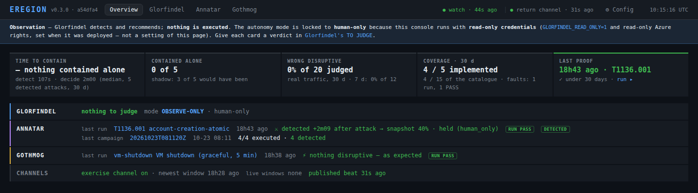
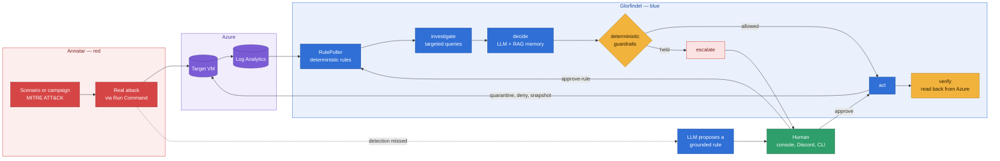
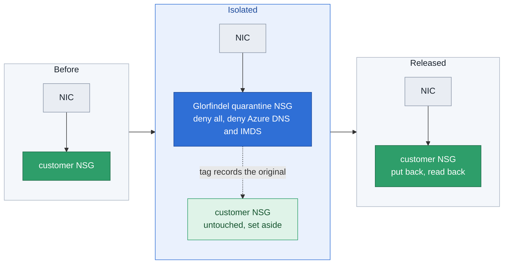
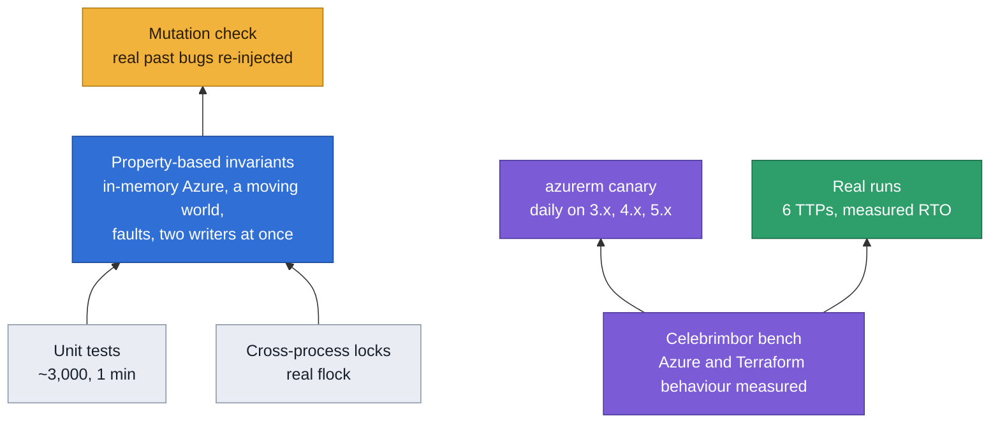

# Eregion — Cloud Detection & Response, for teams without a SOC

**And the proof it works: measured in shadow on your production, with attacks and failures replayed on a disposable copy.**

Three agents form a closed loop: Annatar attacks, Gothmog breaks, Glorfindel detects and responds. Open source, for cloud workloads — on-call humans and workstations stay with a team or a managed SOC. Azure today; a provider interface is planned for AWS and GCP (the LLM layer is already provider-agnostic).

- **Glorfindel** (blue) — the product. It does two jobs on your cloud logs:
  - **Detects** — continuous rule-based polling (KQL / PromQL …), auto-discovers your assets from their own telemetry (no inventory to maintain), and proposes a new detection rule when an attack slips through (purple-team loop).
  - **Responds** — reasons from the raw signal to choose the minimum effective action and verifies it via the cloud API.
- **Annatar** (red) — launches real MITRE ATT&CK attacks to prove the defense actually works. Today its own scenarios on Azure; from 0.3, adapters to public attack libraries (Atomic Red Team first, then Stratus Red Team) — no home-grown offensive logic.
- **Gothmog** (faults — first fault measured on the bench, 19/10) — declared failures run by a public chaos engine (Azure Chaos Studio first): benign noise Glorfindel must not act on, its own dependencies failing (it must fail closed), a recovery timed.
- Around them, the workshop: **Celebrimbor** builds and enrolls the disposable bench (Terraform); **Orodruin** hosts the injectors, with a guardrail contract checked at startup and a one-command kill switch.

> **Production rule** — never a fault or a destructive action on a real workload. In production, only non-destructive techniques on enrolled VMs, and the full chain on an empty sentinel VM; destructive techniques and faults stay on the reference bench or a twin. *(Coded: every enrolled target carries its zone — `bench`, `twin` or `production` — and every injector goes through one guard, `eregion_core/inscription.py`; anything unknown is refused.)*

**Status — v0.4.3.** Glorfindel runs on Azure, hosted next to the bench in observe-only. The full loop runs (0.3): from Orodruin, a public technique (Atomic Red Team) and a declared fault (Chaos Studio) on enrolled targets only, what Glorfindel saw measured and reported. 0.4 held the isolation path to its invariants; the 0.4.x releases harden its edges — the console, the log lines, the channels. Released versions and what changed: [`CHANGELOG.md`](CHANGELOG.md); milestones, lots and the five indicators the project is judged by: [`ROADMAP.md`](ROADMAP.md) (French). Security: how to report a vulnerability is in [`SECURITY.md`](SECURITY.md), the boundaries and what holds them in the [threat model](docs/design/modele-de-menace.md) (French).

**The core — LLM reasoning + RAG, not playbooks.** Glorfindel never follows a TTP→action table. Every decision comes from an **LLM** (provider-agnostic via LiteLLM — Anthropic, OpenAI, Azure OpenAI, Ollama, self-hosted) reasoning over: the enriched signal (targeted follow-up queries run *before* deciding), a **RAG memory of past incidents** (ChromaDB — it learns every cycle, no fine-tuning), and production-validated few-shot examples. Two hard guardrails wrap the LLM: a **confidence gate** (low confidence → forced escalation) and a **safety graph** that blocks destructive actions without human approval regardless of what the LLM proposes. *(Annatar runs fixed scenarios deterministically and also has a generative campaign layer — `annatar campaign plan` composes an ATT&CK kill-chain from a shared technique catalog, optionally LLM-planned, and materializes replayable scenarios.)*

> **Observe-only by default** — Glorfindel recommends, you decide. Grant it autonomy per asset as you build trust.
> With autonomous containment enabled: **~1 min to contain a ransomware VM, 21m29s to restored service** — the only human step is approving the backup restore.



*The Eregion console's overview on the Eregion bench, in observe-only (27 October 2026). Over 30 days: nothing contained alone — human-only —, but Glorfindel would have contained 3 of the 5 attacks it detected (shadow); detection in 107 s and a decision in 2 min (medians); 0 % of the 20 isolations and blocks it recommended on real traffic were judged wrong; 4 of the 5 implemented techniques proven in the last 30 days. Glorfindel's page holds the cards to judge; Annatar's and Gothmog's, what they ran and what Glorfindel made of it.*

## How it works



More diagrams — processes and shared state, the decision graph, the guardrail chain, the life of an isolation, the reassertion loop — in [`docs/architecture.md`](docs/architecture.md).

**[Interactive, zoomable diagrams →](https://vanyar53.github.io/eregion/schemas/)** — the same diagrams in colour, with pinch / Ctrl + wheel zoom, drag to pan and a full-screen view (French).

**Response loop** — on a detection, Glorfindel first runs targeted investigative queries (which process is writing at 147 MB/s? is a backup agent present?) to enrich the signal before the LLM decides. It then reasons about the observed indicators, past cycles from ChromaDB, and current incident context to choose the minimum effective response. Actions are verified via Azure API. Every cycle is stored in ChromaDB — no fine-tuning required.

**Detection loop** — `detection_rules.yaml` defines continuous polling rules (KQL, PromQL, SPL…). VMs are auto-discovered via LAW Heartbeat — no `resource_id` to maintain. Glorfindel polls independently of any attack simulation.

**Purple team loop** — detection authoring is LLM-generated but **grounded**: anchored on a shared technique catalog *and* the real schema of your log tables (`getschema`), so queries reference columns that actually exist — never hallucinated. Reactively, a missed attack triggers a proposed query; proactively, `glorfindel propose-rules` authors detection for uncovered techniques *before* any attack (cold-start). Every result is a **proposal** — `glorfindel approve-rule <id>` applies it; the deterministic poller runs the ratified rule (generative at authoring, deterministic at runtime). The rules get better with each cycle.

**Posture loop** — after each discovery cycle, Glorfindel checks that it can actually defend each VM: backup linked and recent, NSG accessible. Missing capabilities are escalated immediately with the exact `az` command to fix them — before an incident, not during.

**Autonomy — two independent gates.** First, a **trust ladder resolved per asset**: Glorfindel starts **observe-only** (`human_only`, the default — every action is recommended, nothing executes), and you grant it autonomy asset by asset as you learn to trust its reasoning. Second, a **hard safety line the graph enforces regardless of mode or LLM output**: destructive actions (restore, delete) always require human approval; reversible ones (isolate, block, snapshot) may run autonomously and are verified via Azure API. The two axes are orthogonal — even in an autonomous mode, destructive stays gated. *(Setup and the full mode table are in [Autonomy model](#autonomy-model) below.)*

**Verified defense — the action is checked against Azure, not assumed.** An isolation is verified on every NIC, including whether a customer ALLOW rule is evaluated before the deny; sessions that were already open are cut (an NSG rule only stops *new* connections — measured); active isolations and blocks are re-read from Azure every minute, and a change made outside Glorfindel is alerted with who made it (activity log). Isolation is just-in-time: for the time of the incident each NIC carries Glorfindel's quarantine NSG, the customer's own NSG is set aside untouched and restored on release — a `terraform apply` neither sees nor reverts it (measured on the provider, see `docs/design/module-isolation-iac.md`). The quarantine also denies Azure's DNS and IMDS, which a deny-all leaves open — measured: before, an isolated VM still resolved names and could fetch a managed-identity token; after, neither, while Run Command (used to cut sessions) still works. Investigation sources can be let in (`isolation.forensic_sources`: an address or a small prefix, validated, on SSH/RDP only). When the quarantine NSG can't be attached (an Azure Policy, missing rights) the isolation falls back on deny rules — and Azure only lets a rule deny its DNS and IMDS for *every* NIC behind an NSG (measured), so the fallback says they stay reachable rather than claim otherwise. Before an incident, `glorfindel audit` checks the rights the response needs without writing anything (Azure permissions API).



Signals from different resources run in parallel threads; signals from the same resource are serialized with shared incident context.

## Validated TTPs (Azure, real runs)

| TTP | Scenario | Detection source | Detection time | Action | RTO |
|-----|----------|-----------------|----------------|--------|-----|
| T1486 | Ransomware VM | Perf disk write anomaly | 55–71s | cycle 1: `isolate_vm` (autonomous) → cycle 2: `restore_from_backup` (escalate) | **21m29s** |
| T1041 | Data exfiltration | StorageBlobLogs (PutBlob, RFC-1918) | ~79–108s* | `isolate_vm` (internal IP) | — |
| T1110.001 | SSH brute force | Syslog DCR (auth facility) | ~58s | `block_suspicious_ip` | — |
| T1548.003 | Sudo privilege escalation | Syslog DCR (auth facility) | ~40s | `isolate_vm` (OS-level compromise) | — |
| T1110+T1548 | Parallel multi-signal | Syslog DCR | 41s / 59s | `block_suspicious_ip` → `isolate_vm` (incident context) | — |
| T1136.001 | Account creation (purple loop) | Syslog DCR (authpriv) | 21–49s | `snapshot` + escalate (confidence < 0.7) | — |

\* T1041: StorageBlobLogs ingestion latency is variable on the Azure side, not the query. Functional SLA, monitored.

Glorfindel chose the right action on all six by reasoning from raw signal indicators — not from a TTP→action table.

### Caught in the wild

On 2026-06-14, Glorfindel detected a **real SSH brute force** against the exposed sandbox VM — a genuine internet attacker (IP `95.47.246.223`, 26 failed attempts), not an Annatar scenario. Running in `human_only` / observe-only mode, it:

- detected the attack from live Log Analytics Syslog data;
- ran `investigate` → found `successful_auth_from_ip` empty → the brute force **failed**, attacker still outside;
- recommended `block_suspicious_ip`, **not** `isolate_vm` — isolating an uncompromised VM would be an over-reaction;
- escalated the recommendation as `mode_hold` without acting (observe mode holds the action before any write).

The full pipeline — rule → detection → investigate → decide → escalate — held on authentic adversarial traffic, outside the Annatar→Glorfindel loop. The real case even surfaced a bug no scripted run had found (the escalation didn't carry the source IP), fixed the same day.

## Usage profiles

Eregion is self-hosted, on your machine or in a VM of yours. **Glorfindel is always there**: it is the product. A profile is what you add to it. Annatar and Gothmog never run without it: they check its watch is alive before acting.

Each profile has a `docker compose` profile, a Make target and a page in [`docs/profils/`](docs/profils/README.md) (in French).

| Profile | The question | Runs | Start |
|---|---|---|---|
| Discover | be defended first, in observation | Glorfindel (watch + console) | `make profile-discover` |
| Does my detection work? | is a real attack seen? | + Annatar | `make profile-detection` |
| Does my infrastructure hold? | is a fault lived through? | + Gothmog | `make profile-resilience` |
| Proven defense | the proof at any time (like H0, the bench's hosted Glorfindel) | everything | `make profile-proven` |
| Several teams | one defense per team, nothing mixed | one Glorfindel per team | `make team-start TEAM=<name>` |

**Where the injectors act.** They act only from an armed Orodruin, the disposable host of the injectors. On your machine they stay passive: validate, list, `--dry-run`, and `gothmog preflight`.

**Each component runs alone in CI.** This is a technical separation, not a product sold alone. Glorfindel, Annatar, Gothmog and the shared core are each tested with the other components absent ([`components.yml`](.github/workflows/components.yml), `make components-check`).

## Evaluate on your infrastructure — read-only on Azure

The fastest, safest way to see Glorfindel: point it at your existing Log Analytics Workspace with **read-only** credentials and watch a week of recommendations. It detects and reasons on your real signals but **cannot change anything on Azure** — no Contributor role, no write API. The pitch to a colleague: *"see what I'd have done on your real signals; I can't touch a thing."*

**What leaves your machine.** Read-only on Azure is not "nothing leaves":
- **To the model's provider** (Anthropic by default), on each decision: the detection's rows — log excerpts, with the VM's name and resource id, addresses, user and process names as the logs hold them —, the results of the investigative queries, the incident's context, a few similar past decisions from the local memory and the VM's isolation state. Proposing a detection rule (`glorfindel propose-rules`, the purple loop) sends the technique and the columns of your log tables (`getschema`). The model's answer is a proposal: deterministic guards decide what may run, whatever it says (the [threat model](docs/design/modele-de-menace.md), « Le fournisseur du modèle »).
- **To your alert channel**, if you set one: each card, to the webhook or the Discord bot.
- **Nowhere else**: the memory (ChromaDB) and its embedding model run locally; Eregion sends no telemetry of its own.

To keep the logs in-house, run a local model: `GLORFINDEL_LLM_MODEL=ollama/<model>` (and `GLORFINDEL_LLM_BASE_URL`), or `--model ollama/<model>` on `glorfindel watch` — or a provider under your own contract (Azure OpenAI in your tenant). Validated models, and how to compare them on your cases: `make llm-compare` (« Cost of running Glorfindel », below).

**1. Create a Reader-only service principal** (no write permission anywhere):

```bash
az ad sp create-for-rbac --name "glorfindel-eval" --role Reader \
    --scopes /subscriptions/<SUBSCRIPTION_ID>
az role assignment create --assignee <appId> \
    --role "Log Analytics Reader" --scope /subscriptions/<SUBSCRIPTION_ID>
```

**2. Install and wire the credentials**:

```bash
git clone https://github.com/Vanyar53/eregion && cd eregion && make install
export GLORFINDEL_AZURE_CLIENT_ID=<eval-sp-app-id>
export GLORFINDEL_AZURE_CLIENT_SECRET=<eval-sp-secret>
export AZURE_TENANT_ID=<tenant-id>
export AZURE_SUBSCRIPTION_ID=<subscription-id>
```

**3. Point Glorfindel at your workspace** — the LAW ID lives in `glorfindel-config.yaml`, **not** an env var (there is no `AZURE_WORKSPACE_ID`):

```bash
cp glorfindel-config.yaml.example glorfindel-config.yaml
# set monitoring_backends[0].workspace_id to your LAW customer ID:
#   az monitor log-analytics workspace show -g <rg> -n <name> --query customerId -o tsv
# A single azure_monitor backend is enough — the rules bind to it automatically.
```

> Skip step 3 and detection silently never fires — `watch` resolves the workspace from this file only.

> **If you'll use `restore_from_backup` (T1486 recovery)**, also set `restore_staging_storage` on the `azure_backup_vault` backend. Azure restores a VM by first writing the recovered disks to a *throwaway* storage account, then attaching them — this is **not** the vault's storage, just a scratch area in the VM's region (any Standard LRS account). Restoring from the *immutable vault tier* (the copy ransomware can't have touched) requires it. Detection and isolation don't; without it, only `restore` stops — with a message explaining exactly this.

**4. Run observe-only** (`human_only` default — nothing executes):

```bash
export GLORFINDEL_READ_ONLY=1
glorfindel watch runs/ --rules glorfindel/rules/azure/detection_rules.yaml
```

`GLORFINDEL_READ_ONLY=1` guarantees no write API is ever called; `human_only` holds every recommended action *before* the connector is touched (you see `mode_hold` escalations, never permission errors).

**5. Read the recommendations** — the value is in what Glorfindel *would* have done:
- **The Eregion console** (`eregion console` → http://localhost:7007; formerly the War Room, `glorfindel war-room` still works) — an overview, then a page per agent: **Glorfindel** (live cards, `OBSERVE-ONLY` badge, each escalation with the held action + confidence + forensic steps, the cards to judge), **Annatar** and **Gothmog** (what they ran and what Glorfindel made of it — greyed until this host holds their runs), and **Config**. Glorfindel is always there; Annatar and Gothmog require it. It listens on `127.0.0.1` by default (Docker publishes `127.0.0.1:7007`) and always asks for a token — the console can trigger real Azure actions. At its first start without `EREGION_CONSOLE_TOKEN`, it draws one, keeps it in `~/.glorfindel/console_token` (mode 600) and prints the URL to open once: `Eregion console → http://localhost:7007/?token=<token>`. With Docker, `make glorfindel-start` prints it (`make console-url` again later, from the environment's token or that file, the same on the host), and so does `docker compose logs war-room`. To choose the token, set `EREGION_CONSOLE_TOKEN` (its former name, `GLORFINDEL_WARROOM_TOKEN`, is still read); scripts send `Authorization: Bearer <token>`. It answers under `localhost` / `127.0.0.1` only, or a name listed in `EREGION_CONSOLE_HOSTS` (compose passes it), and refuses a change from another origin. Design: [`docs/design/console.md`](docs/design/console.md).
- **`glorfindel pending`** — same on the CLI.

> ⚠ **For the first observe run, disable `data-exfiltration-blob`** — it fires on `PutBlobCount >= 1` from any RFC-1918 source, too noisy on real workloads. Set `enabled: false` on that rule in [`detection_rules.yaml`](glorfindel/rules/azure/detection_rules.yaml) until the allowlist hardening lands. The other rules are safe to leave on.

---

## Try it in a sandbox — full attack/defense loop (optional)

Want to watch the **red→blue loop** end to end (Annatar attacks, Glorfindel responds and recovers)? The Terraform sandbox below provisions a disposable target for exactly that. **Not needed to evaluate on your own infra** — that's the read-only path above. This track uses a **Contributor** service principal because Annatar needs to launch real attacks.

### 1. Deploy the test infrastructure

> **Skip this step if you already have Azure VMs, a Log Analytics Workspace, and NSGs.**
> The Terraform provisions **Celebrimbor** — a disposable, modular test infrastructure for running
> Annatar attack simulations safely (Celebrimbor is the builder; Annatar=red, Glorfindel=blue).
> Glorfindel works on any existing Azure infrastructure — the test infra is not a prerequisite.

Everything is provisioned by Terraform — Log Analytics Workspace, VM, NSG, Backup vault, Data Collection Rule, StorageBlobLogs diagnostic settings, and Managed Identity role assignment. The stack is namespaced by Terraform workspace (`INSTANCE=`), so parallel ephemeral stacks coexist.

```bash
cp infra/terraform/terraform.tfvars.example infra/terraform/terraform.tfvars
# edit terraform.tfvars — set your SSH public key and notification email
make celebrimbor-up          # baseline (vm-celebrimbor-gondolin, law-celebrimbor-amonsul, rsv-celebrimbor-erebor);
                             # the plan is shown and asks for « yes » — YES=1 applies it unread
make celebrimbor-output      # → glorfindel-config.yaml fragment (workspace_id, vault) — no copy-paste
# → full test infrastructure in one command (~5 min). make celebrimbor-down to tear it down.
```

**What gets deployed** (all in one resource group, enrolled as the bench: `eregion-target=celebrimbor`, `eregion-zone=bench`):

| Resource | SKU | Purpose |
|---|---|---|
| Linux VM | Standard_D2as_v6 (2 vCPU, 8 GB) | Attack target |
| Managed disk | Standard LRS 32 GB | Test data volume |
| Log Analytics Workspace | PerGB2018 | Detection source |
| Data Collection Rule | — | Perf + Syslog → LAW |
| Recovery Services Vault | Standard LRS | VM backup for restore |
| Storage account | Standard LRS | Exfiltration target (T1041) |
| NSG | — | Isolation + IP block |
| Public IP | Standard Static | SSH access |

**Cost of the test sandbox** (West Europe, pay-as-you-go — only if you deploy the Terraform):

| Item | Monthly cost |
|---|---|
| VM compute (~6h/day, auto-shutdown at 23:00 UTC) | ~$10–15 |
| Disks + Public IP (always billed) | ~$7 |
| Azure Backup (daily, 7-day retention) | ~$5–10 |
| Log Analytics (<1 GB/month for test runs) | <$3 |
| Storage account | <$1 |
| **Total sandbox** | **~$25–35/month** |

**Cost of running Glorfindel on existing infrastructure**: LLM API only (Anthropic default) — ~$0.05–0.10 per run (<$2/month for regular testing). **Free, local and air-gapped with Ollama** — validated with a real-model harness (`scripts/llm_smoke.py`), scored on *integration* (valid tool-calls) and *judgment* (act on clear threats, escalate on ambiguous). Compare several models side by side in one command: `make llm-compare` (or a single model: `make llm-smoke MODEL=ollama/<model> [RUNS=5]`).

Local-model verdict (6 models × 3 runs over 8 cases — the 5 TTPs Annatar can launch plus 3 ambiguous/sub-threshold traps, 2026-07):

| Model | Integration | Judgment | Overconf err |
|---|---|---|---|
| `qwen2.5` | 24/24 | 20/24 | 4 |
| `gemma4` | 24/24 | 19/24 | 5 |
| `command-r7b` | 22/24 | 18/24 | 4 |
| `qwen3` | 23/24 | 17/24 | 6 |
| `gemma3` | 24/24 | 17/24 | 7 |
| `qwen3.5` | **0/24** | 0/24 | **unusable** — never emits a tool-call under Ollama |

**The model must support tool-calling** — and newer isn't safer: the newest model here (`qwen3.5`) fails completely, and the harness catches it in seconds. `mistral-nemo` and `llama3.1` also work; `llama3.2-3b` is too weak.

**Calibration matters as much as judgment — and confidence is not a safety mechanism.** The harness scores whether a model's self-reported confidence earns the autonomy gate's trust (`confidence < 0.7 → escalate`), counting *overconfident errors* (wrong **and** confidence ≥ 0.7 — the ones the gate can't catch). The revealing cases are **sub-threshold look-alikes**: a 5 MB/s disk write (149× below the real ransomware) or a `sudo apt-get update` (routine admin, not priv-esc). On easy cases the models look perfectly calibrated; on these, *every* usable model over-acts — it isolates the VM — and does so *more* confidently when wrong than when right (`conf|wrong` ≈ 0.90–0.98 vs `conf|correct` ≈ 0.79–0.87). The 0.7 gate is structurally blind to this. It's also a signal that is **characterized** (a `MaxWrite` value *is* a recognized indicator) yet **sub-threshold**, so the uncharacterized-signal guardrail doesn't fire either — the failure slips between both gates.

One reassurance the harness deliberately strips away: in production these two cases never reach `decide()` at all. The detection rules floor the magnitude themselves (`MaxWrite > 50 MB/s`, `FailedAttempts ≥ 10`), so the deterministic RulePoller filters a sub-threshold signal *before* the model ever sees it. The harness injects the row directly to probe the model **in isolation** — the right way to measure raw judgment, but stricter than the running system. The residual real-world risk is therefore not `decide` but a *weakly-thresholded, LLM-authored* detection rule: the magnitude floor belongs in rule-authoring, not in the decision step.

That sounds alarming but its blast radius is bounded **by design, not by trusting the model**: the over-reaction here is `isolate_vm`, which is **reversible**; the destructive gate blocks truly destructive actions *regardless* of confidence; and autonomy is resolved **per asset** — the default is `human_only` (nothing runs unattended), `non_disruptive` is opt-in per non-critical asset, and `allow_destructive` is a separate axis. With proper alerting an over-isolation is a page and a one-click release, not a loss. So the practical takeaway is not "pick the model with zero overconfident errors" (harder tests show none stays at zero) but **never delegate safety to LLM confidence** — gate it on action reversibility, asset criticality, mode, and alerting. This eval empirically validates *why* `human_only` is the default. Run `make llm-compare` and read the `overconf err` column.

> The VM auto-shuts down at 23:00 UTC daily. Start it before each run: `az vm start -g rg-celebrimbor -n vm-celebrimbor-gondolin`. Compute is only billed when running.

### 2. Install Eregion

**Option A — local (dev)**

Base install is the same `make install` as the eval section above. The difference for the sandbox: Annatar launches real attacks via Azure Run Command, so it needs a **Contributor** service principal (Reader isn't enough):

```bash
git clone https://github.com/Vanyar53/eregion && cd eregion && make install
cp .envrc.example .envrc   # fill in ANTHROPIC_API_KEY + Azure creds

az ad sp create-for-rbac --name "eregion" --role Contributor \
  --scopes /subscriptions/$(az account show --query id -o tsv)
# → appId = AZURE_CLIENT_ID, password = AZURE_CLIENT_SECRET, tenant = AZURE_TENANT_ID
```

**Option B — Docker**

```bash
make build              # builds eregion-annatar + eregion-glorfindel images
make annatar-shell      # 🔴 interactive shell — alias: ar
make glorfindel-shell   # 🔵 interactive shell — alias: gf
```

**Option C — Docker Compose (watch + console together)**

```bash
make glorfindel-start   # start watch + the console → http://localhost:7007  (refuses to start without AZURE_SUBSCRIPTION_ID; ALLOW_NO_AZURE=1 for a demo)
make glorfindel-logs    # tail service logs
make glorfindel-dev     # auto-reload on code change (docker compose watch)
make glorfindel-stop    # stop all services
```

State, history, and ChromaDB model cache are persisted on the host (`~/.glorfindel/`, `~/.annatar/`, `~/.cache/chroma/`).

The images run **non-root** as your own UID/GID (baked in by `make build` via `id -u`/`id -g`), so the container and your local `glorfindel` CLI share the same host state without ownership clashes. Upgrading from an older root-built image once? Reclaim the files it wrote with `make fix-state-ownership`.

### 3. Run your first attack/defense loop

```bash
az vm start -g rg-celebrimbor -n vm-celebrimbor-gondolin   # VM auto-shuts down at 23:00 UTC

# Setup T1486 (before each run — clean disk + fresh recovery point)
annatar clean annatar/scenarios/azure/ransomware-vm.yaml           # wipe testdata disk
glorfindel snapshot /subscriptions/.../vm-celebrimbor-gondolin --yes    # clean RP (~5-20min)

glorfindel watch runs/                              # terminal 1 — Glorfindel watches for signals
annatar run annatar/scenarios/azure/ransomware-vm.yaml      # terminal 2 — Annatar attacks

# Cycle 1 (~71s): Glorfindel detects disk write spike → isolate_vm autonomously (stops exfil/spread)
# Cycle 2: Glorfindel escalates restore_from_backup (disk encrypted — human approval required)

glorfindel pending                                  # see escalation: restore_from_backup
glorfindel restore /subscriptions/.../vm-celebrimbor-gondolin --yes   # terminal 3 (~20 min)

# Glorfindel releases isolation automatically after restore completes
```

### 4. Simulate locally (no Azure required)

```bash
python scripts/simulate_annatar.py            # normal flow
python scripts/simulate_annatar.py --ids-gap  # detection_timeout flow
```

The script writes the run's signals to a temporary file, then runs `glorfindel respond <file> --dry-run` on it (no watch needed; a model key, no Azure credential). It no longer goes through `runs/`: the watch only takes the events an injector emits there (`attack_started`, `detection_missed`), and refuses the simulated `detection` and `recovery_complete`. The simulated `recovery_complete` is not Glorfindel's own (`glorfindel restore --wait` emits that one), so the release it proposes is held for a human.

## Using Glorfindel standalone

Glorfindel doesn't require Annatar. Its main standalone path — **continuous detection** — is the **Evaluate on your infrastructure** section above (it polls the rules, auto-discovers assets, runs posture checks, and recommends or acts per the mode you set). Two more standalone uses below: manual signal injection and a pre-deployment audit.

`glorfindel-config.yaml` is the single source of truth for infrastructure connection details:
- `monitoring_backends` — LAW workspace IDs, Prometheus endpoints, etc.
- `action_backends` — Recovery Services Vault for restore
- `exceptions` — fnmatch patterns to opt specific VMs out of auto-discovered rules

`detection_rules.yaml` contains only detection rules (KQL queries, TTPs, backend references). VMs are discovered dynamically via LAW Heartbeat — no `resource_id` or `workspace_id` needed inline. It is the **shipped base**: nothing writes it, an update replaces it. Your own rules — approved after a miss, overriding a base rule (same name), or turning one off (`disable: [<name>]`) — live in the client's layer, `~/.glorfindel/client_rules.yaml`, loaded over the base; `glorfindel rules` shows each rule and its layer. Exporting a rule generalised, without any identifier, to propose it upstream is left to a later lot (P2), reviewed by a human before anything is sent.

**Manual signal injection** — write a `detection` signal directly:
```bash
echo '{
  "signal_id": "test-001", "event": "detection", "ttp": "T1486",
  "severity": "critical", "resource_id": "/subscriptions/.../vm-name",
  "resource_type": "vm", "provider": "azure", "timestamp": "2026-01-01T00:00:00Z",
  "raw_signal": {}, "context": {"run_id": "test"}
}' >> runs/test_signals.jsonl
glorfindel respond runs/test_signals.jsonl
```

**Pre-deployment audit** — before going live, verify that Glorfindel can act:
```bash
glorfindel audit --all   # checks NSG access, backup vault, compute permissions, and what the detection rules can see of each VM
```
Annatar is only needed if you want to run controlled attack scenarios and measure detection time against a real attack baseline.

## Autonomy model

Glorfindel operates under strict autonomy rules. The graph enforces them regardless of what the LLM proposes.

**Autonomous** (reversible, no human approval):
`isolate_vm` (rules + open sessions cut), `release_isolation`, `snapshot`, `block_suspicious_ip`

**Human required** (destructive or irreversible):
`restore_from_backup`, `delete_resource`, `wipe_storage`, `modify_network_rule`, `escalate_permissions`

**Proposed unknown**: Glorfindel proposes freely in snake_case, escalates automatically — human validates and the action gets codified for future runs.

> The graph is defensive by design: even if the LLM proposes a destructive action without `escalate=True`, the routing blocks it.

### Autonomy modes

Three modes, resolved per asset. The default is intentionally conservative.

| Mode | Behavior |
|------|----------|
| `human_only` | Everything escalated as a recommendation — no autonomous action, including reversible ones. Default. |
| `non_disruptive` | Historical behavior: reversible actions (`isolate_vm`, `block`, `snapshot`) run autonomously; destructive always gated. |
| `full_auto` | Deferred — value rejected by config validation. |

Modes resolve per asset via `glorfindel-config.yaml` (fnmatch pattern matching). Run `non_disruptive` on test VMs, `human_only` on production assets, in the same `watch` session.

**A configured mode is an intention; readiness decides.** However a VM becomes autonomous (its own switch in the console, a pattern, the global default, `watch --mode`), it acts alone only once Glorfindel has checked it can actually defend it: rights to isolate (permissions API), session cut available, no customer ALLOW evaluated before a block, a VM type it supports. The watch checks each VM in an autonomous mode as soon as discovery finds it, then at the posture cadence:

| Readiness | What happens |
|---|---|
| Ready | Acts alone, nothing to confirm |
| Reserves (e.g. no Run Command right: open sessions survive) | Stays in `human_only`; one card asks you to read and accept the reserves (console *Review & turn on*, or `glorfindel activate <vm>`) |
| Not ready (no right to isolate, read-only credentials) | Stays in `human_only`, with the fix |

A reserve that appears after activation puts the VM back in `human_only`, with an alert. So setting the global default to `non_disruptive` is safe for VMs created later: none of them acts alone without that check.

> **First demo tip** — to see autonomous containment in action, start with:
> ```bash
> glorfindel watch runs/ --mode non_disruptive
> ```
> The default `human_only` is the right setting for production assets — it generates detection + recommendations without acting. Switch per-asset once you've seen a few cycles and trust the reasoning. Each VM still passes the readiness check above before it acts alone.

### Observe-only mode

Run with read-only credentials — detect threats and generate recommendations, never call write APIs.

```bash
export GLORFINDEL_READ_ONLY=1   # Azure Reader + Log Analytics Reader SP
glorfindel watch runs/           # detects, investigates, recommends — never writes
```

The console and Discord bot still work — every escalation includes the recommended action and suggested forensic steps. No write risk for a first evaluation: give a peer read-only access to your LAW and let them observe a week of Glorfindel decisions before granting Contributor (what still leaves the machine: [above](#evaluate-on-your-infrastructure--read-only-on-azure)).

The full read-only evaluation walkthrough (Reader SP → workspace config → observe) is the **Evaluate on your infrastructure** section near the top of this README.

**How Glorfindel reasons** — it follows a validated reasoning chain from raw signal indicators, not a TTP→action lookup table. The system prompt contains production-verified examples of correct reasoning:

```
Signal: MaxWrite=147 MB/s sustained 8 min
→ Encryption active. VM still on network — may spread or exfiltrate before restore.
→ Cycle 1: isolate_vm (autonomous — severs network immediately)
→ Cycle 2: restore_from_backup (escalate — disk encrypted, human confirms)

Signal: PutBlob, CallerIP=10.x.x.x (RFC-1918)
→ Internal VM uploaded data. Disk intact. Block_ip won't work on internal IP.
→ isolate_vm (reversible, severs exfil channel)

Signal: FailedAttempts=47, SourceIP=185.x.x.x (external)
→ Attacker probing, VM uncompromised. Don't disrupt the VM.
→ block_suspicious_ip (reversible, VM stays online)

Signal: sudo success, USER=root confirmed
→ OS-level access. Disk likely intact. Cut remote foothold.
→ isolate_vm (reversible, forensics later if needed)
```

Before deciding, Glorfindel runs `investigate` — targeted KQL queries based on what's in the signal: which process is writing at 147 MB/s? is a backup agent present? did the brute-force IP succeed? what ran as root after the escalation? The LLM receives both the original signal and this investigative context, making the distinction between ransomware and a legitimate backup job **observable rather than inferred**.

This is few-shot reasoning on enriched signals, not a routing table. The LLM can deviate on ambiguous signals — the examples anchor validated cases. The safety net is the graph: destructive actions are blocked without `escalate=true` regardless of LLM output, and `verify_action` confirms via Azure API.

When an escalation fires, `glorfindel pending` shows **context-aware next steps generated by the LLM** — referencing the specific signal indicators, past cycle history from ChromaDB, and the resource state.

`GLORFINDEL_WEBHOOK_URL` sends two distinct notifications: escalations (`:rotating_light:` — human action required) and autonomous actions (`:robot_face:` — `isolate_vm ✓`, `block_suspicious_ip ✓`, etc.).

**Interactive Discord bot** (`glorfindel bot`): creates one thread per VM (`🔴 vm-name`) and posts escalations as structured embeds. Buttons:
- **✓ Acknowledge** — marks escalation resolved, archives thread when done
- **📋 Command** — shows the CLI command to run (ephemeral)
- **🔄 Restore** — executes `glorfindel restore` directly from Discord (for `restore_from_backup` and `low_confidence` escalations)
- **↩️ Revert** — executes `glorfindel reset` directly from Discord (for `verification_failed`) — full reset (isolation + IP blocks)

A `/pending` slash command lists open escalations. Set `DISCORD_PING_ROLE` to notify an on-call role on thread creation. When the bot has both its token and `DISCORD_CHANNEL_ID`, escalation webhook notifications are suppressed (bot handles them in threads); a channel without a token runs no bot, so the webhook still posts and `glorfindel watch` warns at startup when nothing alerts. In Docker Compose, only the bot's container gets the token: the watch and the War Room get `GLORFINDEL_DISCORD_BOT` (`1` when the token is set, never its value).

**Who may click**: only the Discord users in `DISCORD_ALLOWED_USERS` or members of a role in `DISCORD_ALLOWED_ROLES` (ids, comma-separated). Anyone else gets an ephemeral refusal, logged by the bot. **Closed by default**: with neither set, every button refuses — the buttons judge, acknowledge and run restores, and Discord shows them to whoever reads the channel; the War Room (behind its token) still judges every card.

## CLI reference

```bash
# Glorfindel
glorfindel watch runs/                          # real-time response during an Annatar run
glorfindel watch runs/ --rules glorfindel/rules/azure/detection_rules.yaml  # + continuous detection polling
glorfindel audit <resource_id>                  # remediation readiness: NSG, backup, IAM
glorfindel audit --all                          # audit all discovered VMs
glorfindel approve-rule <id>                    # apply a proposed rule to the client's layer (~/.glorfindel/client_rules.yaml)
glorfindel rules                                # rules loaded: the shipped base, then the client's layer over it
glorfindel reject-rule <id>                     # dismiss a proposed rule without applying it
glorfindel propose-rules [--ttp T..]            # proactively author detection for uncovered techniques (cold-start)
glorfindel respond runs/<run_id>_signals.jsonl  # post-run processing
# ── Remediation actions — choose the right scope ─────────────────────────────
#
# VM state after an incident:
#   isolated  = NSG deny-all rule applied (isolate_vm)
#   blocked   = NSG deny rule for a specific IP (block_suspicious_ip)
#
# Use the minimum scope:
glorfindel release <resource_id> --yes          # lift isolation only (post-restore, VM back online)
glorfindel unblock <ip> <resource_id> --yes     # remove one IP block (e.g. after T1110)
glorfindel reset <resource_id> --yes           # reset: release isolation + unblock all IPs
glorfindel snapshot <resource_id> --yes         # on-demand Recovery Services Vault backup (~5-20min)
glorfindel restore <resource_id> --yes          # Azure Backup restore: newest point before the attack on THIS VM (--before, else its attack_started; unknown → asked)
glorfindel jobs <vm-name> [--refresh]           # snapshot/restore job status
glorfindel list                                 # all VMs with active actions (isolation + blocked IPs)
#
# Console buttons:    ↩️ Release (isolated) | ↩️ Unblock (blocked IP) | ⟳ Reset (both)
# TUI keyboard:       x:release  u:unblock  v:reset  r:restore
glorfindel pending                              # list pending escalations
glorfindel pending --watch                      # stay running, print new escalations as they arrive
glorfindel ack <escalation_id>                  # acknowledge an escalation
glorfindel ack --all                            # acknowledge all pending escalations
glorfindel verdict <id> right|wrong|unsure      # was the recommendation right? (observation, docs/observation.md)
glorfindel report --since 4w                    # verdicts by action and rule, false rate of disruptive recommendations
glorfindel check-ttl                            # release isolations older than TTL (default 4h)
glorfindel memory-stats                         # ChromaDB cycle count
glorfindel bot                                  # start the interactive Discord bot
glorfindel dashboard                            # full-screen TUI: resources + feed + escalations
eregion console [--sections annatar,gothmog]    # web console on http://localhost:7007 (pip install -e '.[console]' from the clone); loopback by default, always a token (drawn at the first start, or EREGION_CONSOLE_TOKEN)

# Annatar
annatar run annatar/scenarios/azure/ransomware-vm.yaml            # run a scenario (--dry-run available)
annatar run annatar/scenarios/azure/data-exfiltration.yaml
annatar run annatar/scenarios/azure/lateral-movement.yaml
annatar run annatar/scenarios/azure/privilege-escalation.yaml
annatar run annatar/scenarios/azure/account-creation.yaml        # T1136.001 (purple-loop test)
# annatar run ... --skip-preflight                        # bypass VM state check (power + isolation)
# annatar run ... --without-glorfindel                    # development run with no live watch — said in the report
annatar campaign plan --target <resource_id> [--llm]      # compose a kill-chain → materialize scenarios
annatar campaign run <campaign_id>                        # execute a planned campaign (sequential, budgeted)
gothmog run vm-shutdown --yes [--without-glorfindel]      # a declared fault, from an armed Orodruin

# LLM provider — default: Anthropic Claude
ANTHROPIC_API_KEY=...               # required for default Anthropic provider
# GLORFINDEL_LLM_MODEL=anthropic/claude-sonnet-5-5  # default (eregion_core/models.py)
# GLORFINDEL_LLM_MODEL=openai/gpt-4o               # OpenAI
# GLORFINDEL_LLM_MODEL=azure/gpt-4o                # Azure OpenAI (+ AZURE_API_KEY, AZURE_API_BASE)
# GLORFINDEL_LLM_MODEL=mistral/mistral-large-latest # Mistral cloud (EU) (+ MISTRAL_API_KEY)
# GLORFINDEL_LLM_MODEL=ollama/command-r7b          # local / air-gapped — must be tool-capable
# GLORFINDEL_LLM_BASE_URL=http://localhost:11434    # self-hosted / Ollama endpoint

# Azure
AZURE_CLIENT_ID=...
AZURE_CLIENT_SECRET=...
AZURE_TENANT_ID=...
AZURE_SUBSCRIPTION_ID=...

# Optional — webhook (one-way)
GLORFINDEL_WEBHOOK_URL=...          # Slack / Teams / Discord — escalations + autonomous actions
                                    # Discord: use https://discord.com/api/webhooks/<id>/<token>/slack

# Optional — Discord bot (interactive, bidirectional)
DISCORD_BOT_TOKEN=...               # Bot token from discord.com/developers/applications
DISCORD_CHANNEL_ID=...              # Channel ID (right-click → Copy Channel ID, Developer Mode on)
DISCORD_PING_ROLE=...               # Role ID to ping on new incident thread (optional)
DISCORD_ALLOWED_USERS=...           # User IDs allowed to click the buttons (comma-separated)
DISCORD_ALLOWED_ROLES=...           # Role IDs allowed to click; both empty → every button refuses

GLORFINDEL_KEEP_ISOLATED=1          # forensic mode — VM stays isolated after restore
GLORFINDEL_ISOLATION_TTL_H=4        # auto-release timeout in hours (default: 4)
GLORFINDEL_INCIDENT_TTL_S=300       # incident grouping window in seconds (default: 300)
GLORFINDEL_CONFIDENCE_THRESHOLD=0.7 # min LLM confidence for autonomous action (default: 0.7 — below this, escalate; unreadable or outside [0, 1]: every autonomous action is held)
GLORFINDEL_LLM_TIMEOUT_S=120        # bound on one model call, per attempt (default: 120 s; a hung provider ends as a cycle_failed card)
GLORFINDEL_DECISION_DRAWS=3         # draws that must agree before a disruptive autonomous action (default: 3, 2 to 10; unreadable, 1 or above 10: every disruptive autonomous action is held)
GLORFINDEL_OWN_CALLERS=<id>,<id>    # Glorfindel's identities on Azure, besides its token and AZURE_CLIENT_ID: its own writes in the Activity Log are not escalated (AL1); in Entra ID's logs nothing is left out under them, they are marked critical (C2)
```

See [.envrc.example](.envrc.example) for a ready-to-fill template with provider examples.

## Architecture

```
glorfindel-config.yaml    → infrastructure config (workspace IDs, RSV, exceptions) — not versioned
                             monitoring_backends: LAW workspace GUID, discovery interval
                             action_backends: RSV vault name + resource group
                             exceptions: fnmatch patterns to exclude VMs from auto-discovery

glorfindel/
  agent.py             → LangGraph graph (8 nodes): load_context → [poll_detection|propose_detection_rule]
                         → investigate → decide → execute_action → verify_action → store_cycle
                         investigate: requêtes KQL ciblées selon contenu signal (process list,
                           backup agent check, auth success, root commands post-escalation)
                           → enrichit raw_signal.investigative_context avant le LLM
                         LLM reasons from enriched signal indicators + few-shot anchors
                         propose_detection_rule: authors a rule ONLY when the TTP has none.
                           A miss on a covered TTP = detection prevented (isolation, ingestion
                           latency, backend down) → `detection_blocked` escalation, no duplicate rule
  config.py            → GlorfindelConfig + load_glorfindel_config() + ExceptionConfig
  discovery.py         → AssetRegistry (thread-safe, disk-persisted) + DiscoveryService (background thread)
                         LAW Heartbeat query → replace_for_backend() evicts deleted VMs
  posture.py           → PostureChecker: backup linked, backup recent, NSG reachable — per discovered VM
                         Escalates posture_gap with exact az fix command. Dedup: pending → skip.
  actions.py           → the import path of the response: every name below is still imported from here (A1)
  response/            → provider-neutral core: action sets and errors, resource ids, local state, locks
  providers/           → the provider interface (MC0): CloudConnector, DetectionConnector, declared capabilities
    azure/             → the only adapter, the only place the Azure SDK is imported: AzureConnector (isolate,
                         release, block, unblock, snapshot, verify_*, audit checks), one module per concern;
                         AzureMonitorDetector; AzureActivityDetector (the Activity Log, detection only); capabilities.py
  detectors.py         → detector_for(): the detection source registry
  detection_rules.py   → DetectionRule + RulePoller: continuous polling, auto-apply via discovered assets
                         load_config(path, glorfindel_cfg=None) — workspace_id from glorfindel-config.yaml
  audit.py             → AuditCheck, AuditResult, run(): NSG / backup / compute readiness checks, and detection coverage
                         (disk write counter and cadence, Syslog, each rule that covers the VM: sees data, blind, in error)
  proposed_rules.py    → record/pending/approve()/reject(): detection rule proposal lifecycle (approve → client's layer)
  rule_layers.py       → the client's layer of rules (P1): write, migrate rules approved before P1
  detection_authoring.py → grounded LLM rule authoring (technique catalog + real LAW getschema) — reactive on a miss, proactive via propose-rules
  campaign_replay.py   → blue-side closing of the generative purple loop: auto-activation + replay
  jobs.py              → snapshot/restore job state shared by CLI + console (active_jobs/<vm>.json)
  rules/azure/
    detection_rules.yaml → the shipped base (never written: the client's rules live in ~/.glorfindel/client_rules.yaml,
                           loaded over it — same name replaces, `disable:` turns a base rule off)
                           rules only: KQL queries, TTP tags, backend references
                           assets: [auto] + monitoring_backends: [law-celebrimbor-amonsul] per rule (optional — omit for single-LAW)
                           no workspace_id, no resource_id, no asset declarations
  incidents.py         → IncidentRegistry: groups signals by resource_id within a TTL window
  memory.py            → CycleMemory: ChromaDB with confidence + past_cycles_used metadata
  cli.py               → watch, respond, restore, release, unblock, reset, snapshot, jobs, list,
                         pending, ack, audit, approve-rule, reject-rule, propose-rules, rules,
                         migrate-rules, check-ttl,
                         bot, dashboard (war-room: hidden alias of `eregion console`)
  escalations.py       → persistent escalation log (~/.glorfindel/escalations.jsonl)
                         types: low_confidence, destructive_action, verification_failed,
                                proposed_rule, proposed_action, posture_gap,
                                mode_hold, write_blocked, action_failed,
                                detection_blocked
  bot.py               → Discord bot: one thread per VM, Ack/Restore/Revert buttons, /pending command
  tui.py               → Rich full-screen TUI: resources + feed + escalations, keyboard shortcuts a/r/v

eregion_console/       → the Eregion console (`eregion console`, docs/design/console.md)
  api.py               → FastAPI: the pages (/, /glorfindel, /annatar, /gothmog, /config), the token
                         (EREGION_CONSOLE_TOKEN, else GLORFINDEL_WARROOM_TOKEN), Glorfindel's API
                         (/api/state, /api/feed WS, /api/config, /api/audit, /api/discovered, /api/pending/rules,
                         /api/autonomy/{vm}, /api/action/{release,revert,restore,ack,approve-rule,approve/<id>,…}),
                         the injectors' (/api/exercises, /api/campaigns, /api/catalog, /api/channel, GET only),
                         /api/sections; /atelier and /api/atelier/* redirect
  sections.py          → which sections are active: Glorfindel always, Annatar and Gothmog when this host
                         holds their runs, or as --sections / EREGION_CONSOLE_SECTIONS chooses
  cli.py               → `eregion console [--host] [--port] [--sections]`
  static/              → console.js + console.css (the shared header), overview.html, injector.html
                         (Annatar's and Gothmog's pages), exercises.js (what Glorfindel did in an exercise),
                         each page's script as a file (overview.js, glorfindel.js, injector.js: the CSP
                         runs no inline script nor handler, #257),
                         glorfindel.html — TO JUDGE (the only place a card is judged), expandable VM cards,
                         live feed, action buttons; INFRASTRUCTURE banner: credentials regime
                         (OBSERVE-ONLY ↔ ACTIVE) + autonomy mode; per-card autonomy badge → capability
                         popover; read-only guards; OFFLINE badge; parametrized Approve & execute;
                         BACKUP section per card; DETECT / PROTECT / RECOVER nodes; /config: Azure, LLM,
                         global autonomy mode, the sections

annatar/
  runner/engine.py    → setup → integrity check → attack → emit attack_started → purple-team feedback thread
  runner/parser.py    → Scenario dataclass (detection: timeout + prerequisites + hints)
  campaign/           → generative red layer: planner (compose an ATT&CK kill-chain from the catalog,
                        optionally LLM-planned) + synthesizer (materialize replayable scenarios) +
                        runner (sequential, budgeted, blind-loop) + scope guard. CLI: annatar campaign plan|run
  signals/emitter.py  → normalized JSONL signal emitter (the Signal contract: eregion_core/signals.py, shared with Glorfindel)
  scenarios/azure/
    ransomware-vm.yaml          → T1486 (detection: timeout + prerequisites + hints)
    data-exfiltration.yaml      → T1041
    lateral-movement.yaml       → T1110.001
    privilege-escalation.yaml   → T1548.003
    account-creation.yaml       → T1136.001 (purple-loop test — no initial rule, rule proposed then approved)

> **Annatar never uses SSH.** Scripts are pushed to the VM via Azure Run Command (Azure VM Agent
> over the Wire Protocol — control plane only). The VM needs no SSH access and no public IP for
> Annatar to work. The only credential required is the Service Principal used for the Azure SDK.

schemas/
  scenario.schema.json → JSON Schema for IDE validation of scenario YAML files

infra/terraform/           → Celebrimbor: modular, namespaced, disposable test infra (VM, NSG, Log Analytics, Backup, DCR)
```

## Extending Glorfindel

### Adding a detection source (Prometheus, Datadog, Splunk, Sentinel, ...)

**1. Implement `DetectionConnector` and register it in the factory:**

In its provider's adapter (`glorfindel/providers/<name>/`, the only place its SDK may be imported), registered in `glorfindel/detectors.py`:

```python
# glorfindel/providers/prometheus/detector.py
class PrometheusDetector(DetectionConnector):   # glorfindel.providers.interface
    def __init__(self, workspace_id: str):   # workspace_id = Prometheus endpoint
        self.endpoint = workspace_id

    def poll_alert(
        self, query: str, since: float, timeout_s: float, interval_s: float = 10.0
    ) -> tuple[float, dict] | None:
        # Poll until the query returns results or timeout_s expires
        # Return (elapsed_seconds, first_result_row) or None
        ...

_DETECTORS["prometheus"] = PrometheusDetector
```

The result row is what the LLM sees to decide — include `CallerIpAddress` or `SourceIP` for internal/external IP routing to work correctly. The `RulePoller` uses `interval_s` from each rule; `poll_detection` uses a tight 10s loop for `attack_started` signals.

**2. Add the query language to `agent.py`:**

```python
# glorfindel/agent.py — _SOURCE_LANGUAGES
_SOURCE_LANGUAGES["prometheus"] = "PromQL"
```

This ensures the LLM proposes queries in the right language when `detection_missed` fires.

**3. Add a backend in `glorfindel-config.yaml` and a rule in `detection_rules.yaml`** (a new `type` is first added to `_MONITORING_TYPES` in `glorfindel/config.py`: the config refuses a type nothing reads):

```yaml
# glorfindel-config.yaml
monitoring_backends:
  - name: prometheus-local
    type: prometheus
    workspace_id: "http://prometheus:9090"
    discovery:
      enabled: false   # Prometheus discovery not yet implemented
```

```yaml
# detection_rules.yaml
- name: high-cpu-anomaly
  description: "Sustained CPU saturation — possible cryptomining or ransomware"
  ttp: T1496
  monitoring_backends: [prometheus-local]
  assets: [auto]
  interval_s: 30
  query: |
    rate(node_cpu_seconds_total{mode!="idle"}[5m]) > 0.9
```

### Adding a cloud provider (AWS, GCP, ...)

One adapter per provider under `glorfindel/providers/<name>/`, the only place its SDK is imported (a test in CI fails otherwise). It implements `CloudConnector` and declares its capabilities (`glorfindel/providers/interface.py`): the readiness check reads which rights an isolation, a block or a session cut needs from that declaration.

```python
class AwsConnector(CloudConnector):
    def isolate_vm(self, resource_id) -> dict: ...
    def block_suspicious_ip(self, ip, resource_id) -> dict: ...
    def release_isolation(self, resource_id) -> dict: ...
```

The agent logic, scenarios, and RAG memory are provider-agnostic — they don't change. The connector itself is more than a stub, though: real isolation has to handle the provider's network topology (on Azure that means NIC-level vs subnet NSGs, multi-NIC VMs, and rule priorities — see `glorfindel/providers/azure/`). Budget for the connector, not a one-liner.

## Operational notes

**Annatar and Gothmog require Glorfindel.** Before each run — each run of a campaign too — and before any call to the cloud, `annatar run`, `annatar campaign run`, `gothmog run` and `gothmog preflight` read the watch's heartbeat: the return channel when `EREGION_WATCH_CHANNEL` is set (the watch hosted on H0, seen from Orodruin), else `~/.glorfindel/watch_heartbeat` (a watch on the same host). With no heartbeat younger than 90 s (and none dated more than 10 s ahead), the run is refused, exits 1, and says how old the last heartbeat is, or that there was never one — nothing was touched. `--without-glorfindel` (Make targets on Orodruin: `WITHOUT_GLORFINDEL=1`) runs anyway, for development: the report says so (`metrics.without_glorfindel`, « detection not measured, by choice »), the detection is not waited for, H0 accepts the report, and the console shows it apart from `unknown`. A campaign run that way says so in its manifest, resumes only the same way, and has no analysis report, here or on H0 (« campaign without Glorfindel: no detection report, by choice »); an aborted campaign exits 1. A `--dry-run` needs no watch. The heartbeat names the watch's perimeter — a digest of the subscription it reads — and the injector compares it with its own: a live watch of another subscription is refused (SEC5). The gate is read again before each action of a run, and `annatar clean` goes through it too; `--without-glorfindel` is refused in zone `production` and written to Orodruin's journal.

**Before each run**, `annatar run` automatically checks that the VM is running and not isolated by Glorfindel. If either check fails, the run aborts with the exact fix command. Use `--skip-preflight` to bypass.

**Exit code**: `annatar run` exits 0 only when the run went through (detected, missed or not measured) or with `--dry-run`; any refusal (no live Glorfindel watch, Orodruin passive, target not enrolled, dirty start, an atomic the adapter refuses, preflight, invalid scenario) or error (no observable effect, initial state not restored) exits 1, with one line and a hint — so a script or a CI chaining runs can stop on it.

To check manually:
```bash
glorfindel list                            # active isolations + blocked IPs
glorfindel reset <resource_id> --yes      # release isolation + unblock all IPs
```

**NSG isolation blocks Azure Monitor Agent** (outbound deny-all). If the VM stays isolated, the next run will hit `detection_timeout` instead of `detection`. Always release before running the next scenario.

**Block IP rules persist** between runs. After a `block_suspicious_ip` action (T1110), the NSG rule stays until explicitly removed. Running `isolate_vm` on a VM with an existing block rule at priority 200 will conflict — always unblock between runs.

**Syslog detection latency**: ~40-60s nominal. Scenario timeout set to 300s for margin (DCR ingestion can vary).

**StorageBlobLogs**: near-realtime (seconds). `AzureNetworkAnalytics_CL` (Traffic Analytics) is unusable for detection — 10-60 min latency.

**Azure's Activity Log (`AzureActivity`), detection only** (AL1): three shipped rules watch the control plane — an NSG or one of its rules changed by someone other than Glorfindel (T1562.007), a role assigned (T1098.003), a disk snapshot or download access (T1578.001). A detection on them is always escalated (`control_plane_change`), with no action recommended, by a decision the code builds — the model is not called; each operation has its card. Glorfindel's own writes are left out: its identity (read from its token — under `az login`, the user's object id only —, `AZURE_CLIENT_ID`, `GLORFINDEL_OWN_CALLERS`) doing an operation it declares on a resource that is its own; its identity on anything else is kept, critical; someone else writing one of Glorfindel's rules is the gravest case, marked critical. The table reaches the workspace only through a **diagnostic setting on the subscription** (category Administrative) — not by default; without it these rules see nothing. Its ingestion takes minutes: the rules look back one hour.

**Entra ID's logs (`AuditLogs`, `AADServicePrincipalSignInLogs`), detection only** (C2, defensive half): four shipped rules (`source: azure_entra`) watch identities — a credential added to an application or a service principal (T1098.001), a consent to an application (T1528), a privileged directory role assigned (T1098.003), a service principal signing in from an address never seen in its 14-day baseline (T1078.004). Each carries its thresholds and exclusions; the adapter applies those in code (failures, non-privileged roles, a principal without history). A detection is always escalated (`identity_change`) with its steps — who, what, how to revoke — by a decision the code builds: the model is never called (no UPN reaches its provider), and no action ever runs on an identity. Glorfindel's own identity, as the actor or the target, is never left out: marked, critical. The logs reach the workspace only through a **diagnostic setting on the tenant** (not by default; sign-in logs need Entra ID P1 or P2) — `infra/terraform/entra_logs.tf` proposes it, disabled.

**Each scenario's `detection` block** contains `prerequisites` (verification queries to run before launching), `hints` (purple-team context sent to Glorfindel on `detection_missed`), `timeout` (hard stop for the feedback watcher), and optionally `time_max` (declared SLA). Detection queries and configuration live in `detection_rules.yaml` — not in the scenario.

**Before each run, run the prerequisite queries** in your monitoring system. If any returns no rows, detection will time out.

**Before deploying Glorfindel**, verify remediation readiness:
```bash
glorfindel audit --all   # NSG / backup vault / compute — surfaces IAM gaps with fix commands
```

The audit also checks **NSG precedence**: NSG rules apply the first match by ascending priority, so an `Allow` rule numbered lower than Glorfindel's deny lets its traffic through an isolation or an IP block. Keep your own allow rules at priority 1000 or higher; Glorfindel places its denies in 100–999.

## How we prove it

A claim such as "the VM is isolated" must be true, not likely. Each layer of evidence sees what the others can't — the full picture, with what each layer has found, is in [`docs/design/preuves.md`](docs/design/preuves.md) (French).



- **Invariants** — fourteen properties checked after every step of thousands of random sequences: never more reachable than designed, the customer's configuration never changed by Glorfindel (also checked by author, from a journal of every API write), no success claimed on a falsehood, no effect on another VM, the local state always agreeing with Azure, two concurrent writers ending as if one ran after the other, a vanished block put back or reported… The oracles are the test's own — what was released, lost or written, and when — never the markers the code leaves. 500 sequences per push, 10,000 every night.
- **Mutation** — the invariants caught 1 of 17 re-injected bugs before the customer's world moved in the fake Azure; they catch nearly all of them now. A **control set** of 16 plausible bugs, never used to shape the tests, measures how well the suite finds bugs it was not taught: 3 of 16 caught when it was introduced, 10 of 16 now. Over thirty defects that no code review had seen were found this way, and fixed — the worst one emptied the shared quarantine NSG on a second release.
- **Measurement first** — no Azure or Terraform behaviour is assumed: it is measured on the bench (e.g. DNS and IMDS reachable from an "isolated" VM, `terraform apply` not reverting a NIC's NSG swap), and the canary re-checks the provider every day.

## Tests

```bash
make install          # the locked dependencies, hashes checked (requirements/dev.txt) — as CI and the image
pytest
# ~3,000 tests (about a minute) — 0 Azure calls, 0 LLM calls, 0 writes to ~/.glorfindel
GLORFINDEL_INVARIANT_EXAMPLES=5000 pytest tests/unit/test_invariants.py   # deep run (~8 min)
python scripts/mutation_check.py --examples 500 --rounds 2                # measure the invariants
```

The suite is hermetic by construction: `tests/unit/conftest.py` redirects every `~/.glorfindel` path to a temp directory and ignores any local `glorfindel-config.yaml`, and the run fails if a test writes in the repository's folder (a `runs/` left at the root, say), from collection on. What that guard sees, what it does not (a C library's writes once a file is open, a subprocess below the root) and its limits (another process creating a file at the root of the main checkout fails the run wrongly; a `TMPDIR` or `--basetemp` inside the repository; only `tests/unit/` is guarded) are in the docstring of `nothing_written_in_the_repository` and in `docs/operations.md`. CI (`.github/workflows/ci.yml`) installs the locked dependencies (`requirements/dev.txt`, every file checked against its hash — the Glorfindel image installs `requirements/glorfindel.txt`, the injectors' image `requirements/annatar.txt`, the same versions; `make lock` regenerates them, `docs/operations.md`) and runs `ruff check` + `pytest` on Python 3.11 and 3.12, plus the state and identity tests on macOS (case-insensitive file system).

**Invariant tests** (`tests/unit/test_invariants.py`, Hypothesis): random customer networks in an in-memory Azure (`tests/unit/fake_azure.py` — NSG evaluation, policies, regions, case-insensitive names) and random sequences of isolate / release / block (VM and perimeter) / unblock / reassert / verify / `reset --from-azure`, with faults anywhere — a throttled call or API, a crash before a write or after it, a lost role (every write refused), a full disk — while the customer's world moves: rules added, narrowed or removed, an NSG deleted, an IP changed, a policy set, a VM deleted, a `terraform apply`, a NIC redeployed, a VM created on a deleted VM's address, Glorfindel's own rules or tags edited by hand (narrowed, or turned into an allow, moved behind a customer allow, given another protocol or target), another host writing a NIC right after Glorfindel did, an isolation left by an older version, the configuration changed or unreadable, the clock moving on, the local state lost. Fourteen properties must hold whatever happens: no VM more reachable than its owner designed it; the customer's configuration is what the customer last wrote, and Glorfindel only writes what is its own; no success claimed on a falsehood (every verification is checked at every step); an operation on one VM changes nothing for another (homonyms included); the reassertion never opens anything; one state file per VM; from any state, release brings every VM back to its design, or keeps it in quarantine and says what is unknown; what an operation leaves on Azure is in its state; a release that has started is never undone; the configuration is honoured; two operations at once end as one after the other; a VM of another subscription is never acted on; a vanished block is put back or reported; an orphan rule cutting a live VM off is reported, then taken off by the watch's pass when that VM runs in `non_disruptive` (a card only in `human_only`) — nothing else moves, and after it every live VM is back to its design. 500 sequences per push (failing sequences found at night are replayed first), 10,000 every night on Linux and macOS (`.github/workflows/invariants.yml`); the sequences found are kept as fixed examples (`tests/unit/test_invariant_regressions.py`).

**Mutation check** (`scripts/mutation_check.py`, weekly in `.github/workflows/mutants.yml`, red below 14): re-introduces, one at a time, 41 bugs Glorfindel really had and checks the invariants catch each of them — plus, for each lot since the eighth pass, the bugs its specification names, measured by that lot's own tests (the six of the inscription, O0, and the two of the `CLAUDE.md` budget, DX1: all caught). At the push budget, 22 are caught by the random sequences in every round and the others by their fixed sequence at every push (one is covered by a unit test, two are equivalent since the code changed). `--control` measures the 16 bugs of the control set, never used to shape the generation: 10 caught in every round.

Coverage: 8 LangGraph nodes (incl. the propose_detection_rule branch), routing rules, signal schema, safety guard, YAML parser, ChromaDB memory, CLI escalation flow, detection rules (RulePoller + auto-apply + eviction), proposed rules lifecycle, grounded detection authoring, campaign planner/synthesizer/runner + replay, audit readiness checks, GlorfindelConfig + ExceptionConfig, AssetRegistry + DiscoveryService (replace-on-refresh, self-evicting threads), PostureChecker (dedup, re-escalation).

## Remove Eregion

Nothing of Eregion stays behind once these are gone. **First, nothing isolated or blocked**: `glorfindel list` must be empty — release or unblock what it lists (`glorfindel reset <resource_id> --yes`), or the VMs stay in quarantine once Glorfindel is gone.

- **Containers and images**: `make glorfindel-stop`, then `docker rmi eregion-glorfindel eregion-annatar`.
- **Local state**, on each host that ran it: `~/.glorfindel/` (isolation and block state, escalations, the console's token, the approved rules, the discovered assets, and the memory of past decisions, `~/.glorfindel/cycles/`), `~/.annatar/`, `~/.eregion/` (the campaign reports' index), `~/.cache/chroma/` (the embedding model) and `runs/` in the clone.
- **On Azure**: the quarantine NSGs Glorfindel created (`nsg-glorfindel-quarantine-<region>`, tagged `managed-by=glorfindel`), once no NIC carries one; the service principals and their role assignments (`az ad sp delete --id <appId>` — Reader, Log Analytics Reader, and Contributor if you granted it); a diagnostic setting you added for Glorfindel (Activity Log, Entra ID). The bench and Orodruin, if you built them: `make celebrimbor-down CONFIRM=<instance>`, `make orodruin-down`.
- **Elsewhere**: the Discord bot and webhooks you created for it; your provider's API key.

## Security

To report a vulnerability: [`SECURITY.md`](SECURITY.md) (a private advisory on GitHub — never the details in a public issue). The boundaries, who is trusted at each, and what holds them: [`docs/design/modele-de-menace.md`](docs/design/modele-de-menace.md) (French).

## Contributing

See [CONTRIBUTING.md](CONTRIBUTING.md). The project is developed with Claude Code: [docs/elrond.md](docs/elrond.md) describes how roadmap lots are dispatched to subagents and reviewed.

## License

Apache 2.0 — see [LICENSE](LICENSE).

---

*Annatar corrupts from within. Glorfindel always returns.*
