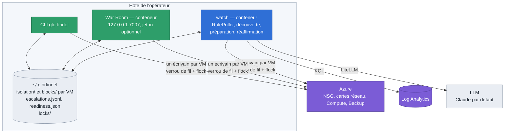
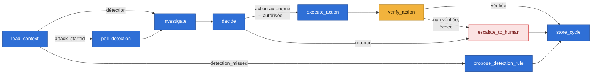
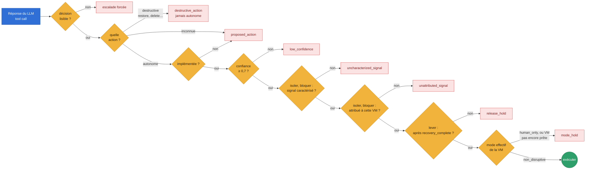
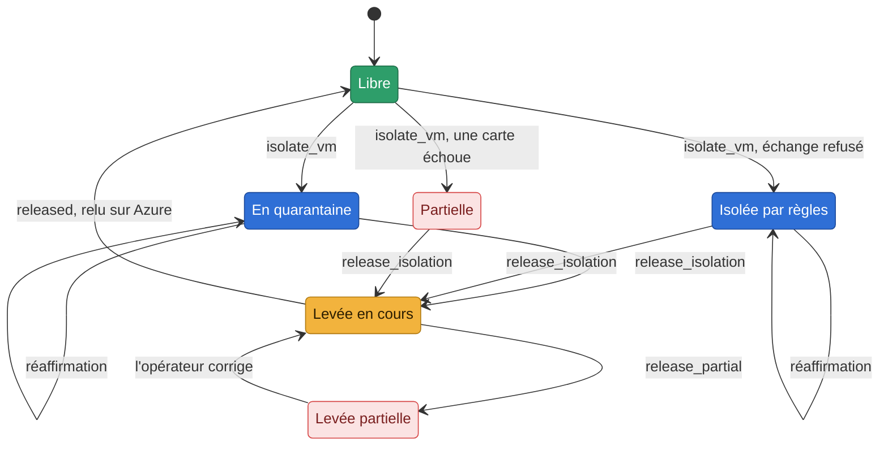
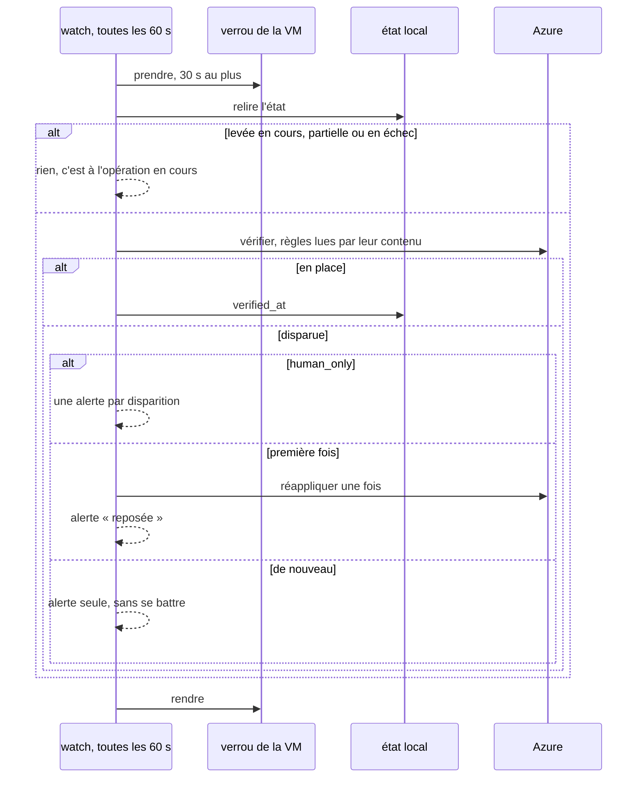

# Architecture d'Eregion

Ce document montre comment les pièces s'emboîtent : la boucle rouge/bleu, les processus et
l'état qu'ils partagent, le graphe de décision, les gardes qui encadrent le LLM, la vie
d'une isolation et la réaffirmation. Les schémas sont en Mermaid (rendus par GitHub), avec un code couleur
commun : rouge = attaque (Annatar), bleu = Glorfindel, ambre = garde ou vérification, vert = humain ou succès,
violet = Azure, rose = escalade ou échec, gris = données.
Pour **comment on prouve** que tout cela tient, voir [`design/preuves.md`](design/preuves.md) ;
pour l'isolation compatible avec l'infrastructure as code, [`design/module-isolation-iac.md`](design/module-isolation-iac.md).

## La boucle complète

Annatar attaque pour de vrai, Glorfindel détecte dans les journaux, raisonne, agit, vérifie
sur Azure et retient. Un humain approuve ce qui est destructif, et ce que le mode de la VM
ne laisse pas faire seul. Une attaque ratée produit une règle de détection proposée.

```mermaid
flowchart LR
    subgraph Red["Annatar — rouge"]
        A1["Scénario ou campagne<br/>MITRE ATT#amp;CK"] --> A2["Attaque réelle<br/>par Run Command"]
    end
    subgraph Az["Azure"]
        VM[("VM cible")] --> LAW[("Log Analytics<br/>Perf, Syslog, StorageBlobLogs")]
    end
    subgraph Blue["Glorfindel — bleu"]
        RP["RulePoller<br/>une requête par règle"] --> INV["investigate<br/>requêtes ciblées"]
        INV --> DEC["decide<br/>LLM + mémoire RAG + exemples"]
        DEC --> G{"gardes<br/>déterministes"}
        G -->|autorisé| EX["execute_action"]
        EX --> VER["verify_action<br/>relu sur Azure"]
        VER --> ST["store_cycle<br/>ChromaDB + journal"]
        G -->|retenu| ESC["escalade"]
    end
    H["Humain<br/>War Room, Discord, CLI"]
    A2 --> VM
    LAW --> RP
    EX -->|"quarantaine, deny, snapshot"| VM
    ESC --> H
    H -->|"approuve"| EX
    A2 -. "detection_missed" .-> PR["propose_detection_rule<br/>autoring groundé"]
    PR --> H
    H -->|"approve-rule"| RULES[("detection_rules.yaml")]
    RULES --> RP
    classDef red fill:#d64545,stroke:#9e2a2a,color:#ffffff
    classDef azure fill:#7b5cd6,stroke:#4f3a99,color:#ffffff
    classDef blue fill:#2f6fd6,stroke:#1d4a9a,color:#ffffff
    classDef guard fill:#f2b33d,stroke:#b07a12,color:#2b1d00
    classDef warn fill:#fbe3e3,stroke:#d64545,color:#7a1f1f
    classDef human fill:#2e9e6a,stroke:#1d6b47,color:#ffffff
    classDef data fill:#e9edf3,stroke:#8a96a8,color:#18212b
    class A1,A2 red
    class VM,LAW azure
    class RP,INV,DEC,EX,ST,PR blue
    class G,VER guard
    class ESC warn
    class H human
    class RULES data
    style Red fill:#fdeeee,stroke:#d64545,color:#7a1f1f
    style Az fill:#f1edfc,stroke:#7b5cd6,color:#4f3a99
    style Blue fill:#eaf1fd,stroke:#2f6fd6,color:#1d4a9a
```

Deux asymétries voulues : la **réaction** est raisonnée par le LLM (aucune table TTP → action),
la **détection** est faite de règles explicites exécutées par un poller déterministe — même
quand c'est le LLM qui les a écrites, elles restent des propositions qu'un humain ratifie.

## Processus et état partagé

Le watch, la War Room et la CLI sont trois processus distincts sur l'hôte de l'opérateur. Ils
partagent l'état local et ne touchent une VM qu'un à la fois.

- **Un fichier d'état par VM**, nommé `<nom>--<empreinte de l'ID>.json` en minuscules : deux VMs
  homonymes dans deux groupes ne se mélangent pas, et la casse de l'ID ne crée pas de doublon.
- **Un écrivain par VM** : isoler, lever, bloquer, débloquer, `reset --from-azure` et la
  réaffirmation prennent le verrou de la VM (fil + `flock`, réentrant). Le `flock` est ce qui
  sépare les processus ; il est testé à part, sur de vrais processus (`tests/unit/test_locks.py`).

## Le graphe de décision

Toute exception d'un cycle finit en escalade (`action_failed`, `cycle_failed`), jamais en
ligne de console : une menace détectée n'est pas perdue parce qu'un appel a échoué.

## Les gardes qui encadrent le LLM

Le LLM propose ; une suite de gardes déterministes décide si l'action part seule. Une action
destructive n'est jamais autonome, quel que soit le mode. Chaque garde qui retient une action
autonome donne son propre type d'escalade, que la War Room affiche. Une VM retenue parce
qu'elle n'est pas prête reçoit en plus, du contrôle de préparation, une carte `readiness_hold`.

Le mode configuré n'est qu'une intention : une VM ne devient autonome qu'une fois contrôlée
**prête** (droits, préséance des règles, coupure des sessions possible), ou après que ses
réserves ont été montrées et acceptées.

## La vie d'une isolation

- **Partielle** : une carte a échoué ; ce qui est posé reste posé et enregistré.
  **Levée en cours** : l'intention est notée (`releasing_at`) avant de toucher Azure.
  **Levée partielle** : quelque chose n'a pas pu être défait ou vérifié ; l'état est gardé.
- **Quarantaine** : chaque carte porte, le temps de l'isolation, le NSG de quarantaine de
  Glorfindel à la place du sien. Le NSG du client reste intact et revient à la levée.
  L'original est noté dans l'état **et** en tag sur le NSG de quarantaine, pour qu'une levée
  sans état sache quoi remettre ; s'il est inconnu, la carte reste en quarantaine et la levée
  le dit. Le NSG de quarantaine refuse aussi le DNS et l'IMDS d'Azure.
- **Par règles** (repli quand une politique ou les droits refusent l'échange) : un deny entrant
  et sortant qui vise toujours les IP de la carte, sur le NSG de la carte, ou sur celui du
  subnet si une allow du client passe avant. Ce repli ne peut pas refuser le DNS et l'IMDS à
  une seule VM : il le déclare (`platform_open`).
- **La levée balaie toujours** : elle défait ce que l'état connaît, puis relit chaque carte et
  retire ce que l'état ignore (crash, réponse perdue, ancienne adresse d'une carte).

## La réaffirmation

Toutes les 60 secondes, le watch relit sur Azure chaque isolation et chaque blocage
enregistrés, sous le verrou de la VM.

Une isolation retirée par un `terraform apply` ou à la main est reposée une fois, puis
Glorfindel alerte sans insister : il ne se bat pas contre un pipeline ou une décision humaine.
