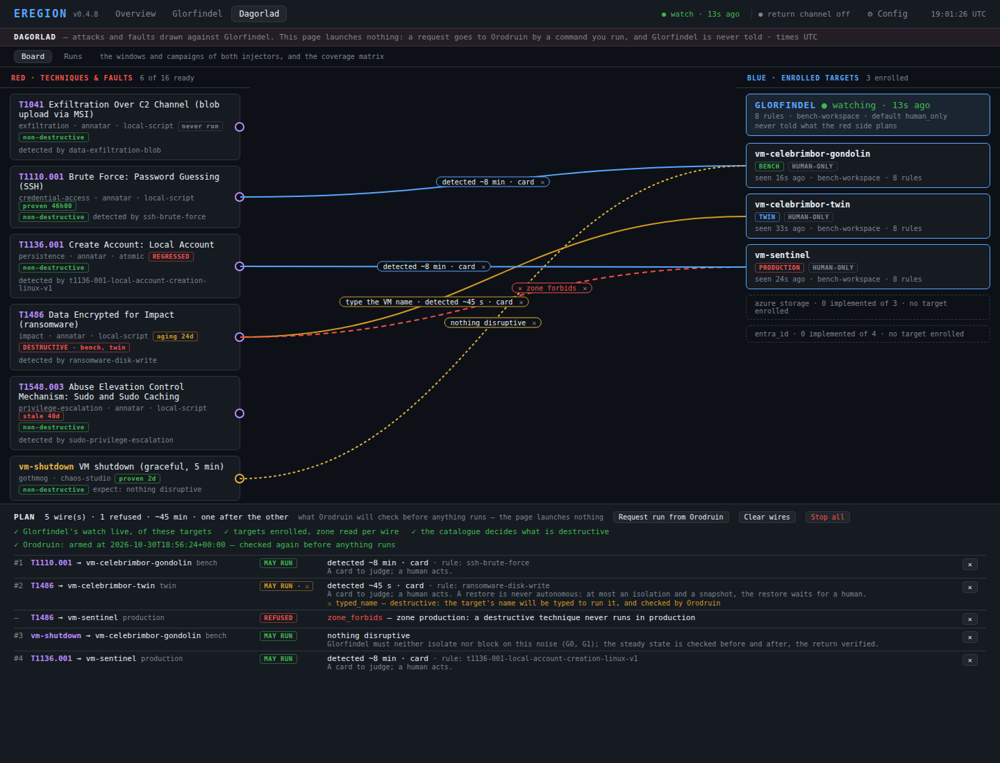
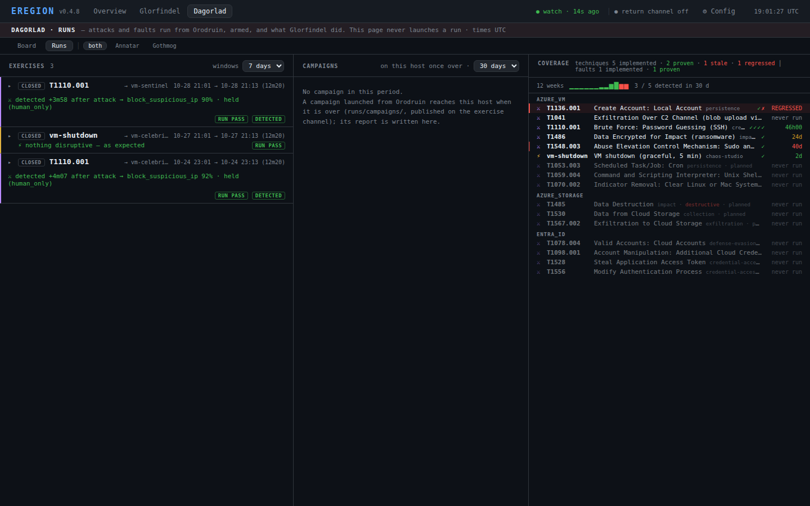
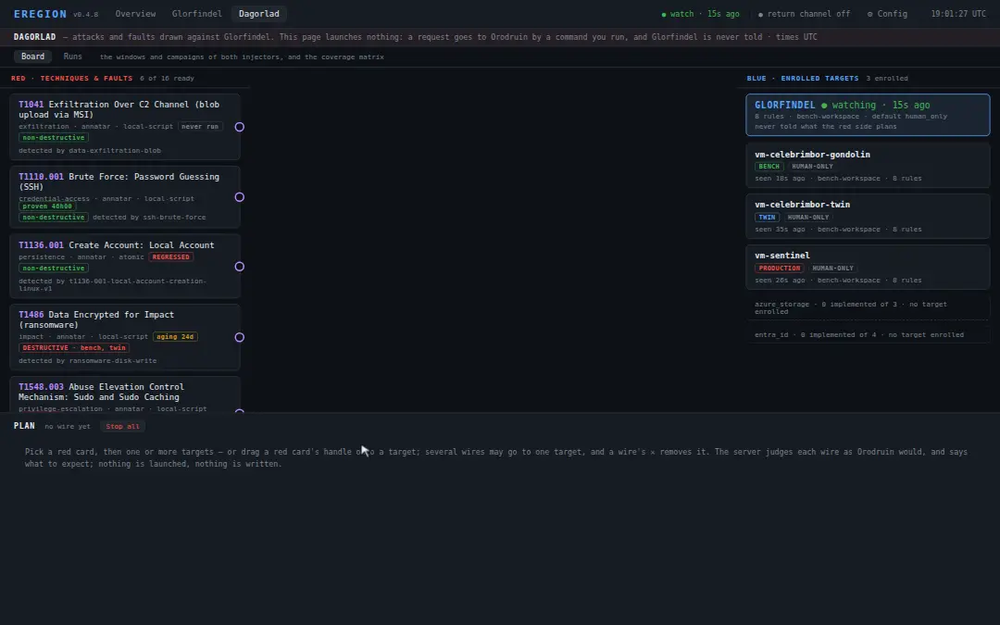

# Dagorlad, le terrain d'exercice

Le guide d'utilisation de Dagorlad, la page `/dagorlad` de la console Eregion. La conception, les
choix et leurs dates sont au §7 de [`design/console.md`](design/console.md) ; le pas à pas
d'Orodruin, dans [`operations.md`](operations.md) (« Dagorlad, phase (b) ») et
[`design/orodruin-contract.md`](design/orodruin-contract.md) (« La demande de Dagorlad »).

Les images de cette page viennent d'un **jeu d'exemple** : un banc fictif, jamais un banc réel
(« Les images », en fin de page).



## Ce que c'est

Le terrain où l'on fait face aux forces d'Annatar : le **rouge** d'un côté, le **bleu** de l'autre.
- **À gauche, les cartes rouges** : les techniques d'Annatar et les pannes de Gothmog, telles que le
  catalogue les déclare (`technique_catalog.yaml`). Chacune dit son injecteur et son moteur
  (Atomic Red Team, Chaos Studio), si elle est destructive, la règle de Glorfindel qui doit la voir, et
  sa dernière preuve. Une entrée prévue (`planned`) est grisée, sans poignée.
- **À droite, les cartes bleues** : Glorfindel, puis les cibles que Celebrimbor a inscrites, avec leur
  zone (`bench`, `twin`, `production`) et leur mode d'autonomie. Une VM du périmètre qui n'est pas
  inscrite n'a pas de carte : bree, la VM à vraie charge, n'y apparaît jamais.
- **Entre les deux, les fils.** On tire un fil d'une carte rouge vers une cible ; le serveur le juge
  comme Orodruin le jugera, et dit ce qu'on doit en attendre.

Les deux côtés ne se connaissent pas : Glorfindel n'apprend jamais ce que le rouge prépare (« Ce que
Glorfindel voit », plus bas).

## Les deux vues

- **Board** (`/dagorlad`) : les cartes, les fils et le plan. Le tableau tient à 1440 × 900.
- **Runs** (`/dagorlad?view=runs`) : ce qui a tourné, des deux injecteurs. On y trouve :
  - les fenêtres d'exercice, et pour chacune ce que Glorfindel a fait pendant ;
  - les campagnes ;
  - la matrice de couverture : chaque technique et chaque panne, son dernier run, sa dernière preuve,
    son état.

  Un filtre (`?injector=annatar|gothmog`) en garde un. `/annatar`, `/gothmog` et `/runs/<id>` y
  mènent.



## Tirer un fil, lire son verdict

**Tirer.** On choisit une carte rouge, puis une ou plusieurs cibles. On peut aussi glisser la poignée
de la carte rouge sur une cible. Le clavier marche aussi.
- Plusieurs fils peuvent aller vers une même cible.
- Re-tirer une paire déjà tirée ne la retire pas : la page dit « already drawn ».
- Le ✕ d'un fil le retire, sur sa pastille comme sur sa ligne du plan. « Clear wires » les retire tous.
- Les fils restent dans le navigateur (`localStorage`), jamais sur le serveur.

Tirer ne lance rien.

**Le verdict.** Le navigateur n'envoie que deux identifiants, la carte rouge et la cible ; le serveur
relit et juge tout le reste, avec le code qu'Orodruin appliquera (`eregion_core/exercise_plan.py`). La
pastille du fil le résume, le plan le détaille :
- **MAY RUN** : le fil peut partir. La pastille dit ce qu'on doit voir : la règle qui détecte et son
  délai (« detected ~8 min »), puis ce que fera Glorfindel dans le mode de la cible (« card » : une
  carte à juger, un humain agit). Pour une panne : « nothing disruptive ».
- **MAY RUN · ⚠** : il peut partir, avec un avertissement.
- **REFUSED** : il ne partira pas. La pastille est rouge et dit le code.

Les refus ont des codes stables, les mêmes que ceux d'`orodruin-check`. Le premier qui tient l'emporte :

| Code | Refusé quand |
|---|---|
| `unknown_experiment` | l'entrée n'est pas au catalogue |
| `not_implemented` | l'entrée est prévue, pas implémentée |
| `wrong_target_type` | la cible n'est pas du type de l'entrée |
| `outside_scope` | la cible est hors du périmètre du banc |
| `not_enrolled` | la cible n'est pas inscrite, ou sa zone manque |
| `zone_forbids` | une panne, ou une technique destructive (ou non déclarée), en `production` |
| `no_watch` | aucune watch de Glorfindel vivante derrière ces cibles : tous les fils |
| `no_engine` | une panne dont aucune expérience Chaos Studio ne vise cette VM |
| `over_cap` | au-delà du plafond d'Orodruin : 20 injections, 2 h en tout |

Les avertissements laissent le fil valide :
- `typed_name` : une technique destructive, ou que personne n'a déclarée inoffensive. Son nom de
  cible sera tapé (« Demander un exercice »).
- `isolated_now` : la cible est isolée, ou des adresses y sont bloquées. Le run mesurerait
  l'isolation, pas la détection.
- `not_seen` : Glorfindel ne voit pas la VM en ce moment. Si elle ne remonte pas, le run finit en
  `unknown`, jamais en raté.
- `no_rule` : aucune règle pour cette technique. Glorfindel est aveugle, le run doit finir en
  `missed`.
- `engine_unknown` : cet hôte ne lit pas les cibles du moteur de la panne. Le preflight de Gothmog
  en décide, sur Orodruin.

Ce que la page dit de Glorfindel est une **enveloppe** : ce que ses gardes lui permettent au plus,
calculé depuis sa configuration, sans appel au modèle. Ce n'est jamais une prédiction de sa décision.
Une restauration n'est jamais autonome, quel que soit le mode.

**La dernière preuve**, sur chaque carte rouge, vient de la matrice de couverture. Une preuve, c'est
un run détecté dont la décision de Glorfindel est retrouvée. Pour une panne, c'est un run PASS avec la
watch en marche. Les états :

| État | Sens |
|---|---|
| `proven` | dernière preuve de moins de 21 jours |
| `aging` | de 21 à 30 jours |
| `stale` | plus de 30 jours : l'indicateur « âge de la dernière preuve » est en alerte |
| `REGRESSED` | détectée avant, ratée depuis |
| `no proof` | des runs, aucun n'est une preuve |
| `never run` | aucun run sur cet hôte |

## Demander un exercice



La console **ne lance rien**. Elle écrit une demande ; l'opérateur la porte sur Orodruin, qui la
juge et la lance.

1. **« Request run from Orodruin »**, dans le plan. Le bouton reste grisé tant qu'un fil est refusé :
   retire-le d'abord. Les fils sont jugés une dernière fois ; un seul refusé, et rien n'est écrit.
   - La demande porte un identifiant (`r-<heure UTC>-<6 hex>`), son heure et, par fil, l'expérience,
     la cible et son rang. Rien d'autre : ni zone, ni « destructive », ni résultat attendu.
   - Elle est écrite dans `~/.eregion/console/requests/`, jamais dans `runs/` ni `~/.glorfindel/`.
   - Les fils sont figés jusqu'à « New plan ».
2. **La commande.** La page la donne, à lancer sur ton poste :

   ```bash
   make orodruin-exercise REQUEST=r-20261030T075200Z-a1b2c3 [DRY_RUN=1] [REQUEST_FROM=local]
   ```

   - Elle tire la demande de H0 par SSH, la clé d'hôte vérifiée (`HOST_SSH_FINGERPRINT`).
   - Elle l'affiche fil par fil.
   - Elle fait **taper le nom de la cible** de chaque fil destructif, ou non déclaré, tel qu'Azure
     l'écrit. Un autre nom, ou « n » : rien n'est envoyé.

   **La console ne prend jamais un nom tapé** : un nom qu'elle aurait gardé ne prouverait rien.
   `DRY_RUN=1` s'arrête avant l'envoi. `REQUEST_FROM=local` lit la console de ton poste.
3. **Sur Orodruin.** Il vérifie son contrat (`armed`), rejuge chaque fil sur ce qu'il lit maintenant
   et compare le nom tapé. Puis il lance **les fils l'un après l'autre**, une fenêtre à la fois.
   - **Une demande à la fois** : Orodruin la tient sous un verrou.
   - Avant chaque fil, il relit le plafond restant à la demande entière, la watch et la cible.
   - Une VM isolée par Glorfindel est attendue 20 min au plus, puis son fil est sauté. Elle n'est
     jamais levée.
4. **Le retour.** Chaque fenêtre porte l'identifiant de la demande ; la vue Runs les montre. Orodruin
   publie son verdict et le statut de la demande ; sous le plan, la page dit « Orodruin: armed », ou
   « unknown here » tant qu'il n'a rien publié.

## Stop all

Le bouton **« Stop all »** ne coupe rien lui-même : la console ne peut pas révoquer une identité, et
ne doit pas le pouvoir. Il donne :
- la commande, `make orodruin-kill`, l'arrêt d'urgence d'Orodruin. Elle révoque son identité, annule le
  chaos, arrête sa VM et ferme les fenêtres ;
- ce qu'elle arrêtera : les fenêtres ouvertes, et leurs cibles ;
- ce qui marque encore (la grâce), et ce qui reste en vol.

Pendant une demande, c'est le seul geste : les fils sont verrouillés, et la console n'a pas de canal
pour dire à Orodruin de sauter un fil.

## Ce que Glorfindel voit, et ne voit pas

**Il ne voit pas le plan.** Une demande n'entre jamais dans ce que lit sa décision :
- elle vit dans le répertoire de la console, `~/.eregion/console/`, que ni la watch ni le bot ne
  montent ;
- le résultat attendu n'est écrit nulle part : il est calculé à la demande de la page ;
- la console n'avertit pas la watch : ni route, ni signal ;
- un cycle de décision rejoué avec une demande présente envoie au modèle le même message, à l'octet
  près (`tests/unit/test_dagorlad_blind.py`).

**Il voit l'attaque, comme une vraie.** L'injecteur ouvre une fenêtre d'exercice en touchant sa cible.
La fenêtre ne sert qu'à étiqueter le cycle (`exercise`) :
- l'étiquette n'abaisse aucune garde ;
- le modèle ne la voit pas ;
- elle ne porte que l'identifiant de la demande, rien de ce qu'elle attend.

C'est ce que la vue Runs montre ensuite : la détection, sa décision, la carte, le verdict du run.

## Les garde-fous

- **La règle de production** : jamais de panne ni d'action destructive sur une charge réelle.
  - En `production`, seulement des techniques non destructives, sur des VM inscrites, et la chaîne
    complète sur une VM sentinelle vide.
  - Le destructif et les pannes restent sur le banc (`bench`) ou le jumeau (`twin`).
  - Une technique dont le caractère destructif n'est pas déclaré est traitée comme destructive.
  - Sur le Board, c'est `zone_forbids`.
- **Les zones** se lisent sur les tags de la cible et de son groupe (`eregion-target`,
  `eregion-zone`). Orodruin les relit à chaque injection, avec sa propre identité.
- **Le contrat d'Orodruin** est vérifié au démarrage et à chaque demande. Un injecteur n'agit que
  depuis un Orodruin armé ; ailleurs, il reste passif
  ([`design/orodruin-contract.md`](design/orodruin-contract.md)).
- **Jamais sans Glorfindel** (V1) : sans battement vivant de la watch, aucun fil ne part (`no_watch`).
  `--without-glorfindel` n'est pas proposé par la page ; un run de développement reste un geste sur
  Orodruin.
- **La frontière de la console** (SEC1) : le jeton, l'origine, un corps JSON. La seule écriture de
  Dagorlad est la demande, dans son propre répertoire, jamais sur le cloud.

## Les images

Les captures et la boucle de cette page et du README se rejouent sur le poste, jamais en CI :

```bash
make console-shots                          # docs/images/dagorlad/ : board.png, runs.png, loop.webp
make console-shots VIDEO=~/dagorlad.mp4     # et le tour complet, hors du dépôt
python scripts/console_shots.py --check     # quels outils sont là ; ne rend rien
```

- **Le jeu d'exemple, et rien d'autre.** La console démarre sur `tests/fixtures/dagorlad_sample.json`,
  écrit dans un répertoire jetable. Ce répertoire est son HOME et son répertoire de travail ; jamais
  `~/.glorfindel`, `runs/` ni un banc réel.
  - L'abonnement est le GUID nul ; les noms sont ceux, publics, du banc (`rg-celebrimbor`,
    `vm-celebrimbor-…`, `vm-sentinel`).
  - Le script refuse (code 2) un autre jeu, ou un jeu qui porte un autre GUID, une adresse hors des
    plages de documentation, un autre nom.
  - Le serveur qu'il démarre refuse une variable Azure dans son environnement, ou un autre HOME. Il ne
    se connecte qu'à la boucle locale.
- **Les outils sont ceux du poste**, jamais des dépendances du paquet :
  - un Chromium (`--chromium`, `EREGION_CHROMIUM`, le PATH, ou le cache de Playwright :
    `chrome-headless-shell`), piloté par le protocole DevTools avec `websockets` ;
  - ffmpeg pour la vidéo seulement. Avec libx264, elle sort en mp4 ; sinon en WebM (VP9), comme avec
    le ffmpeg de Playwright.

  S'il en manque un, le script le dit et s'arrête (code 3).
- **Les images restent liées au jeu.** `docs/images/dagorlad/shots.json` garde l'empreinte du jeu et
  celle de chaque image. `tests/unit/test_console_shots.py` les vérifie, avec les identifiants du jeu,
  les tailles (moins de 300 Ko par capture, 3 Mo pour la boucle) et la durée de la boucle (10 à 15 s).
  Un jeu modifié demande de rejouer les images.
