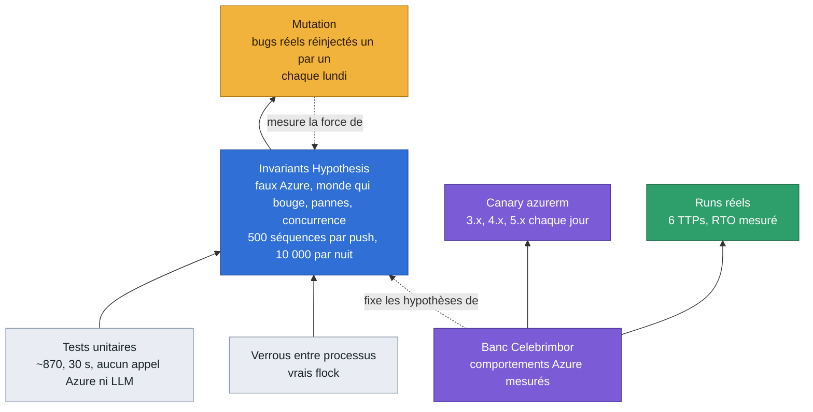
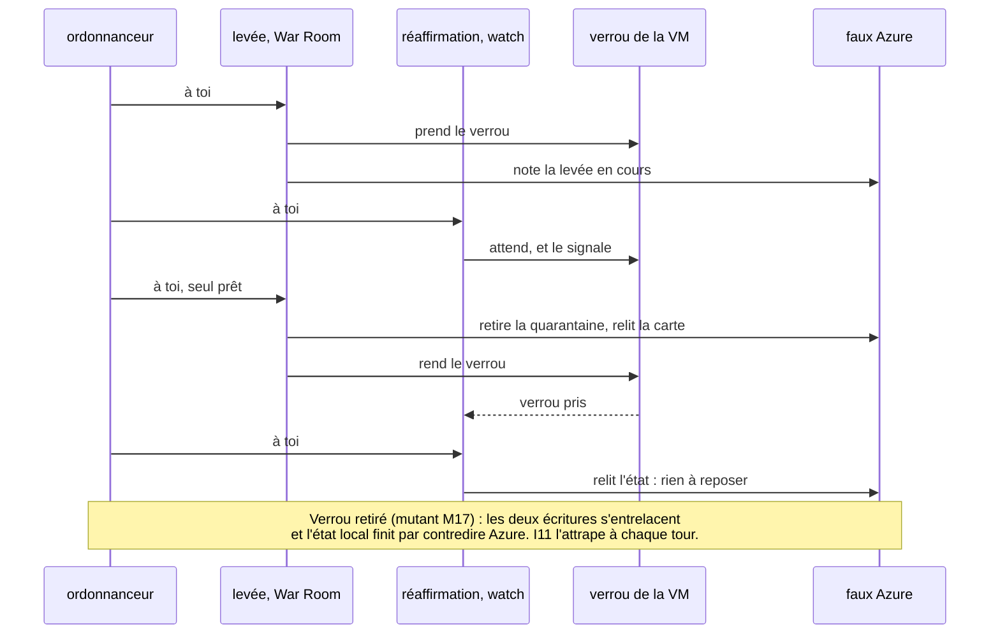
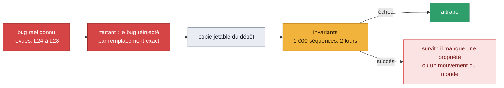
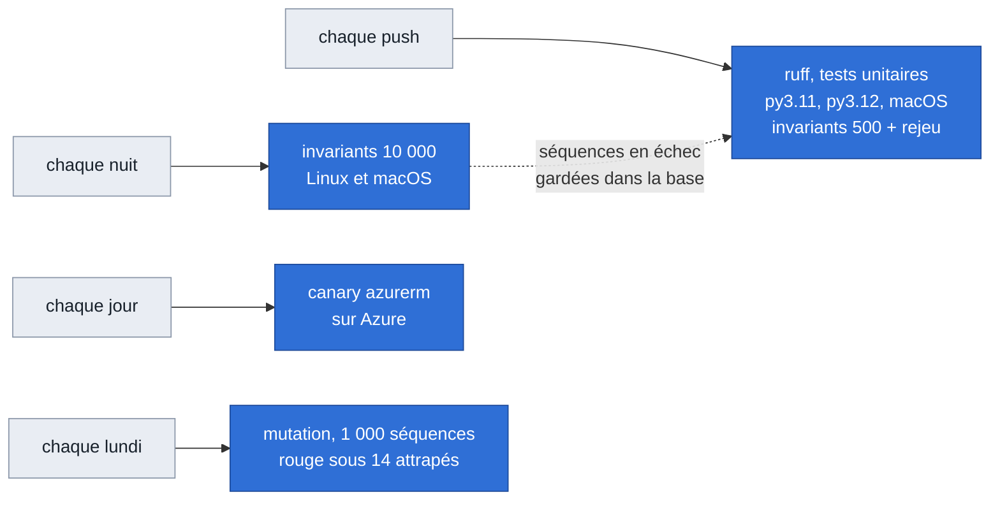

# Comment on prouve ce qu'on avance

Glorfindel modifie le réseau d'un client, parfois seul. Une affirmation du type « la VM est
isolée » doit donc être vraie, pas probable. Ce document montre les couches de preuve, ce que
chacune voit et ne voit pas, et ce qu'elles ont trouvé. Vue d'ensemble du produit :
[`../architecture.md`](../architecture.md).

## Les couches

| Couche | Ce qu'elle voit | Ce qu'elle ne voit pas |
|---|---|---|
| Tests unitaires | une fonction, un cas écrit à la main | les enchaînements, les cas auxquels personne n'a pensé |
| Invariants | des milliers de réseaux et de séquences tirés au hasard, avec pannes, monde qui bouge et deux opérations à la fois | ce que le faux Azure ne modélise pas (deux hôtes, couches au-dessus du NSG) |
| Mutation | si les invariants attrapent un bug connu | un bug d'une classe jamais vue |
| Verrous entre processus | l'exclusion mutuelle réelle de `flock` | un verrou entre deux hôtes |
| Banc Celebrimbor | le comportement réel d'Azure et de Terraform | la variété des réseaux clients |
| Canary azurerm | qu'un comportement mesuré du provider tient encore | Bicep, ARM, autres outils |
| Runs réels | la boucle complète, de l'attaque à la remise en service | la répétition à grande échelle |

Règle de travail : un comportement d'Azure ou de Terraform n'est affirmé qu'après une mesure
sur le banc. Le faux Azure reprend ces mesures ; ce qu'il suppose sans mesure est écrit en
tête de `tests/unit/fake_azure.py`.

## La machine à invariants

Les propriétés, vérifiées après chaque étape :

| | Propriété |
|---|---|
| I1 | aucune VM n'est plus joignable que son propriétaire ne l'a conçue |
| I2 | la configuration du client est ce qu'il a écrit en dernier ; une carte porte son NSG ou celui de quarantaine, jamais aucun ni un autre ; et, par auteur (journal des écritures de l'API), Glorfindel n'écrit que ce qui est à lui |
| I3 | aucun succès sur un mensonge : chaque vérification qui dit vrai est vraie, à chaque étape |
| I4 | une opération sur une VM ne change rien pour une autre, homonymes compris |
| I5 | la réaffirmation n'ouvre jamais rien, et n'écrit rien en `human_only` |
| I6 | une VM, un fichier d'état |
| I7 | depuis tout état atteint, la levée ramène chaque VM à sa conception, ou la garde en quarantaine en disant ce qui manque |
| I8 | ce qu'une opération laisse sur Azure est dans l'état |
| I9 | une levée commencée n'est jamais défaite par la réaffirmation |
| I10 | la configuration est respectée ; illisible, l'isolation n'écrit rien |
| I11 | deux opérations à la fois finissent comme l'une après l'autre : l'état local dit ce qu'Azure a |
| I12 | une VM d'un autre abonnement n'est jamais touchée, ni déclarée isolée |
| L1 | un blocage dont les règles ont disparu est reposé ou signalé, même derrière la quarantaine |
| U1 | une règle laissée par une carte qui n'existe plus, et qui coupe une carte vivante, est signalée |

**Des oracles qui ne demandent rien au code.** Ce qu'une propriété juge vient du journal du test :
la levée qu'il a demandée (I9), ce qu'il a perdu et quand (une carte « intraçable »), qui a écrit
quoi (I2 par auteur). Lire les marqueurs que le code pose revenait à le croire sur parole : un bug
qui efface l'état d'une carte gagnait l'exemption prévue pour une carte dont l'état est perdu (A0).

### Deux opérations à la fois

La War Room, la CLI et le watch sont trois processus qui peuvent viser la même VM. Un
ordonnanceur fait avancer deux opérations un appel Azure à la fois, dans un ordre tiré au
hasard, avec les vrais verrous. Un fil qui attend un verrou le signale ; il ne reçoit son tour
qu'une fois le verrou pris.

Le `flock` qui sépare les processus est testé à part, sur de vrais processus
(`tests/unit/test_locks.py`) : quatre processus sur le même verrou ne se chevauchent jamais,
l'ID canonique et l'ID en minuscules prennent le même verrou, une tâche de fond renonce au
bout de son délai. Sans `flock`, ces tests échouent.

## La mesure par mutation

Un test qui passe ne dit rien de sa force. `scripts/mutation_check.py` réinjecte, un par un,
des bugs que Glorfindel a vraiment eus, dans une copie jetable du dépôt, et regarde si les
invariants les attrapent.

| Étape | Attrapés à chaque tour, au budget du push |
|---|---|
| Invariants L24/L25, avant le monde qui bouge | 1 sur 17 |
| L26 : le monde bouge, quatre propriétés de plus | 15 sur 17 |
| L27 : deux opérations à la fois, verrou compris | 17 sur 22 (M01 à M25) |
| A0 : monde v3 (voir plus bas), 41 mutants | 22 sur 36 par les séquences tirées, les autres par leur séquence figée |

**Le jeu de contrôle.** Seize bugs plausibles proposés par la septième passe, jamais utilisés pour
orienter la génération (`--control`) : il mesure si la suite trouve ce qu'on ne lui a pas appris.
Au budget du push : 3 sur 16 à son arrivée, 6 après la première étape d'A0, **10 sur 16** à la fin
d'A0 (et 2 intermittents).

Écartés du décompte, avec leur raison écrite dans le harnais : **M11** (plus aucun appelant ne voit
un « not found » autre qu'un 404) et **M25** (depuis A0 le reset note son intention avant de toucher
Azure : l'état d'un reset partiel est tenu de toute façon). **M02** et **M14**, autrefois écartés,
sont attrapés depuis A0 : M02 par les isolations d'une ancienne version dans le monde, M14 par un
autre hôte qui écrit la carte juste après Glorfindel. M36 (fichier d'état ancien) n'est couvert que
par un test unitaire : il faut un crash entre deux opérations de fichier.

Les mutants M18 à M29 réinjectent les défauts trouvés par la machine elle-même. Les plus rares
(M21 à M24, trouvés à des milliers de séquences) ne sont pas attrapés à chaque tour au budget
du push ; leur séquence figée, elle, les attrape à chaque push.

### Les pannes des dépendances (G2)

Les invariants modélisent les pannes d'Azure sous l'isolation (429, crash, 403, disque plein).
G2 couvre les autres dépendances de la décision — le modèle, l'API du cloud au contrôle de
préparation, la télémétrie de l'enquête, la configuration — par huit mutants mesurés par
`tests/unit/test_dependency_failures.py` (table `TESTS`), un cycle complet du graphe chacun,
avec un témoin positif qui exécute quand rien ne tombe :

| Mutant | Panne réinjectée | Effet |
|---|---|---|
| M151 | l'appel de décision sans borne | un modèle pendu tient la file de la VM des heures, sans carte |
| M152 | VM jamais contrôlée tenue pour prête | Azure injoignable au contrôle : la VM agit seule |
| M153 | requête d'enquête en échec lue comme « aucune ligne » | isolation décidée sur une absence que la télémétrie n'a pas dite |
| M154 | garde de télémétrie retirée | idem, l'échec connu mais ignoré |
| M155 | `--mode` appliqué sur une configuration illisible | une VM épinglée `human_only` devient autonome |
| M156 | seuil de confiance illisible accepté | `nan` ou `-1` : la porte de confiance ne retient plus rien |
| M157 | interrupteur de lecture seule lu strictement | `on`, `TRUE` : les écritures restent ouvertes |
| M158 | âge maximal d'approbation `nan` ou `inf` accepté | une carte de tout âge s'exécute depuis la War Room |

Huit sur huit attrapés au premier tour (21/10). Détail des pannes et de ce que fait Glorfindel :
[`../glorfindel.md`](../glorfindel.md), « Pannes des dépendances ».

## Ce que les invariants ont trouvé

Aucun de ces défauts n'avait été vu en revue. Chacun a son test et sa séquence figée.

| Lot | Défaut | Effet avant correction |
|---|---|---|
| L24 | nom de règle commun aux homonymes | isoler l'un rouvrait l'autre |
| L24 | présence par nom prise pour une preuve | une règle restreinte comptait comme isolation |
| L24 | état réécrit par une ré-isolation interrompue | « released » avec une carte encore isolée |
| L24 | NSG d'origine masqué par la quarantaine | un ancien repli échappait à la levée |
| L24 | any/any sur un NSG partagé qui semblait dédié | une autre VM coupée à sa propre levée |
| L24 | subnet illisible lu comme « sans NSG » | « released » sans rien retirer |
| L24 | reste contourné qui masquait un deny sain | fausse alerte |
| L24 | déblocage sans état | « unblocked », règles en place |
| L24 | blocage sain à côté d'un ancien contourné | lu « contourné » |
| L26 | règle de l'ancienne IP après un changement d'adresse | la VM suivante sur cette IP aurait été coupée |
| L26 | blocage vérifié sur les IP du moment du blocage | « bloqué », la nouvelle adresse ouverte |
| L26 | blocage caché derrière la quarantaine | « bloqué », quarantaine vidée, attaquant passé |
| L26 | original demandé pour une carte redéployée | levée en échec pour toujours |
| L26 | seconde levée lisant l'état comme un ancien format | **NSG de quarantaine partagé vidé, VMs rouvertes** |
| L27 | déblocage aveugle derrière la quarantaine | « not_found », IP rebloquée à la levée |
| L27 | `reset --from-azure` qui lisait l'original dans le seul tag | reset partiel alors que l'état connaissait l'original |
| L27 | reset partiel qui laissait l'état intact | la réaffirmation aurait reposé ce que l'opérateur retirait |
| L28 | carte détachée vers « aucun NSG » à la levée (U2, septième passe) | `released`, carte laissée sans son NSG, tag effacé |
| L28 | réisolation d'une carte nue | « aucun » enregistré par-dessus le vrai original, carte laissée sans NSG à la levée |
| A0 | une seule priorité (l'entrante) pour juger les deux sens | deny sortant déplacé derrière une allow client : « isolée », mouvement latéral ouvert |
| A0 | allow sortante avant le deny d'un blocage comptée comme « exposition » | « bloqué », la VM joignait encore l'attaquant |
| A0 | carte pas relue après l'échange de NSG | un autre hôte défait l'échange : « isolée », carte sans NSG |
| A0 | ancienne règle à nom fixe sur un NSG partagé ou au partage illisible | « levée », la VM encore coupée |
| A0 | ancien état mono-NSG ignoré par `verify_release` | « levée », règles de l'ancienne version en place |
| A0 | `reset --from-azure` sans intention notée | interrompu, la réaffirmation réisolait en pleine levée |
| A0 | ancien fichier d'état réécrit avant d'être déplacé | crash : deux fichiers, la recherche par nom lisait l'ancien |
| A0 | alertes de la réaffirmation clées par le nom | l'alerte d'un homonyme fermait la carte de l'autre : blocage disparu, rien de dit |
| A0 | blocage disparu derrière la quarantaine | rien de dit avant que la levée rouvre la carte |
| A0 | original d'une carte nue lu dans le seul tag par le reset | « swept », état effacé, carte sans NSG en silence |
| A0 | NSG d'origine remis sans en lire les règles | « swept », VM encore coupée par une ancienne isolation |
| A0 | NSG supprimé lu comme « illisible » | blocage disparu jamais signalé, levée partielle pour toujours |

Le plus grave : après une levée qui échoue en partie, une seconde levée lisait les champs de
rétro-compatibilité de l'état comme un ancien format, et supprimait les deny du NSG de
quarantaine **partagé**. Toutes les VMs en quarantaine du même groupe étaient rouvertes. La
machine ne l'a trouvé qu'à 5 000 séquences.

## Cadence

Une séquence trouvée la nuit est rejouée en premier à chaque push jusqu'à sa correction, puis
écrite dans `tests/unit/test_invariant_regressions.py`.

## Ce qui n'est pas couvert

- **Deux hôtes** : les verrous sont par hôte. Un autre hôte qui écrit la carte juste après
  Glorfindel est modélisé (A0) ; deux Glorfindel complets sur deux machines ne le sont pas.
- **VM supprimée et état perdu** : les règles qu'une isolation par règles a laissées sur un
  NSG partagé sont introuvables, faute de cartes pour dire où chercher.
- **Couches au-dessus du NSG** : règles d'administration d'Azure Virtual Network Manager,
  routes, pare-feu. Elles peuvent contourner une isolation et ne sont pas encore lues.
- **Hypothèses du faux Azure** non mesurées : le code d'erreur d'un NSG d'une autre région,
  le refus de supprimer un NSG attaché, Run Command shell refusé sous Windows.
