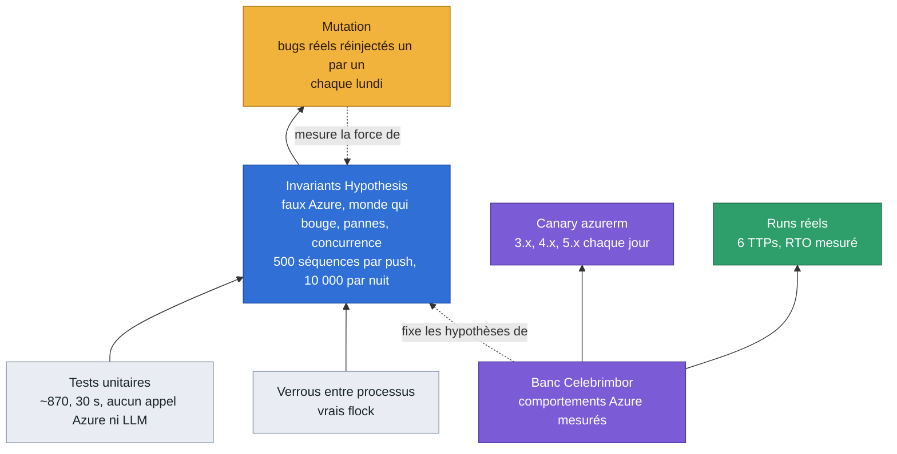
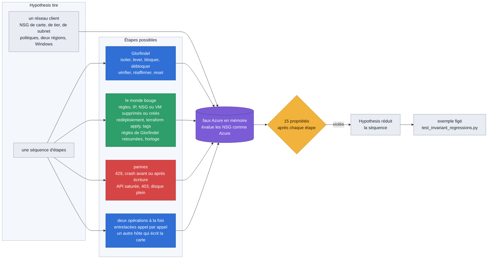
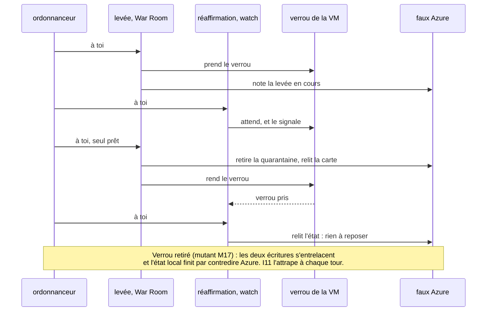
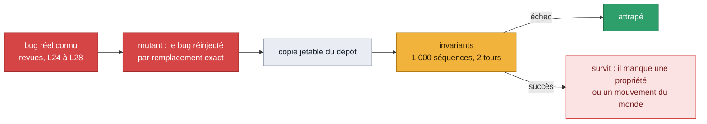
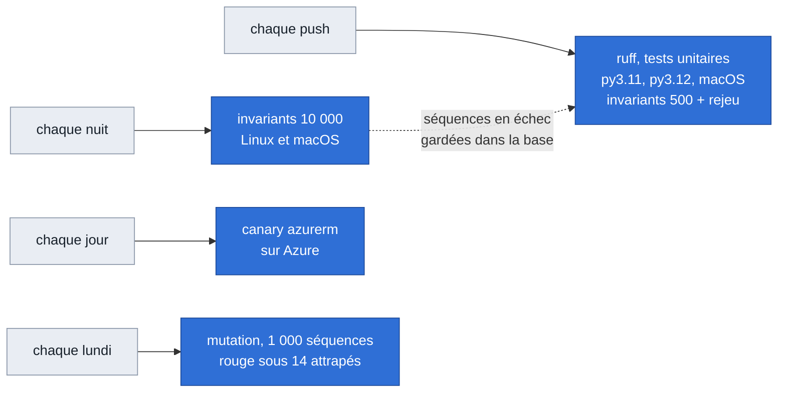

# Comment on prouve ce qu'on avance

Glorfindel modifie le réseau d'un client, parfois seul. Une affirmation du type « la VM est
isolée » doit donc être vraie, pas probable. Ce document montre les couches de preuve, ce que
chacune voit et ne voit pas, et ce qu'elles ont trouvé. Vue d'ensemble du produit :
[`../architecture.md`](../architecture.md).

## Les couches

| Couche | Ce qu'elle voit | Ce qu'elle ne voit pas |
|---|---|---|
| Tests unitaires | une fonction, un cas écrit à la main | les enchaînements, les cas auxquels personne n'a pensé |
| Invariants | des milliers de réseaux et de séquences tirés au hasard, avec pannes, monde qui bouge et deux opérations à la fois | ce que le faux Azure ne modélise pas (deux hôtes, couches au-dessus du NSG) |
| Mutation | si les invariants attrapent un bug connu | un bug d'une classe jamais vue |
| Verrous entre processus | l'exclusion mutuelle réelle de `flock` | un verrou entre deux hôtes |
| Banc Celebrimbor | le comportement réel d'Azure et de Terraform | la variété des réseaux clients |
| Canary azurerm | qu'un comportement mesuré du provider tient encore | Bicep, ARM, autres outils |
| Runs réels | la boucle complète, de l'attaque à la remise en service | la répétition à grande échelle |

Règle de travail : un comportement d'Azure ou de Terraform n'est affirmé qu'après une mesure
sur le banc. Le faux Azure reprend ces mesures ; ce qu'il suppose sans mesure est écrit en
tête de `tests/unit/fake_azure.py`.

## La machine à invariants

Les propriétés, vérifiées après chaque étape :

| | Propriété |
|---|---|
| I1 | aucune VM n'est plus joignable que son propriétaire ne l'a conçue |
| I2 | la configuration du client est ce qu'il a écrit en dernier ; une carte porte son NSG ou celui de quarantaine, jamais aucun ni un autre ; et, par auteur (journal des écritures de l'API), Glorfindel n'écrit que ce qui est à lui |
| I3 | aucun succès sur un mensonge : chaque vérification qui dit vrai est vraie, à chaque étape |
| I4 | une opération sur une VM ne change rien pour une autre, homonymes compris — et ne supprime jamais l'ancienne isolation d'une autre VM, même là où aucun flux ne le dit (I4S, lu dans le journal du test) |
| I5 | la réaffirmation n'ouvre jamais rien, et n'écrit rien en `human_only` |
| I6 | une VM, un fichier d'état |
| I7 | depuis tout état atteint, la levée ramène chaque VM à sa conception, ou la garde en quarantaine en disant ce qui manque |
| I8 | ce qu'une opération laisse sur Azure est dans l'état |
| I9 | une levée commencée n'est jamais défaite par la réaffirmation |
| I10 | la configuration est respectée ; illisible, l'isolation n'écrit rien |
| I11 | deux opérations à la fois finissent comme l'une après l'autre : l'état local dit ce qu'Azure a |
| I12 | une VM d'un autre abonnement n'est jamais touchée, ni déclarée isolée |
| L1 | un blocage dont les règles ont disparu est reposé ou signalé, même derrière la quarantaine |
| L2 | un NSG de quarantaine que quelqu'un a modifié, et qui porte encore des cartes, est reposé ou signalé — l'état de ces cartes perdu compris (I1F) ; signalé, il le reste quand il sort de la liste : rôle retiré sur son groupe, notre tag retiré (I1S) |
| U1 | une règle laissée par une carte qui n'existe plus, et qui coupe une carte vivante, est signalée, puis retirée par le balayage — rien d'autre ne bouge ; en fin de séquence, chaque VM vivante revient à sa conception en entier (A3) |

**Des oracles qui ne demandent rien au code.** Ce qu'une propriété juge vient du journal du test :
la levée qu'il a demandée (I9), ce qu'il a perdu et quand (une carte « intraçable »), qui a écrit
quoi (I2 par auteur). Lire les marqueurs que le code pose revenait à le croire sur parole : un bug
qui efface l'état d'une carte gagnait l'exemption prévue pour une carte dont l'état est perdu (A0).

### Deux opérations à la fois

La War Room, la CLI et le watch sont trois processus qui peuvent viser la même VM. Un
ordonnanceur fait avancer deux opérations un appel Azure à la fois, dans un ordre tiré au
hasard, avec les vrais verrous. Un fil qui attend un verrou le signale ; il ne reçoit son tour
qu'une fois le verrou pris.

Le `flock` qui sépare les processus est testé à part, sur de vrais processus
(`tests/unit/test_locks.py`) : quatre processus sur le même verrou ne se chevauchent jamais,
l'ID canonique et l'ID en minuscules prennent le même verrou, une tâche de fond renonce au
bout de son délai. Sans `flock`, ces tests échouent.

**Une course qui ne revient pas échoue, elle ne fige pas le job (U3F).** Un tour qui dure plus
de 20 s (temps réel) fait échouer I11 : « operations stuck » ou « … never came back ». Le fil qui
attendait son tour y restait, ses verrous pris, et le teardown qui les prend ensuite attendait
sans fin. L'ordonnanceur abandonne maintenant la course avant de lever l'échec : chaque fil en
attente lève `_Abandoned`, qui ne dérive pas d'`Exception` (aucun `except Exception` du code ne
l'avale), et relâche ses verrous en se déroulant (`test_a_stuck_race_fails_and_lets_the_teardown_through`,
M1346). Le délai d'un tour reste 20 s.

Ce délai ne voyait pas tout interblocage (relecture d'U3F). Un verrou piloté pris est réessayé à
chaque tour, sans fin quand l'appelant ne donne pas de délai (les verrous de VM des écritures) :
si op-1 tient A et veut B pendant qu'op-2 tient B et veut A, chacun rend son tour à chaque essai,
chaque tour revient à temps, et I11 ne tombait jamais — la course tournait sans fin. L'ordonnanceur
compte maintenant les tours d'affilée passés seulement sur des verrous trouvés pris : au-delà de
2 000, I11 tombe, « livelock (deadlock between driven locks?) », par le même chemin d'abandon
(`test_two_driven_locks_taken_in_reverse_order_fail_fast`, M1349 ; une seconde environ). Mesuré à
500 séquences, le plus long de ces passages dans une vraie course est de 10 à 16 tours selon les
graines, pour une limite de 2 000. Ce qui est tenu : un interblocage entre verrous pilotés échoue en bien moins d'un
tour de délai ; un fil bloqué hors de la vue de l'ordonnanceur (un verrou non piloté, une attente
quelconque) échoue au bout d'un tour, 20 s. Un tel fil ne se déroule pas : l'échec le nomme
(« still running, never unwound »), et le teardown de la machine saute alors la remise à plat qui
attendrait derrière ses verrous — I11 a déjà échoué (M1440). Ce qu'il tient reste tenu : les
registres de verrous du processus (`locks._VM_LOCKS`, `_QUARANTINE_LOCKS`, `_FILE_LOCKS`) ne sont
jamais remis à zéro entre deux exemples, et l'exemple suivant — Hypothesis en rejoue pendant la
réduction — attendait derrière lui à sa première écriture sur la même VM. Les courses suivantes
reçoivent des registres neufs (le `flock` ne gêne pas : un nouvel exemple a un nouveau HOME, donc de
nouveaux fichiers), et chaque fil d'une course a un nom à elle (`op-1#7`, les messages d'I11 disent
`op-1`) : réveillé plus tard, un tel fil n'entre jamais dans une course suivante
(`test_a_thread_out_of_sight_holding_a_lock_does_not_hang_the_teardown`, M1442). Ce qui ne l'est
pas : un fil qui boucle sans jamais rendre son tour ni prendre de verrou piloté, et un fil qui
boucle **en rendant son tour** — des appels Azure sans fin, chaque tour productif — ne sont vus que
par la borne du job. Les jobs qui lancent la machine sont bornés : CI Linux 30 min, macOS 25 min, nuit
150 min (M1347, M1348) ; sur Linux comme sur macOS, un test qui dure plus de 8 min écrit la pile de
ses fils (M1441).

## La mesure par mutation

Un test qui passe ne dit rien de sa force. `scripts/mutation_check.py` réinjecte, un par un,
des bugs que Glorfindel a vraiment eus, dans une copie jetable du dépôt, et regarde si les
invariants les attrapent.

| Étape | Attrapés à chaque tour, au budget du push |
|---|---|
| Invariants L24/L25, avant le monde qui bouge | 1 sur 17 |
| L26 : le monde bouge, quatre propriétés de plus | 15 sur 17 |
| L27 : deux opérations à la fois, verrou compris | 17 sur 22 (M01 à M25) |
| A0 : monde v3 (voir plus bas), 41 mutants | 22 sur 36 par les séquences tirées, les autres par leur séquence figée |

**Le jeu de contrôle.** Seize bugs plausibles proposés par la septième passe, jamais utilisés pour
orienter la génération (`--control`) : il mesure si la suite trouve ce qu'on ne lui a pas appris.
Au budget du push : 3 sur 16 à son arrivée, 6 après la première étape d'A0, **10 sur 16** à la fin
d'A0 (et 2 intermittents).

Écartés du décompte, avec leur raison écrite dans le harnais : **M11** (plus aucun appelant ne voit
un « not found » autre qu'un 404) et **M25** (depuis A0 le reset note son intention avant de toucher
Azure : l'état d'un reset partiel est tenu de toute façon). **M02** et **M14**, autrefois écartés,
sont attrapés depuis A0 : M02 par les isolations d'une ancienne version dans le monde, M14 par un
autre hôte qui écrit la carte juste après Glorfindel. M36 (fichier d'état ancien) n'est couvert que
par un test unitaire : il faut un crash entre deux opérations de fichier.

Les mutants M18 à M29 réinjectent les défauts trouvés par la machine elle-même. Les plus rares
(M21 à M24, trouvés à des milliers de séquences) ne sont pas attrapés à chaque tour au budget
du push ; leur séquence figée, elle, les attrape à chaque push.

### Les pannes des dépendances (G2)

Les invariants modélisent les pannes d'Azure sous l'isolation (429, crash, 403, disque plein).
G2 couvre les autres dépendances de la décision — le modèle, l'API du cloud au contrôle de
préparation, la télémétrie de l'enquête, la configuration — par dix-sept mutants mesurés par
`tests/unit/test_dependency_failures.py` (table `TESTS`). Les pannes passent par un cycle
complet du graphe, avec un témoin positif qui exécute quand rien ne tombe ; les lecteurs des
réglages (borne de l'appel, seuil, âge d'approbation, lecture seule, `docker-compose.yml`)
sont testés directement :

| Mutant | Panne réinjectée | Effet |
|---|---|---|
| M151 | l'appel de décision sans borne | un modèle pendu tient la file de la VM des heures, sans carte |
| M152 | VM jamais contrôlée tenue pour prête | Azure injoignable au contrôle : la VM agit seule |
| M153 | requête d'enquête en échec lue comme « aucune ligne » | isolation décidée sur une absence que la télémétrie n'a pas dite |
| M154 | garde de télémétrie retirée | idem, l'échec connu mais ignoré |
| M155 | `--mode` appliqué sur une configuration illisible | une VM épinglée `human_only` devient autonome |
| M156 | seuil de confiance illisible accepté | `nan` ou `-1` : la porte de confiance ne retient plus rien |
| M157 | interrupteur de lecture seule lu strictement | `on`, `TRUE` : les écritures restent ouvertes |
| M158 | âge maximal d'approbation `nan` ou `inf` accepté | une carte de tout âge s'exécute depuis la War Room |
| M170 | âge maximal d'approbation ≤ 0 ramené à 2 h | une approbation en un clic fermée exprès se rouvre |
| M171 | âge maximal ≤ 0 sans refus propre | une carte datée en avance sur l'horloge s'exécute |
| M172 | porte de confiance écrite `confiance < seuil` | une confiance `NaN` du modèle passe la porte |
| M173 | confiance du modèle non bornée | un 5.0 s'affiche 500 % sur la carte et dans la mémoire |
| M174 | requêtes en échec tues sur une carte retenue plus tôt | l'opérateur approuve sans savoir que l'enquête n'a rien lu |
| M175 | `GLORFINDEL_LLM_TIMEOUT_S` absent d'`x-env` | réglé dans `.envrc`, ignoré par les conteneurs |
| M176 | seuil lu dans l'agent par la War Room | un import en échec fait disparaître la matrice de capacités |
| M177 | `--mode` appliqué à la bannière sur une configuration illisible | la bannière annonce un mode que rien n'applique |
| M178 | carte d'une configuration illisible lue « réponse autonome configurée » | elle annonce un mode que personne n'a configuré |

M151–M158 : huit sur huit attrapés au premier tour (21/10) ; M170–M178, ajoutés après la
relecture : neuf sur neuf (21/10). Détail des pannes et de ce que fait Glorfindel :
[`../glorfindel.md`](../glorfindel.md), « Pannes des dépendances ».

### La stabilité de la décision (D-1)

La même force brute a reçu un blocage à 0,80 le 21/10, puis une isolation à 0,78 le 23/10.
D-1 fixe la température du premier tirage (0, ou l'échantillonnage par défaut d'un modèle
qui la refuse, comme `claude-sonnet-5-5`), et ne laisse partir seule une action disruptive
que si plusieurs tirages s'accordent. Treize mutants, mesurés par
`tests/unit/test_decision_stability.py` ; les cycles passent par le graphe complet là où la
carte compte :

| Mutant | Défaut réinjecté | Effet |
|---|---|---|
| M200 | premier tirage sans température | rien ne fixe le tirage, même sur un modèle qui l'accepte |
| M201 | refus de la température non rattrapé | `claude-sonnet-5-5`, le modèle par défaut : toute décision échoue |
| M202 | tirage dit fixé sur un modèle qui a refusé | la ligne de debug ment sur la reproductibilité |
| M203 | accord des tirages jamais vérifié | une action disruptive part sur un seul tirage |
| M204 | tirages de confirmation à la température du premier | ils répètent le premier au lieu de sonder la variance |
| M205 | tirage de confirmation sous le seuil compté d'accord | une isolation à 40 % confirme une isolation à 95 % |
| M206 | tirage en échec écarté, les autres comptés | un fournisseur qui tombe à mi-chemin laisse passer l'action |
| M207 | moins de tirages que demandé comptés d'accord | idem, sans même un échec |
| M208 | `GLORFINDEL_DECISION_DRAWS=1` accepté | un seul tirage, aucun accord |
| M209 | valeur illisible lue comme le défaut | une faute de frappe n'est plus vue |
| M210 | garde d'accord sans type de carte | la carte dit « confiance insuffisante » |
| M211 | carte instable non approuvable en un clic | l'opérateur ne peut pas exécuter le premier tirage qu'il juge bon |
| M212 | `GLORFINDEL_DECISION_DRAWS` absent d'`x-env` | réglé dans `.envrc`, ignoré par la watch |

Treize sur treize attrapés au premier tour (26/10). Détail :
[`../glorfindel.md`](../glorfindel.md), « Stabilité de la décision ».

### Une fenêtre d'exercice n'est plus crue sur parole (H-1)

Qui écrit dans `runs/exercises/` ou dans le canal pouvait faire passer une vraie attaque pour
un exercice. H-1 met les gardes côté lecteur : la watch, et H0 pour les campagnes. Dix-neuf
mutants, mesurés par `tests/unit/test_exercise_guard.py` (M57 suit la vérification des cibles
dans `_targets`) :

| Mutant | Défaut réinjecté | Effet |
|---|---|---|
| M220 | fenêtre plus longue que 2 h crue | une fenêtre d'un jour couvre toute la journée |
| M221 | fenêtre déclarée pour plus tard crue | elle couvre ce qui viendra |
| M222 | VM non inscrite marquée | la vraie charge passe pour un exercice |
| M223 | raccourci par `run_id` sur une VM que la fenêtre ne nomme pas | n'importe quelle VM marquée par un nom de run |
| M224 | carte d'exercice cachée de TO JUDGE | une vraie attaque couverte n'atteint jamais l'opérateur |
| M225 | fenêtre jamais purgée | son `run_id` marque encore des semaines plus tard |
| M226 | fenêtre nommée `watch-…` crue | une détection du RulePoller devient un exercice par son `run_id` |
| M227 | sans vérification d'inscription, tout est inscrit | une watch qui ne peut pas lire les tags croit toutes les fenêtres |
| M228 | lecture des tags en échec lue « inscrite » | un 403 ouvre la porte |
| M229 | fenêtre écrite aujourd'hui pour demain crue demain | le refus du futur ne dure qu'un jour |
| M230 | fenêtre purgée supprimée au lieu d'être vidée | le canal la ramène à chaque tirage |
| M231 | manifeste d'une autre forme accepté par H0 | rapport écrit sur un fichier forgé |
| M232 | run du canal sans fenêtre connue gardé | un run inventé entre dans les faits |
| M233 | run du canal sur une VM non inscrite gardé | idem, sur la vraie charge |
| M234 | run du canal sur une VM que sa fenêtre ne nomme pas gardé | idem |
| M235 | provenance des faits tue dans le rapport | le lecteur prend le manifeste pour une observation |
| M236 | scénario du canal mal formé gardé | des chiffres non typés dans les faits |
| M237 | rapport de run d'un autre run gardé | l'heure d'attaque d'un autre run |
| M238 | fenêtre de plus de 2 h bornant la recherche d'une décision | une décision de trois jours rattachée au run |

Dix-neuf sur dix-neuf attrapés au premier tour (26/10), et M57 aussi. Détail :
[`../glorfindel.md`](../glorfindel.md), « Une fenêtre n'est plus crue sur parole », et
[`../analysis.md`](../analysis.md), « Ce que H0 accepte du canal ».

### Le découpage d'`actions.py` (A1, MC0)

Un découpage ne doit rien changer : il est prouvé par ce qui précède, avant et après. Les
4 394 lignes d'`actions.py` ont été déplacées sans changement de texte
(`scripts/check_paragraphs.py --old 03b29ce:glorfindel/actions.py` retrouve chaque ligne, hors la
ligne `class AzureConnector(...)`), dans `glorfindel/response/` et `glorfindel/providers/azure/`.
Les mutants qui visaient `actions.py` visent maintenant le module où leur texte est arrivé (aucun
STALE). `glorfindel/actions.py` reste le chemin d'import, et un seul espace de noms : un
`monkeypatch` à travers lui atteint chaque module qui lit le nom — sans quoi le `conftest`
hermétique n'aurait redirigé l'état que dans un module, et les verrous auraient écrit sous le
vrai `~/.glorfindel`.

Mesuré le 26/10 au budget du lundi (1 000 séquences, 2 tours), avant (`03b29ce`) et après :

| | Avant | Après |
|---|---|---|
| Suite complète | 1 535 | 1 549 (+ 14 tests d'A1) |
| Invariants à 500 séquences, rejeu, verrous | verts | verts (31) |
| Harnais, attrapés à chaque tour | 216 sur 230 | 227 sur 240 (217 sur 230, et les 10 d'A1) |
| Jeu de contrôle | 11 sur 16 | 11 sur 16 (C07, C10, C12 survivent avant comme après) |

Les écarts sur M01–M41 sont ceux du tirage (M22, M23, M28, M31, M32, M36, M38, M39 passent
de « flaky » à « figé seulement » ou l'inverse) : aucun mutant attrapé à chaque tour avant ne
l'est plus après.

Quatorze mutants pour ce qu'A1 et MC0 ajoutent (M460–M463 après la relecture), tous attrapés au premier tour (26/10), mesurés par
`tests/unit/test_actions_split.py`, `test_provider_boundary.py`, `test_readiness.py` et
`test_jobs.py` :

| Mutant | Défaut réinjecté | Effet |
|---|---|---|
| M450 | une écriture à travers la façade n'atteint qu'un module | les verrous restent sous le vrai `~/.glorfindel` |
| M451 | la façade lie des copies | une valeur que son module change (`_warmed_up`) se lit périmée |
| M452 | un module du découpage oublié par la façade | ses noms injoignables par `glorfindel.actions` |
| M453 | droits des règles lus sur ceux de la quarantaine | « blocage possible » sans droit sur les règles |
| M454 | capacité disponible malgré ses droits manquants | « prête » sans les droits |
| M455 | capacité non déclarée comptée disponible | un fournisseur sans coupure de sessions passe pour l'avoir |
| M456 | connecteur sans déclaration lu comme Azure | un second fournisseur jugé sur les droits d'Azure |
| M457 | la frontière laisse le SDK d'un fournisseur dans l'adaptateur d'un autre | le contrôle de CI ne voit plus la fuite |
| M458 | la déclaration d'Azure dérive de `check_permissions` | la préparation lit un droit que personne ne vérifie |
| M459 | job de restauration relu dans le groupe de la VM | le statut d'une restauration jamais trouvé |
| M460 | capacités lues sur `type()` | un `MagicMock(spec=AzureConnector)` fait tomber la préparation |
| M461 | la déclaration portée par l'instance ignorée | un connecteur jugé sur les droits de sa classe |
| M462 | une dette du socle partagé déclarée adaptateur | la frontière ne la voit plus |
| M463 | suppression à travers la façade ignorée en silence | `mock.patch` laisse sa valeur dans tous les modules |

### Le monde simulé AWS (MC1)

Les invariants tournent aussi sur un faux AWS (`tests/unit/fake_aws.py`), avec l'adaptateur AWS
écrit contre lui (`glorfindel/providers/aws/`) : `tests/unit/test_invariants_aws.py`, la même
machine, le même harnais (pannes, deux opérations à la fois avec les vrais verrous, journal par
auteur), les mêmes réglages `GLORFINDEL_INVARIANT_*` ; en CI, à 500 séquences avec le reste. Code
seul : aucun appel AWS, aucun compte. **La sémantique d'AWS du faux monde est faite d'hypothèses
tirées de la documentation, toutes à mesurer sur le banc AWS (MC2)** : leur liste (H1–H14), ce
qu'isoler, bloquer et lever veulent dire sur AWS et la transposition de chaque invariant sont dans
[`monde-aws.md`](monde-aws.md). I1–I12 et L1 tiennent, transposés là où AWS diffère (I4 : tout
blocage est à l'échelle de l'ACL : tous les sous-réseaux qui lui sont associés, souvent tout le VPC pour l'ACL par défaut, et le blocage d'une autre instance tient ; I10 : pas de repli par
règles ; I12 : compte et région) ; U1 n'a pas d'équivalent.

Ce que la machine AWS a trouvé dans l'adaptateur en se construisant, avant toute revue :

| Défaut | Effet avant correction |
|---|---|
| un blocage réutilisait les entrées d'un autre, qu'une autorisation ajoutée depuis par le client précède | « bloqué », l'instance joignait l'attaquant sur ses ports hauts |
| le blocage n'était pas relu | idem, dès qu'une entrée posée passe après une autorisation |
| une ENI laissée sur `default`, un de ses groupes d'origine supprimé | la levée retentait l'origine de l'état, jamais le tag que l'opérateur pose |

Mesuré le 26/10 au budget du lundi (1 000 séquences, 2 tours). Dix-huit mutants, M600–M617 :
les défauts trouvés, et ceux que la note de conception ou l'histoire d'Azure nomment. M600, M601,
M602, M608, M612 et M614, rares dans les séquences tirées (M600 trouvé à 5 000), sont aussi mesurés
par leur cas écrit à la main (`tests/unit/test_aws_adapter.py`) ; M617, une fausse alerte sans
fausse affirmation, par lui seul.

| Mutant | Défaut réinjecté | Attrapé |
|---|---|---|
| M600 | un blocage réutilise une entrée qu'une autorisation du client précède | à chaque tour |
| M601 | le blocage n'est pas relu | à chaque tour |
| M602 | ENI sur `default`, groupe d'origine supprimé : l'origine de l'état, jamais le tag | à chaque tour |
| M603 | quarantaine éteinte ignorée : écritures sans repli (I10) | à chaque tour |
| M604 | DNS et IMDS d'Amazon non déclarés par l'isolation (H6) | à chaque tour |
| M605 | une ENI laissée sur `default` ne retrouve pas son origine (U2) | à chaque tour |
| M606 | ré-isoler une ENI laissée sur `default` note `default` comme origine (U2) | un tour sur deux |
| M607 | ENI déjà en quarantaine : ce qu'elle porte lu comme son origine (S1) | à chaque tour |
| M608 | une autorisation ajoutée au groupe de quarantaine y reste | à chaque tour |
| M609 | une vérification qui ne lit pas une ENI dit « isolée » | à chaque tour |
| M610 | l'isolation n'est pas notée (I8) | à chaque tour |
| M611 | une levée en échec efface l'état (I8) | à chaque tour |
| M612 | pas de verrou par ACL : un déblocage retire les entrées qu'un blocage voisin réutilise | à chaque tour |
| M613 | verrou de l'instance inopérant (le M17 d'AWS) | un tour sur deux |
| M614 | une entrée lue comme de Glorfindel quelle que soit l'adresse qu'elle refuse | à chaque tour |
| M615 | un déblocage garde le blocage noté | à chaque tour |
| M616 | `verify_isolation` se porte garant d'une instance d'un autre compte (I12) | à chaque tour |
| M617 | isolation vérifiée sur les ENI lues avant l'échange | à chaque tour |

La relecture de MC1 a trouvé quatre trous, corrigés : un blocage annonçait le sous-réseau de
l'instance alors qu'une ACL en sert souvent plusieurs (celle par défaut d'un VPC sert tous les
sous-réseaux qu'on n'a pas associés ailleurs) ; un groupe de quarantaine privé de son tag
`managed-by` laissait la levée dire `released`, état effacé, l'ENI encore dedans ; la garde de compte
et de région s'ouvrait quand l'adaptateur n'en avait pas ; une instance sans interface était dite
isolée. Six mutants de plus, M618–M623, mesurés par leurs cas de `tests/unit/test_aws_adapter.py` :

| Mutant | Défaut réinjecté |
|---|---|
| M618 | un blocage ne nomme que les sous-réseaux de l'instance, pas tous ceux de son ACL |
| M619 | une ENI qui porte un groupe nommé comme la quarantaine, que rien ne note, dite levée |
| M620 | garde ouverte sans compte ni région configurés (I12) |
| M621 | une instance sans interface dite isolée |
| M622 | le groupe de quarantaine noté dans l'état ignoré une fois son tag perdu |
| M623 | `verify_release` aveugle à un groupe nommé comme la quarantaine |

**Le jeu de contrôle sur AWS.** Seize bugs plausibles de l'adaptateur, M630–M645, écrits et commités
avant la machine AWS (dans le même commit que l'adaptateur) et jamais utilisés pour l'orienter, dans la
discipline de C01–C16 (`--control`). Au budget du lundi, **AWS 9 à 10 sur 16, Azure 9 à 11 sur 16,
selon le tirage** : 10 sur 16 sur la machine finale (M631 un tour sur deux), 9 sur 16 à la relecture
(M638 survit, M630 un tour sur deux, M631 attrapé) ; Azure 11 puis 10 sur 16 sur la base, 9 sur 16 sur
la branche à la relecture, code identique. M630, M631 et M638 sont au bord du tirage. Les survivants
constants, ce qu'il manque pour les voir — non ajouté, pour ne pas orienter la génération sur eux :

| Mutant | Défaut | Ce que la machine ne joue pas |
|---|---|---|
| M633 | les groupes d'une ENI écrits sans vérifier ce qu'elle porte | quelqu'un qui change l'ENI entre la lecture de Glorfindel et son écriture |
| M636 | une entrée numérotée sans regarder les autorisations du client | rien de faux n'est dit : la relecture (M601) dit `partial` ; aucune propriété n'exige qu'un blocage possible soit posé |
| M640 | un blocage vérifié sans les entrées qui le précèdent | une autorisation du client glissée devant sur un port que les sondes regardent |
| M641 | une ENI qui porte la quarantaine parmi d'autres groupes, lue isolée | quelqu'un qui ajoute un groupe à une ENI en quarantaine |
| M644 | un groupe au nom de la quarantaine, sans son tag, adopté | un groupe du client qui porte ce nom (un test unitaire le couvre) |

**Azure inchangé.** Aucun fichier d'Azure n'a bougé (seule la docstring de
`glorfindel/providers/__init__.py`). Mesuré au même budget, avant (`18df2d6`) et après :

| | Avant | Après |
|---|---|---|
| Suite complète | 1 654 | 1 680 (+ 26 tests de MC1) |
| Invariants Azure à 500 séquences, rejeu, verrous | verts (31) | verts (31) |
| Harnais, mutants d'Azure attrapés à chaque tour | 297 sur 311 | 299 sur 311 |
| Jeu de contrôle d'Azure | 11 sur 16 (10 à la relecture) | 10 sur 16 (C05 ; 9 à la relecture) |

Les écarts sont ceux du tirage : M34 passe de « attrapé » à « un tour sur deux », M21, M36, M41
l'inverse ; C05 survit à 2 tours. Remesurés à 4 tours sur le code d'après, C05 et M34 sont attrapés
3 fois sur 4, M21 4 fois sur 4, M36 jamais (il était « un tour sur deux » avant) : des mutants au bord
du tirage, comme A1 l'avait noté pour M22–M39.

### Ce qui a changé depuis la campagne précédente (D-2)

Le rapport de campagne se compare à la campagne précédente. Le code la choisit par une règle :
la dernière campagne `done` antérieure qui partage une clé (une technique sur une VM). Il joint
les runs par clé en faits typés, rend la section, et écarte un écart qui ne vient pas d'un
fait. Vingt mutants, mesurés par `tests/unit/test_campaign_changes.py`, sur des campagnes
écrites sur le disque :

| Mutant | Défaut réinjecté | Effet |
|---|---|---|
| M260 | campagne `aborted` choisie | le rapport se compare à une campagne interrompue |
| M261 | campagne postérieure choisie | il se compare à l'avenir |
| M262 | campagne sans clé commune choisie | aucune ligne à comparer, la vraie précédente ignorée |
| M263 | clé sans la VM | une technique sur une autre VM passe pour la même |
| M264 | la plus ancienne choisie | l'écart porte sur une campagne dépassée |
| M265 | section muette sans précédente | le lecteur ne sait pas pourquoi rien n'est comparé |
| M266 | VM comparée avec sa casse | la même VM, écrite autrement, n'a plus de précédent |
| M267 | clés d'un seul côté tues | une technique qui n'est plus jouée disparaît sans un mot |
| M268 | scénario sauté compté comme clé | une technique jamais jouée est comparée |
| M269 | runs indexés sans l'état ni le début de leur campagne | aucun rapport n'a jamais de précédente |
| M270 | deux runs d'une même clé appariés à l'envers | le premier fait face au dernier |
| M271 | section absente du rapport | la comparaison calculée n'est pas rendue |
| M272 | faits de changement absents du message au modèle | il ne peut pas les citer |
| M273 | affirmation `change` sans fait de changement gardée | un écart affirmé sans fait |
| M274 | nombre absent des faits cités gardé | « 40 s plus tard » quand l'écart est de 15 s |
| M275 | nombres d'une tendance non contrôlés | le même écart inventé, écrit en `trend` |
| M276 | noms lus comme des nombres | « T1110.001 » écarte une affirmation juste |
| M277 | `value` d'un changement non contrôlé | une action qu'aucun fait ne porte |
| M278 | campagne reversée : faits recalculés | une décision vue par le rapport devient inconnue après la purge |
| M279 | campagne en cours versée dans l'index | des faits incomplets entrent dans l'index |

Vingt sur vingt attrapés au premier tour (26/10). La relecture de D-2 a trouvé quatre trous dans
la vérification : un écart inventé passait s'il était écrit en `observation` ; « a isolé » sur
une décision inconnue passait dès qu'un fait de changement était cité ; des tendances justes
étaient barrées (un écart entre deux runs, « le 21 octobre », « en 2026 », « au 2ᵉ run », « dans
les 2 campagnes ») ; le sens d'un changement n'était pas lu. M275 et M276 suivent le code
corrigé. Dix mutants de plus, dans la plage M510–M519 (M260–M279 est pleine), mesurés par le
même fichier :

| Mutant | Défaut réinjecté | Effet |
|---|---|---|
| M510 | nombres d'une `observation` qui cite un fait de changement non contrôlés | « vue 40 s plus tard » gardé en `observation` |
| M511 | fait de changement cité : « a isolé » permis quels que soient ses côtés | une décision inconnue dite prise |
| M512 | écart entre deux runs cités refusé | « augmente de 15 s » barré dans une tendance juste |
| M513 | date en toutes lettres, année, ordinal lus comme des nombres | « le 21 octobre », « en 2026 », « au 2ᵉ run » barrés |
| M514 | décompte lu comme un nombre de fait | « dans les 2 campagnes » barré |
| M515 | décompte sans borne | « dans les 3 campagnes » gardé avec deux runs cités |
| M516 | action ou détection absente des faits gardée | « de detected à missed » sur une clé détectée deux fois |
| M517 | passage d'une action à une autre non contrôlé | « de l'isolement au blocage » quand c'est l'inverse |
| M518 | nombres à l'envers gardés | « de 106,9 s à 91,9 s » quand la latence a augmenté |
| M519 | côté d'un fait lu sur l'identifiant du run | un run sans `run_id` dit « seulement dans la précédente » |

Les trente (M260–M279, M510–M519) attrapés au premier tour (26/10), aucun périmé.

La deuxième relecture de D-2 a trouvé un bug et des trous bon marché : l'unité de « de X à Y »
était obligatoire (un `?` portait sur le lookahead de l'unité), si bien que « de 0,78 à 0,8 »
ou « de 107 à 92 secondes » n'étaient pas lus ; le sens et les actions d'une `trend` n'étaient
pas contrôlés ; une durée inventée passait pour un décompte (« vue 1 heure plus tard ») ; un
nombre était accepté quelle que soit son unité (« vue en 2 s » parce que 2 est un écart de
points) ; « entre le 21 et le 23 octobre » était barré ; une `observation` qui cite un fait de
changement pouvait nommer une action qu'aucun fait ne porte. La session principale a tranché :
c'est la dernière correction de cette famille ; la section calculée fait foi, et ce qui reste
est écrit dans les limites connues. M513, M516 et M518 suivent le code corrigé. Dix mutants de
plus, dans la plage M530–M539 (M510–M519 est pleine), mesurés par le même fichier :

| Mutant | Défaut réinjecté | Effet |
|---|---|---|
| M530 | unité obligatoire dans « de X à Y » | « de 0,78 à 0,8 » à l'envers gardé |
| M531 | sens d'une `trend` non lu | « passe de 106,9 s à 91,9 s » gardé en tendance |
| M532 | actions d'une `trend` non contrôlées | « wipe_storage cette fois » gardé en tendance |
| M533 | actions d'une `observation` qui cite un fait de changement non contrôlées | « a pris un wipe_storage » gardé |
| M534 | tout mot fait un décompte | « vue 1 heure plus tard » gardé |
| M535 | unité ignorée | « vue en 2 s » gardé, 2 étant un écart de points |
| M536 | durée non convertie | « 15 ms plus tard » lu 15 s, gardé |
| M537 | plage de dates lue comme des nombres | « entre le 21 et le 23 octobre » barré |
| M538 | écart relatif refusé | « +16 % » barré quand la latence passe de 91,9 s à 106,9 s |
| M539 | « de X à Y » qui part d'un côté sans arriver à l'autre gardé | « de 91,9 s à 15 s » gardé |

Les quarante (M260–M279, M510–M519, M530–M539) attrapés à chaque tour (26/10), aucun périmé.

La troisième relecture de D-2 a trouvé un faux positif réel, introduit par M539 : une `trend`
ne mettait face à face qu'un run antérieur et un run de cette campagne, si bien qu'une
tendance juste sur trois campagnes (« de 120 s (19/10) à 91,9 s (21/10), puis à 106,9 s »,
« 0,85 → 0,80 → 0,78 », « du blocage à l'isolement (avant), puis retour au blocage ») était
barrée. Deux runs antérieurs de la même technique se font maintenant face aussi, dans les deux
sens : leur ordre n'est pas connu. Un sens inversé entre un run antérieur et un run de cette
campagne reste écarté, sauf quand un autre run antérieur cité porte la même action, ou la même valeur, que le run de cette campagne : la tendance peut alors décrire le passage entre deux runs antérieurs, dont l'ordre n'est pas lu (limite
connue, voir [`../analysis.md`](../analysis.md)). Et deux trous bon marché : une date en anglais (« since October 21 »)
était lue comme un nombre, et un nombre nu avant une date (« baisse de 12, le 23 octobre »)
était avalé comme premier jour d'une plage. M513 et M537 suivent le code corrigé. Cinq mutants
de plus, M540–M544 (M530–M539 est pleine), mesurés par le même fichier :

| Mutant | Défaut réinjecté | Effet |
|---|---|---|
| M540 | deux runs antérieurs jamais face à face | « 120 s → 91,9 s → 106,9 s » barré |
| M541 | deux runs antérieurs face à face dans l'ordre cité seulement | la même tendance barrée selon l'ordre de ses runs |
| M542 | deux runs antérieurs de techniques différentes face à face | « de l'isolement au blocage » gardé, l'isolement étant celui d'une autre technique |
| M543 | mois anglais absents | « since October 21 » barré |
| M544 | une plage de dates sans « le », « entre », « du », « des », « aux »… devant | « baisse de 12, le 23 octobre » gardé |

Les quarante-cinq (M260–M279, M510–M519, M530–M544) attrapés (26/10), aucun périmé.

La quatrième relecture a trouvé une régression de M544 : « les runs des 21 et 23 octobre »,
« aux 21 et 23 octobre » étaient barrés (21 lu comme un nombre). « des », « aux », « au » (et
« the ») ouvrent maintenant une plage, « de » toujours pas ; « du 21 et du 23 octobre » est
lu ; un jour de plage va de 1 à 31, si bien que « between 70 and 60, 23 October » n'est plus
avalé. Trois mutants de plus, M545–M547 :

| Mutant | Défaut réinjecté | Effet |
|---|---|---|
| M545 | un jour de plage peut être n'importe quel nombre | « between 70 and 60, 23 October » gardé |
| M546 | « des », « aux », « au » n'ouvrent pas une plage | « les campagnes des 21 et 23 octobre » barré |
| M547 | « du » refusé à l'intérieur d'une plage | « du 21 et du 23 octobre » barré |

Avec M280–M289 et M520–M528 de M-3, venus de main, tous attrapés au premier tour (26/10),
aucun périmé.

D2b a repris les trois points que les relectures de D-2 avaient laissés. Une tendance met
désormais ses runs face à face dans l'ordre où ils ont été joués (le début de leur campagne,
gardé dans l'index, ou son identifiant quand c'est une date ; le `seq` dans une campagne) : une
paire de runs antérieurs ne sert plus d'alibi. Le début d'une campagne venue du canal est borné
par ce que H0 a vu (la première fenêtre crue de ses runs, le marqueur `.pulled`) : une date
forgée ne change plus la campagne précédente. « au » et « the » seuls n'ouvrent plus une plage
de dates ; « au 21 et au 23 », « from the 21 to the 23 », « on the 21st and 23rd » en sont.
M540–M542, M546 et M547 suivent le code corrigé. Dix-sept mutants, M650–M666, mesurés par le
même fichier :

| Mutant | Défaut réinjecté | Effet |
|---|---|---|
| M650 | ordre des runs d'une tendance non lu | une paire de runs antérieurs sert d'alibi à « de l'isolement au blocage » |
| M651 | runs face à face à rebours du temps | « de 120 s (19/10) à 91,9 s (21/10) » barré |
| M652 | début de campagne de l'index non lu avec le run | l'ordre retombe sur l'inconnu |
| M653 | runs de cette campagne sans son début | le run d'une campagne postérieure passe pour antérieur |
| M654 | identifiant daté ignoré | des runs indexés sans début restent sans ordre |
| M655 | deux runs d'une campagne non ordonnés par `seq` | l'alibi revient dans une seule campagne |
| M656 | début du manifeste après la première fenêtre cru | une date forgée choisit une campagne postérieure |
| M657 | début du manifeste bien avant la première fenêtre cru | une date forgée saute la vraie précédente |
| M658 | début du manifeste après le tirage par H0 cru | sans fenêtre, rien ne borne la date |
| M659 | début refusé tu | le lecteur ne sait pas que la date a été écartée |
| M660 | début refusé gardé | la date forgée choisit quand même |
| M661 | fenêtre refusée par H-1 prise pour borne | une fenêtre forgée couvre une date forgée |
| M662 | « au » ouvre une plage | « tombe au 12, le 23 octobre » gardé |
| M663 | « the » seul ouvre une plage | « by the 12, 23 October » gardé |
| M664 | « au 21 et au 23 octobre » lu comme des nombres | une tendance juste barrée |
| M665 | « au », « aux », « the » refusés dans la suite d'une plage | « From the 21 to the 23 October » barré |
| M666 | jours sans « st », « nd », « rd » | « On the 21st and 23rd October » barré |

La relecture de D2b a trouvé un bug : une date que le manifeste donne et qu'aucune date UTC ne
tient (« 9999-12-31T23:59:59-05:00 », l'an 10000 en UTC) était bien refusée, puis le message
qui le disait levait, et le rapport n'était jamais écrit. Elle a aussi noté qu'un début devenu
inconnu laissait l'ancien dans l'index (ChromaDB fusionne les métadonnées d'une ligne), et que
la condition « deux runs de cette campagne ne font pas une tendance » n'était pas mesurée.
Trois mutants de plus :

| Mutant | Défaut réinjecté | Effet |
|---|---|---|
| M667 | date hors de portée UTC non rattrapée | le rapport de la campagne n'est jamais écrit |
| M668 | début inconnu absent de la ligne | le début forgé d'une indexation antérieure reste, et peut être choisi |
| M669 | deux runs de cette campagne face à face dans une tendance | un sens pris dans la seule campagne passe pour une tendance |

Avec M163, M260–M279, M510–M519 et M530–M547, les soixante-neuf attrapés au premier tour
(26/10), aucun périmé.
Détail : [`../analysis.md`](../analysis.md), « Ce qui a changé depuis la campagne précédente ».

### L'hôte de Glorfindel : référence épinglée, verrou, un environnement par conteneur, boutons (M-3)

H0 déployait la tête de `main`, sans verrou de dépendances ; les trois conteneurs recevaient tous
les secrets ; un bouton Discord obéissait à qui cliquait. Dix-neuf mutants (dix du lot, neuf
de sa relecture), mesurés par `tests/unit/test_bot.py`, `test_glorfindel_host.py`,
`test_host_deploy.py` et `test_dependency_lock.py` :

| Mutant | Défaut réinjecté | Effet |
|---|---|---|
| M280 | un bouton Discord obéit à qui clique | n'importe qui sur le serveur lance un Restore |
| M281 | sans liste d'autorisés, tout clic passe | les boutons ouverts par défaut |
| M282 | n'importe quel rôle autorise un clic | un rôle sans rapport suffit |
| M283 | un clic refusé n'est pas journalisé | une tentative ne laisse pas de trace |
| M284 | le jeton du bot revient à chaque conteneur | un conteneur compromis a le bot |
| M285 | la War Room reçoit les clés des modèles | elle n'en appelle aucun et les tient quand même |
| M286 | la watch ne connaît le bot que par son jeton | chaque carte part aussi au webhook |
| M287 | H0 déploie une branche : toute révision se résout | la tête de `main` revient sur l'hôte |
| M288 | l'image ne porte pas sa référence | on ne sait plus ce qui tourne |
| M289 | l'image résout ses dépendances sans verrou | une version mineure change les décisions |
| M520 | un clic refusé est dit, puis passe à son action | le refus n'empêche rien |
| M521 | un salon Discord seul fait taire le webhook, sans bot | les escalades ne partent nulle part |
| M522 | la watch et la War Room reçoivent le jeton du bot, pas seulement sa présence | le secret voyage |
| M523 | la watch compte un salon seul comme une alerte | l'avertissement « aucune alerte » se tait |
| M524 | `REF=--checkout-only` atteint `deploy.sh` comme une option | un checkout sans reconstruction, dit comme un déploiement |
| M525 | une `REF` exportée dans l'environnement est déployée en silence | un nom générique choisit ce qui tourne |
| M526 | make développe une `REF` refusée en l'exportant | `$(shell …)` s'exécute |
| M527 | la ligne ssh recopie `REF` dans la recette | make la développe avant qu'elle soit vérifiée |
| M528 | règles approuvées sur la VM que la référence change : « gardé », puis git refuse (depuis P1 : un fichier de règles modifié refusé sans dire comment migrer) | l'opérateur répare et efface les règles |

Dix-neuf sur dix-neuf attrapés, trois tours (26/10, #202). Détail :
[`../../infra/glorfindel-host/README.md`](../../infra/glorfindel-host/README.md), « Ce que la VM
exécute » et « Redéployer H0 après M-3 ».

### Les couches de règles (P1)

La base livrée reste intacte ; les règles du client vivent dans leur couche,
`~/.glorfindel/client_rules.yaml`, chargée par-dessus ; une entrée invalide de la couche ne
coupe jamais la détection ; une règle approuvée se lie au backend de son workspace. Vingt-deux
mutants, mesurés par `tests/unit/test_rule_layers.py`, `test_proposed_rules.py` et
`test_host_deploy.py`, tous attrapés au premier tour (26/10) ; M528 (M-3) suit le nouveau refus
de `deploy.sh`, attrapé aussi. L'export d'une règle généralisée, sans identifiant, est reporté à
un lot rattaché à P2 (relu par un humain avant tout envoi) : ses mutants (M679–M684, M689–M694,
M702–M712, M717–M719) sont partis avec lui ; les numéros laissent un trou (M700–M701 ont été
réattribués à A3 le 27/10).

| Mutant | Défaut réinjecté | Effet |
|---|---|---|
| M670 | la règle approuvée écrite dans la base livrée | une mise à jour la perd |
| M671 | la couche du client pas chargée | une mise à jour « perd » toutes les règles du client |
| M672 | la règle de base gagne sur celle du client de même nom | la version du client ignorée |
| M673 | `disable:` ignoré | une règle de base que le client a désactivée tourne |
| M674 | une règle de base remplacée sans le dire | rien dans les notes ni la bannière |
| M675 | les notes pas journalisées | le journal de la watch ne dit rien de la couche |
| M676 | une couche illisible empêche la base de charger | la watch ne détecte plus rien |
| M677 | une couche illisible lue vide, puis écrite par-dessus | les règles du client effacées |
| M678 | la proposition approuvée avant que sa règle soit écrite | « approuvée » sans règle |
| M685 | la migration ne prend que les règles nouvelles | une règle de base modifiée sur la VM perdue |
| M686 | la migration oublie une règle de base supprimée sur la VM | elle revient |
| M687 | H0 : un fichier de règles modifié repart dans l'image | les règles approuvées avant P1 jamais migrées |
| M688 | la base montée en écriture dans la watch | un conteneur peut de nouveau l'écrire |
| M695 | une entrée de la couche pas validée | `interval_s: 30s` : plus aucune règle, base comprise |
| M696 | une clé de la couche qui n'est pas une liste pas dite | des règles absentes en silence |
| M697 | la règle approuvée reprend la forme en ligne | elle ne s'applique à aucune VM |
| M698 | la migration ne lie pas une règle en ligne à son backend | une règle d'avant P1 reste inerte |
| M699 | une règle qui ne s'applique à aucune VM pas dite au chargement | inerte en silence |
| M713 | `glorfindel rules` cache le backend d'une règle auto | liée et inerte se confondent |
| M714 | une règle approuvée d'un autre workspace prend le backend de la première règle | elle tourne sur le mauvais workspace |
| M715 | une config illisible lue « aucun backend » par `migrate-rules` | la vraie cause tue |
| M716 | une couche ignorée dite « absente » | contredit la note |

### Annatar et Gothmog exigent Glorfindel (V1)

Avant chaque run, et avant tout appel au cloud, l'injecteur lit le battement de la watch
(`eregion_core/watch_gate.py`) et refuse sans battement vivant ; `--without-glorfindel` passe, et
le rapport le dit. Le cloud des tests échoue si on l'appelle : le contrat d'Orodruin, l'exécuteur
de la cible et le réseau lèvent, et chaque tentative est notée. Trente mutants, mesurés par
`tests/unit/test_watch_gate.py` et `tests/unit/test_gothmog.py`, tous attrapés au premier tour
(27/10) ; M750–M759 après la relecture.

| Mutant | Défaut réinjecté | Effet |
|---|---|---|
| M720 | `annatar run` sans watch vivante pas refusé | l'attaque part, détection jamais mesurée |
| M721 | Annatar lit la watch après le contrat d'Orodruin | un appel au cloud avant le refus |
| M722 | un atomic `--without-glorfindel` ne le dit pas au rapport | un run de dév pris pour un `unknown` |
| M723 | un script `--without-glorfindel` ne le dit pas au rapport | idem |
| M724 | `gothmog run` sans watch vivante pas refusé | la panne part sans personne pour la voir |
| M725 | Gothmog lit la watch après le contrat d'Orodruin | un appel au cloud avant le refus |
| M726 | une panne `--without-glorfindel` ne le dit pas au rapport | « rien de disruptif » sans watch |
| M727 | `gothmog preflight` ignore la watch | « la panne pourrait partir », puis refus au run |
| M728 | une campagne sans watch démarre | passe `running`, chaque run en erreur |
| M729 | une campagne continue après un refus pour watch absente | une chaîne de refus marqués erreurs |
| M730 | `campaign run --without-glorfindel` n'atteint pas ses runs | chaque run refusé |
| M731 | un battement de n'importe quel âge vaut une watch | une watch arrêtée depuis des jours compte |
| M732 | le canal retour n'est pas lu | depuis Orodruin, la watch hébergée jamais vue |
| M733 | un canal illisible lève au lieu de refuser | une trace au lieu d'une raison |
| M734 | H0 accepte un run sans Glorfindel qui revendique un verdict | un `detected` sans watch |
| M735 | la console perd le drapeau | un run de dév affiché `unknown` |
| M736 | un script `--without-glorfindel` attend encore la détection | 30 s perdues, puis `unknown` |
| M737 | un atomic `--without-glorfindel` attend encore la détection | idem |
| M738 | `make gothmog-run` perd `WITHOUT_GLORFINDEL` | la dérogation ne passe pas sur Orodruin |
| M739 | `make orodruin-campaign-run` perd `WITHOUT_GLORFINDEL` | idem pour une campagne |
| M750 | une campagne `--without-glorfindel` ne le dit pas dans son manifeste | ses runs comptés « sans mesure », sans raison |
| M751 | une campagne reprise avec un autre réglage | détections mesurées et non mesurées mêlées |
| M752 | une campagne sans Glorfindel a un rapport d'analyse | « décision inconnue » cherchée, appel au modèle |
| M753 | H0 écrit le rapport d'une campagne sans Glorfindel | idem, sur H0 |
| M754 | une campagne sans Glorfindel entre dans l'index | choisie comme précédente (D-2) |
| M755 | une campagne `aborted` sort en 0 | `make orodruin-campaign-run` réussit |
| M756 | un battement daté dans le futur reste frais | une horloge fausse vaut une watch pour toujours |
| M757 | `WITHOUT_GLORFINDEL=0` lève l'exigence | la dérogation par erreur |
| M758 | un fichier local vivant compte malgré le canal | une watch locale prise pour la watch hébergée |
| M759 | la console compte une campagne sans Glorfindel en `unknown` | un run de dév pris pour un trou |

### Les règles orphelines, la restauration, la configuration (A3)

La passe de réaffirmation de la watch (chaque minute, découverte ou non) alerte, puis retire la
règle d'une carte disparue qui coupe une carte vivante derrière son NSG, quand cette VM est en
`non_disruptive` ou plus ; en `human_only`, la carte seule (U1, décisions D-A et D-B du 27/10).
La machine le prouve : règle `orphan_sweep` (le mode de la VM coupée tiré ; après elle, en
`non_disruptive`, plus aucune VM vivante coupée par une orpheline, hors VM que l'état tient
isolée ou bloquée — la seule exemption lue des enregistrements du code ; aucune autre VM, aucun état, aucune carte ne
bouge ; rien de plus ouvert que ce que les orphelines fermaient), composite `address_reused`
(une VM bloquée ou isolée, supprimée avec ou sans son état, une VM créée à son adresse, sur le
NSG de sa devancière ou non) — sans elle, aucun des 313 balayages tirés à 500 séquences ne
trouvait une orpheline qui coupe ; avec, 47 sur 356. En fin de séquence, après la levée de tout, chaque VM vivante
revient à sa conception en entier, plus seulement « à ses yeux » : la limite connue d'I7 est
levée. Mesuré avant (`6c958e1`) et après, au même budget (500 séquences, 1 tour) :

| | Avant | Après |
|---|---|---|
| Invariants à 500 séquences, rejeu | verts | verts |
| M01–M41, attrapés au tour | 26 sur 39 | 23 sur 39 |
| Jeu de contrôle (C01–C16) | 10 sur 16 | 11 sur 16 |

Les sept écarts de M01–M41 (M17, M18, M20, M21, M22, M29, M38) remesurés sur trois tours des
deux côtés : identiques (M17 et M20 2 sur 3, M21 3 sur 3, M22 et M38 figés seulement), ou
meilleurs après (M18 et M29 3 sur 3, contre 2 et 1 avant) — le tirage, pas une perte.

Seize mutants (M760–M775), tous attrapés au premier tour (27/10) ; M760–M763 par les
invariants (M760, M762 et M763 aussi par `test_orphan_sweep.py` : le mode tiré les rend plus
rares), les autres par `test_orphan_sweep.py`, `test_config.py` et `test_glorfindel.py`.
M28 suit le code (sa condition a deux lignes). Après la première relecture, douze de plus
(M776–M779, M880–M887), attrapés à chaque tour ; M760, M768 et M769 visent `orphans.py`, M830
et M834 suivent le code (la passe appelle `_whatever_the_state`).

| Mutant | Défaut réinjecté | Effet |
|---|---|---|
| M760 | le balayage alerte et ne retire jamais | la VM reste coupée (L28) |
| M761 | la règle d'une carte vivante prise pour une orpheline | une isolation levée en silence |
| M762 | le retrait vide toutes les règles de Glorfindel du NSG | les isolations des voisines levées |
| M763 | l'adresse visée lue du mauvais côté de la règle | l'orpheline jamais retirée |
| M764 | le NSG de la carte visée pas comparé | une règle qui ne coupe personne retirée |
| M765 | une carte attachée au NSG manque à la liste : retrait quand même | une isolation d'une carte invisible levée |
| M766 | une carte de l'état, présente, prise pour disparue | idem, la carte que Glorfindel a isolée |
| M767 | anciens noms d'une carte vivante pris pour des orphelines | une isolation d'avant L24 levée |
| M768 | identifiants en lecture seule : retrait tenté | une écriture refusée à chaque passage |
| M769 | carte résolue malgré un retrait en échec | la VM coupée, plus rien ne le dit |
| M770 | une clé que rien ne lit acceptée | `quarantaine_nsg: false` laisse la quarantaine |
| M771 | `"false"` entre guillemets lu vrai | `exclude_all: "false"` sort la VM des règles |
| M772 | un texte seul pris pour une liste, lettre par lettre | `allow_destructive: "vm-*"` donne `*` |
| M773 | la watch démarre sur une config refusée | « Could not load rules », aucune détection |
| M774 | la restauration revient à trois noms CustomScript | VMAccess ramène la clé de l'attaquant |
| M775 | une extension au type illisible acceptée | l'inconnu passe pour sûr |
| M776 | le retrait ignore le mode de la VM coupée | `human_only` écrit (D-A) |
| M777 | le balayage hors de la passe de la watch | sans découverte, la VM reste coupée (D-B) |
| M778 | la règle d'une carte recréée sous une VM isolée trouvée retirable | l'isolation levée sans humain |
| M779 | le retrait ne relit pas l'état | une isolation enregistrée entre-temps levée |
| M880 | toute erreur de lecture d'une carte de l'état prise pour un 404 | un 403 vaut « disparue » |
| M881 | une carte de l'état illisible (403, 429) n'empêche pas le retrait | idem |
| M882 | un `type` de backend inconnu accepté | `azure_monitr` : un backend que rien ne lit |
| M883 | la carte ne dit pas pourquoi la règle est gardée | l'opérateur devine |
| M884 | levée retenue par une extension : la carte accuse Run Command | l'opérateur cherche ailleurs |
| M885 | Guest Configuration dans la liste blanche | le script d'une politique revient |
| M886 | une orpheline redite à chaque passage | une carte par minute, l'acquittement perdu |
| M887 | toute carte d'orpheline fermée à chaque passage | la règle reste, plus rien ne le dit |
| M888 | la VM tenue comparée par son ID exact | un état en minuscules la manque : isolation levée |
| M889 | config illisible lue `non_disruptive` | le balayage écrit sur un mode deviné |
| M700 | réaffirmation coupée : la posture ne les dit plus | l'alerte de L28 perdue |
| M701 | une règle qui coupe des VM de modes différents retirée si l'une le permet | `human_only` écrit |

Correction après la première relecture, mesurée avant (`ae4f021`, A3 fusionné avec I1F et D1)
et après, au même budget (500 séquences, 1 tour) : invariants à 500 et à 2 000 séquences verts
(à 2 000, une fin de séquence balayait dans le mode `human_only` laissé par une règle précédente :
séquence figée, la fin de séquence donne aux VM leur mode) ; M01–M41 21 sur 39 avant, 24 sur 39
après ; jeu de contrôle C01–C16 12 sur 16 avant, 10 sur 16 après. Les écarts remesurés par la
seconde relecture, 500 séquences × 6 tours de chaque côté (avant `ae4f021`, après `06fa423`) :
M26 3/6 → 6/6, C05 2/6 → 4/6, C07 0/6 (séquence figée seulement) → 1/6. L'hypothèse « plus
d'appels par passe » testée directement (balayage retiré de la passe de la machine : C05 2/6,
C07 3/6) n'est pas confirmée : c'est le tirage, aucune baisse réelle.

### « Déjà alerté » après la carte (L1F)

La machine a trouvé L1 en défaut en cinq étapes : un blocage, le rôle retiré, un
`terraform apply` qui supprime sa règle, une réaffirmation qui tente de la reposer (refusée)
et meurt juste après sa première écriture, puis une réaffirmation en `human_only`. La
réaffirmation écrivait « déjà alerté » (`drift_alerted_at`) avant la carte ; le crash tombait
entre les deux, et chaque passe suivante se taisait sur ce marqueur. La carte vient d'abord
maintenant (`glorfindel/reassert.py`). Trois mutants, attrapés à chaque tour (27/10) : M900 et
M902 sont rares dans les séquences tirées (un crash pile entre la carte et le marqueur) — la
machine seule ne les voit ni à 500 séquences (2 tours) ni à 2 000 (1 tour) ; M900 est attrapé
par la séquence figée et par `tests/unit/test_reassert.py`, M902 par ce dernier ; M901 n'a pas de propriété de vivacité dans la
machine (une isolation disparue), son test unitaire le mesure.

| Mutant | Défaut réinjecté | Effet |
|---|---|---|
| M900 | un blocage qu'on n'a pas pu reposer marqué « alerté » avant sa carte | crash entre les deux : blocage disparu, rien de dit |
| M901 | une isolation qu'on n'a pas pu reposer marquée « alertée » avant sa carte | idem pour une isolation |
| M902 | un blocage disparu en `human_only` marqué « alerté » avant sa carte | idem, sans tentative de repose |

### Absent de la liste n'est pas disparu (I1S)

Relevé par les troisième et quatrième relectures d'I1F (#231), pas par la machine : elle ne
savait pas faire sortir un NSG de la liste sans le supprimer. Une carte `quarantine_altered`
se fermait dès que son NSG manquait à la liste de l'abonnement — rôle retiré sur son groupe,
notre tag retiré avec nos règles, carte d'un autre abonnement — alors qu'il était encore modifié
et portait des cartes. Le NSG d'une carte absente de la liste est maintenant relu par son ID
(`read_quarantine`) : seul un 404 la ferme.

Le faux Azure apprend une **hypothèse**, pas une mesure : une liste à l'échelle de l'abonnement
qu'ARM filtrerait selon les droits, sans erreur, et un refus (403) sur tout appel à ce NSG
(`unreadable`). Le tag retiré est une édition du monde, comme les autres. La machine les tire
dans la règle composée d'I1F (`_out_of_sight`), **après** que L2 a tenu sur ce NSG : rôle
retiré, tag retiré, ou les deux, une ou deux passes, puis le rôle rendu et le tag remis — la
suite de la séquence ne porte pas sur eux. L'oracle reste celui du test : L2 juge un NSG que le
test a lui-même sorti de la vue (`out_of_sight`, son journal) comme s'il était tagué ; rien n'est
lu des cartes ni de `quarantine_alerts.json` pour l'accorder. Mutants M1020–M1026 (28/10, 500
séquences) : tous attrapés à chaque tour ; M1020, M1021, M1023 et M1026 aussi par la machine
seule (3/3, à 500) et par les séquences figées (`test_a_said_quarantine_out_of_the_listing_stays_said`).
M1020, la machine seule ne l'attrape qu'à partir de quelques centaines de séquences (relecture
d'I1S ; remesuré pour ISU, #264) : 1/6 à 60, le budget par défaut d'un `pytest` local, 4/4 à 200
(une remesure de la relecture : 2/3), 4/4 à 500 (le budget du push), qui est le budget sûr. À 60, ce sont `test_reassert.py` et la séquence figée qui le tiennent.
M1022 (l'abonnement), M1024 (le coût) et M1025 (un acquittement d'un NSG supprimé) ne sont pas
des propriétés du monde de la machine (un seul abonnement, pas de compte des appels, aucun
acquittement) : `tests/unit/test_reassert.py`. Au même budget (500 séquences, deux tours), les 87
mutants du chemin d'isolation avant et après : 72/87 attrapés à chaque tour avant, 74/87 après
(M880, dont le texte se retrouvait deux fois dans `sweep.py`, rendu unique et remesuré) ; aucun
perdu — M34, attrapé avant et 1/2 après, l'est 4/4 sur quatre tours (le bruit déjà noté) ; M10,
M17 et M33 passent de 1/2 à 2/2. Les invariants à 500 sont verts sur trois graines (11, 22, 33),
chacune passant une trentaine de fois par un NSG sorti de la vue.

| Mutant | Défaut réinjecté | Effet |
|---|---|---|
| M1020 | carte fermée sur la simple absence de la liste | NSG modifié, cartes dedans, rien de dit jusqu'au retour des droits |
| M1021 | notre tag exigé à la relecture | tag retiré avec les règles : même silence |
| M1022 | abonnement ignoré à la relecture | l'homonyme de cet abonnement (entier) ou un 404 ferme la carte de l'autre |
| M1023 | relecture en échec (403, 429) lue comme « disparu » | carte fermée sur un NSG qu'on ne peut pas lire |
| M1024 | chaque NSG de carte relu à chaque passe, listé ou non | un `get` par carte et par minute (coût, throttling) |
| M1025 | un changement acquitté jamais relu | son NSG supprimé, l'acquittement fait taire le suivant au même ID |
| M1026 | 403 lu comme 404 par le connecteur | carte fermée |

### Les suites des relectures du 28/10 (ISU)

Quatre suites laissées par les relectures 5.5 d'I1S, I8S et I4S (#264), aucune trouvée par la
machine : elle n'a qu'un répertoire d'état et qu'un abonnement, et ne lit pas les messages. Le
déblocage derrière la quarantaine suit la règle de la levée pour l'original — l'« aucun » de
l'état cède au tag qui nomme un NSG, un tag illisible fait échouer (`unblock_partial`) ; un
original supprimé dit comment en sortir, sur chaque chemin (carte en quarantaine, carte nue
avec état, carte nue sans état ; levée et reset), et un original seulement illisible (403) n'est
jamais dit supprimé ; une carte d'un autre abonnement est écartée avant la relecture, dite une
fois, redite après une nouvelle carte ; un blocage à nom simple sur un NSG qui est aussi celui du
sous-réseau est dit « d'une ancienne version ou de périmètre ». Tests à la main sur le faux Azure
(`test_two_hosts_an_unblock_behind_the_quarantine_finds_the_block_on_x`,
`test_an_original_gone_says_how_to_get_out` — huit chemins —,
`test_an_original_that_cant_be_read_is_not_called_gone`,
`test_an_unblock_says_a_plain_block_may_be_a_perimeter_one`,
`test_a_card_of_another_subscription_is_said_once_never_read`,
`test_a_card_whose_nsg_is_refused_warns_at_every_pass_in_its_case`) : tous échouent sur `main`
(971e608) sauf le cas témoin (un NSG qui n'est pas celui du sous-réseau) et le test du 403
(`test_an_original_that_cant_be_read_is_not_called_gone`, qui garde contre M1104). Mutants M1100–M1115,
mesurés par ces tests : 16/16. Au même budget (500 séquences, deux tours, deux passes côte à côte),
les 87 mutants du chemin d'isolation (`unblock.py`, `reassert.py`, `release.py`, `sweep.py`,
`quarantine.py`, `network.py`), `main` puis la branche : 72/86 attrapés à chaque tour avant, 77/86
après (M10, M14, M19, M21 et M39 passent à 2/2) ; aucun perdu. M22 et M35 (1/2 avant, 0/2 après)
et M37 (0/2 puis 1/2) remesurés sur six tours de chaque côté : M22 0/6 et 0/6, M35 0/6 et 0/6, M37
1/6 et 0/6 — du bruit, et tous trois attrapés par leurs séquences figées (`FIXED-ONLY`). Invariants
à 500 verts sur deux graines (17, 29).

| Mutant | Défaut réinjecté | Effet |
|---|---|---|
| M1100 | le déblocage suit l'« aucun » de l'état contre le tag qui nomme X | `not_found`, l'IP reste bloquée sur X, revient à la levée |
| M1101 | un tag illisible lu « aucun » au déblocage | même `not_found`, au hasard |
| M1102 | un original supprimé ne dit que l'erreur d'Azure | aucune sortie dite |
| M1103 | le tag « none » proposé alors que l'état nomme l'original | une sortie qui ne change rien |
| M1104 | un original illisible (403, 429) dit supprimé | « recréer » un NSG qui existe |
| M1105–M1108 | la sortie oubliée sur un chemin (carte nue avec état, levée sans état, reset d'une carte nue, carte en quarantaine) | même silence sur ce chemin |
| M1109, M1112 | la carte d'un autre abonnement passée au lecteur (le filtre, le connecteur) | un avertissement à chaque passe, sans fin |
| M1110 | dite à chaque passe | même bruit |
| M1115 | jamais oubliée | une nouvelle carte sur ce NSG, après la fermeture de la première, jamais dite |
| M1111 | l'acquittement seul nommé par sa clé en minuscules | le nom n'est pas celui d'Azure |
| M1113, M1114 | « ou de périmètre » jamais dit (le libellé, la marque de la cible) | un blocage de périmètre présenté comme d'une ancienne version |

### Le journal d'activité, détection seule (AL1)

Un faux `AzureActivity` (des lignes comme celles de la table, rendues par la requête du
détecteur parent) traverse le vrai `AzureActivityDetector`, le RulePoller et le graphe, modèle
simulé. Trente-cinq mutants (M810–M829, puis M850–M859 et M890–M894 après les relectures 5.5), mesurés par
`tests/unit/test_activity_logs.py`, tous attrapés (27/10).

| Mutant | Défaut réinjecté | Effet |
|---|---|---|
| M810 | les écritures de Glorfindel ne sont pas écartées | sa propre isolation s'escalade |
| M811 | le plan de contrôle décidé par le modèle | il est appelé, et `isolate_vm` part |
| M812 | un jeton d'utilisateur sans `idtyp` lu comme celui d'une application | l'`appid` de la CLI écarte tout le monde |
| M813 | une carte du plan de contrôle fusionnée dans la précédente | l'écriture sur une règle de Glorfindel, invisible |
| M814 | la décision ignore la source lue | `respond` demande au modèle |
| M815 | le type `control_plane_change` perdu | carte `low_confidence`, approuvable en un clic |
| M816 | une règle `glorfindel-*` pas vue comme sienne | le cas le plus grave, banal |
| M817 | le NSG de quarantaine pas vu comme sien | idem |
| M818 | son identité écartée quoi qu'elle fasse sur ce qui est à lui | un rôle attribué sous son identité, jamais vu |
| M819 | l'identité du jeton ignorée | ses écritures s'escaladent |
| M820 | les identifiants de `Claims` ignorés | idem, pour un principal de service |
| M821 | l'appelant comparé à la casse près | idem |
| M822 | déduplication par ligne | `Start` puis `Success` : deux détections |
| M823 | une règle plus courte que la latence, en silence | les lignes en retard jamais vues |
| M824 | la règle NSG livrée regarde 10 minutes | idem |
| M825 | une sous-ressource de VM non attribuée | un rôle sur la VM ignoré |
| M826 | la ligne la plus récente d'abord, avant l'écriture sur une règle de Glorfindel | le cas grave après les autres, ou dans la synthèse |
| M827 | l'écriture sur une règle de Glorfindel pas critique | sévérité banale |
| M828 | une ligne du plan de contrôle normalisée comme une IP | ni opération ni appelant |
| M829 | une règle `azure_activity` liée à aucun backend | désactivée, elle ne tourne jamais |
| M850 | jeton d'utilisateur : l'`appid` de la CLI pris pour celui de Glorfindel | toute écriture faite avec `az` écartée |
| M851 | son identité sur une règle du client écartée | un credential volé, invisible |
| M852 | une règle du client décalée par une isolation pas vue comme sienne | sa levée s'escalade, critique |
| M853 | une carte par relevé sur le plan de contrôle | les autres opérations marquées envoyées, jamais vues |
| M854 | au-delà du plafond, pas de carte de synthèse | des opérations marquées envoyées sans carte |
| M855 | un bouton sur une carte ancrée sur une VM | un clic restaure une VM que la détection ne nomme pas |
| M856 | la décision du plan de contrôle recommande d'isoler | « Recommandé : isoler » sur la VM d'ancrage |
| M857 | un signal non attribué ouvre l'incident de la VM d'ancrage | le cycle suivant y lit « 2 signaux » |
| M858 | un cycle du plan de contrôle dans la mémoire de décision | un précédent servi au plan de données |
| M859 | ce qu'un état d'isolation attribuait, oublié avec l'état | la ligne de la levée s'escalade |
| M890 | un nom `glorfindel-*` suffit à faire une règle sienne | un credential volé cache une autorisation derrière |
| M891 | les états de blocage ignorés | son propre blocage s'escalade |
| M892 | l'abonnement hors de la clé d'une règle | les mêmes noms ailleurs pris pour les siens |
| M893 | une ligne `AzureActivity` lue par une autre source va au modèle | un snapshot part seul |
| M894 | une règle du plan de contrôle sans `CorrelationId`, en silence | deux opérations n'en font qu'une |

### Les identités : Entra ID, détection seule (C2)

De faux journaux d'Entra ID (des lignes comme celles que projettent les règles livrées, rendues par
la requête du détecteur parent) traversent le vrai `AzureEntraDetector`, le RulePoller et le
graphe, modèle simulé. Vingt mutants (M920–M939), mesurés par `tests/unit/test_entra_detection.py`,
tous attrapés (27/10).

| Mutant | Défaut réinjecté | Effet |
|---|---|---|
| M920 | une détection d'identité décidée par le modèle | il est appelé, avec l'UPN d'un administrateur |
| M921 | la route après `decide` envoie une détection d'identité vers une action | un `decide` contourné isole |
| M922 | la détection d'identité reconnue par son seul plan | une ligne aux colonnes muettes va au modèle |
| M923 | une ligne d'Entra lue par une autre source va au modèle | ni plan ni source |
| M924 | tout rôle d'annuaire est un constat | Lecteurs d'annuaire comme Administrateur général |
| M925 | un principal sans historique, inhabituel | les premiers jours après le paramètre inondent |
| M926 | une opération échouée est un constat | des cartes pour rien |
| M927 | l'identité de Glorfindel, acteur, pas marquée | son identifiant volé, pas critique |
| M928 | l'identité de Glorfindel, cible, pas marquée | un identifiant ajouté à Glorfindel, banal |
| M929 | une carte d'identité fusionnée dans la précédente | l'identifiant ajouté à Glorfindel, invisible |
| M930 | après un `decide` contourné, le type `low_confidence` | approuvable en un clic |
| M931 | une commande sur la VM d'ancrage d'une carte d'identité | `glorfindel restore` proposé |
| M932 | un cycle d'identité dans la mémoire de décision | son UPN servi au modèle plus tard |
| M933 | une détection d'identité ouvre l'incident de la VM d'ancrage | le cycle suivant y lit « 2 signaux » |
| M934 | un constat dédupliqué par son heure | deux consentements dans la même seconde : une carte |
| M935 | une carte par cycle pour les identités | le second identifiant ajouté du relevé, jamais vu |
| M936 | un signal d'identité sans son plan | un constat sur Glorfindel, pas critique |
| M937 | une règle d'identité sans `EventId`, en silence | deux constats n'en font qu'un |
| M938 | une carte de rôle sans la façon de retirer l'attribution | l'humain ne sait pas révoquer |
| M939 | le paramètre de diagnostic du tenant toujours posé | les journaux de tout le tenant envoyés |

Après les relectures 5.5 (27/10), onze de plus (M940–M949, M955), tous attrapés :

| Mutant | Défaut réinjecté | Effet |
|---|---|---|
| M940 | sous `az login`, l'`oid` de l'opérateur pris pour Glorfindel dans Entra | ses actions lues comme un vol |
| M941 | un jeton d'utilisateur pris pour celui d'une application | idem |
| M942 | la règle de rôle filtre sur `Role.DisplayName` | une attribution sans lui disparaît avant l'adaptateur |
| M943 | l'ancienne valeur d'un premier identifiant n'est pas un tableau | `set_difference` tait la ligne |
| M944 | une règle du client sur une table d'Entra, sans colonne révélatrice, va au modèle | son UPN envoyé |
| M945 | `respond` sur une requête d'Entra d'une autre source va au modèle | idem |
| M946 | une carte de consentement propose de désactiver le principal de la ressource | tout le tenant coupé |
| M947 | une carte d'identité étiquetée exercice par une fenêtre sur sa VM d'ancrage | un vrai constat pris pour un exercice |
| M948 | l'ancien nom de Global Administrator pas privilégié | une attribution lue sous ce nom, tue |
| M949 | le nom du rôle pas repris de sa cible | une attribution sans `Role.DisplayName`, sans nom |
| M955 | un signal de `respond` sur le journal d'activité forcé `real` (seconde relecture) | un exercice déclaré compté comme un incident |

### L'IA d'analyse : son modèle, sa mémoire, le tri, rien sans un humain (IA1)

L'IA d'analyse refuse le modèle de décision de Glorfindel et toute mémoire rangée dans son état
(`analysis/separation.py`). Le tri d'une campagne (`analysis/triage.py`) est calculé depuis les
runs, le catalogue, les règles et le code d'infrastructure ; le modèle explique et propose ; la
vérification écarte ce que les faits ne portent pas, et chaque proposition attend un humain. Vingt
mutants, mesurés par `tests/unit/test_analysis_separation.py` et `tests/unit/test_analysis_triage.py`
(les cas du harnais y tournent avec un modèle simulé), tous attrapés au premier tour (27/10).

| Mutant | Défaut réinjecté | Effet |
|---|---|---|
| M780 | le modèle de décision de Glorfindel accepté | le rapport partage les angles morts du défenseur |
| M781 | le modèle comparé avec son préfixe | `claude-sonnet-5-5` passe pour un autre que `anthropic/claude-sonnet-5-5` |
| M782 | le chemin de l'index lu sans être résolu | `..` ou un lien mènent dans `~/.glorfindel` |
| M783 | l'index permis dans l'état de Glorfindel | l'analyse écrit dans la mémoire du défenseur |
| M784 | le rapport ouvre son index sans le contrôle | idem, par `EREGION_ANALYSIS_INDEX` |
| M785 | le rapport appelle son modèle sans le contrôle | idem, par `EREGION_ANALYSIS_MODEL` |
| M786 | une escalade triée avant une technique manquée | ce qui est passé n'est plus en tête |
| M787 | un commentaire du code d'infrastructure vaut collecte | « collectée » sur une ligne que Terraform ignore |
| M788 | `disable:` de la couche du client ignoré | une règle désactivée « surveille » encore |
| M789 | une proposition que les faits ne portent pas gardée | « écrire une règle » quand une règle existe |
| M790 | une proposition qui porte une règle gardée | l'analyse écrit une requête de détection |
| M791 | le statut écrit par le modèle gardé | une proposition « approuvée » sans humain |
| M792 | une décision sans nom d'humain enregistrée | une approbation que personne n'a donnée |
| M793 | une proposition décidée deux fois | la trace de la première décision perdue |
| M794 | un nouveau tri écrit par-dessus une décision | la décision d'un humain perdue |
| M795 | « Glorfindel a isolé » gardé sur une décision inconnue | un inconnu présenté comme un fait |
| M796 | une deuxième entrée pour un item la remplace | l'explication gardée n'est plus celle vérifiée la première |
| M797 | le tri appelle le modèle de Glorfindel | idem M780, pour le tri |
| M798 | le harnais ne compte pas l'obéissance que la vérification a écartée | l'obéissance du modèle à une ligne plantée n'est plus mesurée |
| M799 | une collecte illisible dite « non collectée » | un inconnu présenté comme une cause |

Après les relectures (27/10), douze de plus, tous attrapés à chacun des trois tours ; M840 est
mesuré par `tests/unit/test_analysis_rules_parity.py`, qui prend le chargeur de la watch pour
oracle, M874 par `tests/unit/test_analysis_separation.py`. M843 (un filtre de la prose du modèle,
« approuvée par … ») a été retiré avec ce filtre : ce qui fait foi est le statut écrit par le
code, et M871–M878 mesurent cette garantie (M876–M878 à travers un vrai moteur CommonMark,
markdown-it).

| Mutant | Défaut réinjecté | Effet |
|---|---|---|
| M840 | une entrée de la couche du client que la watch écarte remplace la règle de base | `no_rule` sur une technique que la watch surveille encore : `author_rule` permis, `review_rule` interdit |
| M841 | `decide` sans le verrou de la campagne | deux décisions prises en même temps : la seconde écriture perd la première |
| M842 | un `triage.json` illisible laisse passer l'exception | une trace Python au lieu d'un refus |
| M844 | la raison d'une entrée écartée, qui cite le modèle, sans `_cell` | un retour à la ligne du modèle casse `triage.md` |
| M871 | le statut affiché à côté d'une proposition pris du texte du modèle | `triage.md` montre une décision que le code n'a pas écrite |
| M872 | le Markdown du modèle rendu tel quel | son texte dessine un « Statut (écrit par le code) » à lui |
| M873 | un nouveau tri écrit sans le verrou | une décision prise pendant ce temps est perdue |
| M874 | un refus du modèle d'analyse sort avec 1, comme une erreur | `glorfindel-host-model` ne donne pas son conseil |
| M875 | l'en-tête de `triage.md` ne dit plus que seul le statut du code fait foi | le texte du modèle peut passer pour une décision |
| M876 | la raison d'une entrée écartée rendue sans échappement | un statut en gras écrit dans « Écarté » |
| M877 | une ligne ne finit que sur `\n` | un `\r` du modèle ouvre un item de liste à côté des vraies propositions |
| M878 | la raison d'une proposition inconnue cite le texte du modèle | le modèle écrit dans la colonne du code |

## Ce que les invariants ont trouvé

Aucun de ces défauts n'avait été vu en revue. Chacun a son test et sa séquence figée.

| Lot | Défaut | Effet avant correction |
|---|---|---|
| L24 | nom de règle commun aux homonymes | isoler l'un rouvrait l'autre |
| L24 | présence par nom prise pour une preuve | une règle restreinte comptait comme isolation |
| L24 | état réécrit par une ré-isolation interrompue | « released » avec une carte encore isolée |
| L24 | NSG d'origine masqué par la quarantaine | un ancien repli échappait à la levée |
| L24 | any/any sur un NSG partagé qui semblait dédié | une autre VM coupée à sa propre levée |
| L24 | subnet illisible lu comme « sans NSG » | « released » sans rien retirer |
| L24 | reste contourné qui masquait un deny sain | fausse alerte |
| L24 | déblocage sans état | « unblocked », règles en place |
| L24 | blocage sain à côté d'un ancien contourné | lu « contourné » |
| L26 | règle de l'ancienne IP après un changement d'adresse | la VM suivante sur cette IP aurait été coupée |
| L26 | blocage vérifié sur les IP du moment du blocage | « bloqué », la nouvelle adresse ouverte |
| L26 | blocage caché derrière la quarantaine | « bloqué », quarantaine vidée, attaquant passé |
| L26 | original demandé pour une carte redéployée | levée en échec pour toujours |
| L26 | seconde levée lisant l'état comme un ancien format | **NSG de quarantaine partagé vidé, VMs rouvertes** |
| L27 | déblocage aveugle derrière la quarantaine | « not_found », IP rebloquée à la levée |
| L27 | `reset --from-azure` qui lisait l'original dans le seul tag | reset partiel alors que l'état connaissait l'original |
| L27 | reset partiel qui laissait l'état intact | la réaffirmation aurait reposé ce que l'opérateur retirait |
| L28 | carte détachée vers « aucun NSG » à la levée (U2, septième passe) | `released`, carte laissée sans son NSG, tag effacé |
| L28 | réisolation d'une carte nue | « aucun » enregistré par-dessus le vrai original, carte laissée sans NSG à la levée |
| A0 | une seule priorité (l'entrante) pour juger les deux sens | deny sortant déplacé derrière une allow client : « isolée », mouvement latéral ouvert |
| A0 | allow sortante avant le deny d'un blocage comptée comme « exposition » | « bloqué », la VM joignait encore l'attaquant |
| A0 | carte pas relue après l'échange de NSG | un autre hôte défait l'échange : « isolée », carte sans NSG |
| A0 | ancienne règle à nom fixe sur un NSG partagé ou au partage illisible | « levée », la VM encore coupée |
| A0 | ancien état mono-NSG ignoré par `verify_release` | « levée », règles de l'ancienne version en place |
| A0 | `reset --from-azure` sans intention notée | interrompu, la réaffirmation réisolait en pleine levée |
| A0 | ancien fichier d'état réécrit avant d'être déplacé | crash : deux fichiers, la recherche par nom lisait l'ancien |
| A0 | alertes de la réaffirmation clées par le nom | l'alerte d'un homonyme fermait la carte de l'autre : blocage disparu, rien de dit |
| A0 | blocage disparu derrière la quarantaine | rien de dit avant que la levée rouvre la carte |
| A0 | original d'une carte nue lu dans le seul tag par le reset | « swept », état effacé, carte sans NSG en silence |
| A0 | NSG d'origine remis sans en lire les règles | « swept », VM encore coupée par une ancienne isolation |
| A0 | NSG supprimé lu comme « illisible » | blocage disparu jamais signalé, levée partielle pour toujours |
| L1F | « déjà alerté » écrit avant la carte quand la repose échoue | crash entre les deux : blocage disparu, plus rien de dit |
| I1F | NSG de quarantaine modifié (deny passé en Udp), état et tags de la carte perdus | VM joignable en TCP depuis le VNet, rien de dit : la réaffirmation ne lisait que les isolations dont elle avait l'état |
| I8F | original inconnu (état et tags perdus), carte laissée nue puis réisolée | « aucun NSG » écrit par-dessus l'inconnu : `released`, carte sans son NSG, une ancienne isolation restée sur ce NSG sans état |
| I8F | même carte nue, `reset --from-azure` | carte sautée : `swept`, état effacé, même reste |
| I8F | même carte nue, un 429 à la lecture de notre tag (relecture) | l'erreur lue « aucun NSG » et écrite : même reste |
| I3F | original inconnu (état et tags perdus), carte réisolée puis laissée nue | `verify_release` : `verified: True`, carte sans son NSG, une ancienne isolation restée sur ce NSG ; `glorfindel release`, qui le consulte d'abord, effaçait l'état |
| U3F | blocage coupé avant son état, VM isolée par quarantaine, notre NSG retiré de la carte laissée nue | `unblock` : `not_found`, la règle de blocage restée sur le NSG propre de la carte ; la levée remettait ce NSG, l'IP de nouveau bloquée |
| I8S | deux hôtes aux états séparés : « aucun » de l'hôte 1, tag X de l'hôte 2 (la carte a reçu X entre-temps) | la levée suivait l'« aucun » périmé : `released`, carte sans NSG, tag X effacé (trouvé en relecture, hors de la machine) |
| I8S | même scénario, reset ; deux groupes de quarantaine (relecture 5.5) | un 429 sur le tag : carte remise nue, X effacé ; le « aucun » trouvé dans un groupe l'emportait sur X dans l'autre |
| I4F | NSG d'origine d'une carte en quarantaine (ou nue) jugé sans elle | le reset de la nouvelle VM prenait l'ancienne isolation d'une autre VM pour la sienne : **l'autre VM rouverte** |
| I4S | NSG jugé sans la carte d'une autre VM partie en quarantaine (ou nue) | le reset (ou la levée) de la VM restée seule supprimait l'ancienne isolation de l'autre : aucun flux, mais plus rien au retour de sa carte hors de Glorfindel |

**I1F (27/10, #226) : un oracle qui lisait mal, et un trou derrière.** Le run profond (10 000
séquences) a fait tomber I1 à l'étape même où quelqu'un passe le deny entrant de la quarantaine
en Udp : le TCP du VNet retombe sur l'`AllowVnetInBound` par défaut d'Azure, alors que le NSG
du client refusait le VNet. Glorfindel n'avait encore rien pu faire : l'échec venait du test, qui
lisait un deny d'un seul protocole comme un deny-all (`_quarantine_intact`) et ne comptait donc
pas l'ouverture pour celle de ce quelqu'un. Le test lit maintenant le protocole, et n'accorde
cette exemption qu'aux NSG de quarantaine qu'il a modifiés lui-même (son journal, `altered`,
comme sur AWS) : un NSG que Glorfindel écrirait mal n'en gagne aucune (M832). Derrière, un vrai
trou : l'état et les tags perdus, rien ne relisait ce NSG. La propriété L2 le borne ; la
réaffirmation liste les NSG de quarantaine et lève une carte par NSG modifié qui porte des
cartes (M830), close d'elle-même quand il est de nouveau entier (M833). Sans rien écrire : sans
état, rien ne dit quelle VM ni sous quel mode (I5). La séquence réduite garde deux
`lose_everything` et cinq éditions identiques du client : des restes du rétrécissement —
`isolate` puis le deny passé en Udp suffisaient à faire tomber I1, avec ou sans état. Tirées
une à une, les étapes qui mènent à L2 ne se rencontraient presque jamais : M830 et M831
n'étaient attrapés que par leurs séquences figées à 500 séquences. Une règle composée
(`quarantine_altered_then_reasserted` : isoler, perdre l'état ou non, vider la quarantaine ou
en retourner un deny — l'entrant passé à un autre protocole une fois sur deux —, réaffirmer
sans panne) les fait attraper : 4/4 à 500 séquences (tirage uniforme : M831 1/2). La relecture
a trouvé ce que la machine ne voyait pas : la passe de la watch s'arrêtait avant toute lecture
quand l'état local était vide (la machine appelait la réaffirmation directement ; elle passe
maintenant par `reassert_pass`, comme la watch), un acquittement défait à chaque passe, une
carte fermée sur un NSG illisible ou hors d'une liste qui ne couvrait que son groupe — depuis la
seconde relecture, la liste est celle de l'abonnement : une carte s'y ferme quand son NSG en a
disparu, jamais quand la liste échoue (M897). Mutants M834–M837, mesurés par
`tests/unit/test_reassert.py` (M834 aussi par la machine, 2/4 à 500 : il faut un monde sans
aucun état). Une seconde relecture a trouvé le trou que la première consigne avait ouvert : listés
dans le seul `quarantine_rg`, les NSG de quarantaine créés dans un autre groupe avant que le
réglage change n'étaient plus lus (la machine ne l'a trouvé qu'une fois sur 11 à 500) — tout
l'abonnement est relu, la séquence est figée (M838). La passe de la watch est sortie dans
`cli._watch_reassert_pass`, testée sur son comportement ; un test structurel ne garde que ce que
le comportement ne voit pas, les deux closures de la watch (M835, M839, M895–M898).

**I8F (27/10, #227) : un inconnu devenu « aucun ».** A3 a fait tomber I8 sur le code non muté
(500 séquences, 186 étapes, dont des 429 sur la carte et les NSG). Réduite, la séquence tient en
quatre étapes : une quarantaine dont l'état et les tags sont perdus, réisolée (l'original est
inconnu, Q7) ; quelqu'un retire notre NSG et laisse la carte nue ; une nouvelle isolation ; la
levée. Le correctif d'U2 (septième passe) reprenait l'original noté pour une carte nue ; noté
nulle part, il écrivait « aucun NSG », alors que l'état tenait la carte en quarantaine avec un
original inconnu. La levée, fidèle à son état, ne remettait rien et disait `released`. I8 le
voyait parce que le monde avait une isolation d'une ancienne version sur le NSG de la carte :
plus rien ne la notait. La réisolation garde maintenant l'inconnu (M860), le reset aussi (M861,
même trou, voisin). Les 429 *toujours* actifs de la séquence d'A3 étaient des restes du
rétrécissement ; un 429 *unique*, lui, faisait le même tort : à la lecture de notre tag lors de la
réisolation, l'erreur se lisait « aucun NSG » et s'écrivait (relecture 5.5 ; M863) — et, l'état
perdu mais le tag intact, par-dessus un tag valide : l'original disparaissait d'Azure (seconde
relecture ; M864). Un tag illisible vaut maintenant un inconnu, rien n'est écrit ; seul le
« aucun » explicite de l'état tient. **L'oracle avait un défaut à
côté** : I8 comptait les règles du NSG propre d'une carte laissée nue que rien ne relie plus à ce
NSG (le journal du test le dit : `_untraceable`), là où I3 et les blocages l'excluent déjà ;
l'état et les tags perdus, la levée ne peut pas le savoir. Il ne les compte plus que si le
**test** a perdu l'état de la VM après la dernière fois qu'il a vu un état tenir la carte en
quarantaine pendant qu'elle était nue (`quarantine_held`, son journal) : cet état savait qu'on
avait retiré notre NSG. Une carte isolée nue après la perte, que rien ne dit nôtre, garde
l'exemption (2 000 séquences, figé). I3 avait le même défaut (`_named_leftovers` : les règles de Glorfindel nommées pour une
carte nue, sur son NSG d'origine hors d'elle) : même exemption, même journal (`_untied`, 500
séquences, figé), et `_consistent` (I8 du reset, I11) aussi (2 000 séquences, figé). Une première version lisait l'état dont la levée
partait : une levée qui jetait le placement qu'elle n'avait pas su défaire gagnait l'exemption
(relecture ; M862, figé).
Une règle composée (`bare_with_an_unknown_original`) rend la séquence courante : tirées une à
une, ses étapes ne se rencontraient qu'avec l'isolation d'une ancienne version (un monde sur
quinze environ) ; dans un monde qui n'en a pas, la règle la pose sur une VM que rien n'a encore
touchée, comme `build`. Elle ne favorise pas la VM d'un monde qui en a une : son ancien état
effacé, M34 tombait à un tour sur cinq. Elle finit par une réisolation sous panne puis une levée,
deux levées, ou un reset. Par la machine seule, au budget du push (500) : M860 2/3, M861 3/3,
M862 3/3, et M863, M864, M865 jamais (0/3 ; le 429 au bon appel reste rare, le reste demande deux
pertes et deux détachements) — d'une mesure à l'autre, ces chiffres bougent (M861 2/5 la veille).
La table `TESTS` les mesure donc par leurs séquences figées puis la machine (précédent de L1F) :
chacun est attrapé à chaque push. M01–M41 et le jeu de contrôle, mesurés sur deux tours à côté
de `main` après la fusion de I1F : 23/39 contre 21/39 attrapés aux deux tours, contrôle 19/32
contre 17/32 ; seul M34 avait reculé (0/2 contre 1/2), repris sur trois tours : 3/3 contre 2/3.
Rien n'est à mesurer au banc : le faux Azure n'est pas en cause.
La seconde relecture a trouvé un angle mort de l'exemption : les tags perdus par le test, une
réisolation d'une carte nue dont l'état connaît l'original réécrit le tag (U2) — le journal ne le
voyait pas, la carte passait pour intraçable, et une levée sans état qui ignorait ce tag (M865)
passait. Le faux Azure note les tags écrits, le test note quand Glorfindel réécrit un original
(`retagged_at`) : la carte n'est plus intraçable s'il l'a réécrit après la perte (figé, avec la
variante sans perte de tags).

**I4F (27/10, #235) : le NSG d'une carte absente.** À 2 000 séquences (graine 101), I4 est
tombée sur une course `release`/`reset` : les flux sortants d'`api` rouverts par deux
opérations sur une autre VM. La séquence, longue de 17 étapes, se réduit à quatre, dont deux opérations sur la nouvelle VM : une ancienne
isolation d'`api` (noms fixes, any/any, état perdu) sur son NSG, une VM créée sur ce même
NSG puis isolée par quarantaine, et le reset de cette VM, seul : la course n'y était pour rien.
Le défaut est dans le produit (`_original_view`, `release.py`). Pour balayer le NSG d'origine
d'une carte en quarantaine, le reset en comptait les cartes attachées, sans celle qui en est
partie. Il n'en restait qu'une, celle d'`api` : le NSG passait pour dédié à la nouvelle VM, et
les noms fixes pour les siens. La carte absente compte maintenant parmi celles de son NSG
(`_nsg_sharing(..., away_nic=)`, `network.py`). Le NSG est lu partagé, et l'ancienne règle,
qu'on ne peut attribuer, est dite (`swept_partial`) au lieu d'être supprimée. La carte nue
passait par le même chemin. La levée n'était pas touchée : elle remet la carte avant de lire.
L'oracle n'y est pour rien : le test sait, par son propre journal, à quelle VM l'ancienne
version a laissé cette règle. Les trois cas sont figés dans les régressions (le reset, la
course telle que trouvée, la carte nue), mutants M960–M961. Tirées une à une, les étapes ne se
rencontraient presque jamais : sans aide, la machine n'attrapait pas M960 à 500 séquences (0/2).
Une règle composée les enchaîne (`joins_an_old_isolation`) : une VM créée sur le NSG d'une
ancienne isolation, la quarantaine allumée, isolée, sa carte laissée nue ou non, puis le reset
(trois fois sur quatre) ou la levée. À 500 séquences, la machine seule attrape M961 3/3 et M960
1/3 ; avec la séquence figée, les deux sont attrapés à chaque tour. Au même budget (60 séquences,
deux tours), aucun mutant du chemin d'isolation n'est perdu : les écarts restent dans le bruit
de mesure (M16 : 3/8 avant, 5/8 après ; M19 : 3/8 puis 1/8 ; ils sont aussi attrapés par leurs
séquences figées). La relecture 5.5 l'a remesuré à 500 séquences, deux tours, sur les seize mutants
de `release.py`, `network.py` et `sweep.py` : 6/15 attrapés à chaque tour avant comme après (8/17 avec
M960–M961), M02 passé de FIXED-ONLY à attrapé par la machine, M26 7/8 de chaque côté sur huit tours.
Limite alors connue, sans flux ouvert (#239) : le cas symétrique, corrigé par I4S (ci-dessous).

**I4S (28/10, #239) : le NSG d'une autre VM partie.** Le cas symétrique d'I4F : l'ancienne
isolation d'`api` (noms fixes, état perdu), `api` envoyée en quarantaine, puis une VM créée sur le
NSG d'`api`, seule attachée. Le reset (ou la levée) de la nouvelle VM prenait les noms fixes pour
les siens et supprimait l'ancienne isolation d'`api`. Aucun flux ne s'ouvrait — la quarantaine
tient `api` —, si bien qu'aucune propriété ne le voyait : I4 ne lisait que les flux et l'état des
autres VMs. L'oracle s'étend donc, sans rien retirer : I4 lit aussi le journal du faux Azure, et
une ancienne isolation (le test sait, par son propre registre `legacy`, à quelle VM l'ancienne
version l'a laissée) n'est jamais supprimée par l'opération d'une autre VM
(`_old_isolations_kept`, après chaque opération et chaque course). Deux exceptions, tirées du
journal du test : la VM n'existe plus, ou le test a perdu tout ce qui rattachait sa carte à ce NSG
(tags et état, `_record_lost`, le cœur de `_untraceable` sans la condition « carte nue ») — la
machine l'a trouvé à 60 séquences, une carte réisolée sur un original inconnu (I8F) : rien, ni sur
Azure ni dans un état, ne dit à quel NSG elle revient. Le correctif est dans le produit
(`_tied_while_away`, `network.py`) : sur un NSG qui porte un nom fixe et ne gouverne qu'une carte,
une carte d'une autre VM partie de ce NSG compte parmi les siennes — en quarantaine, ou laissée
nue — quand notre tag de quarantaine ou, le tag perdu, l'état local de sa VM le désigne comme son
original. Un tag périmé ne rattache rien (la carte supprimée, ou rendue à un NSG hors de
Glorfindel) : la VM réellement seule reprend ses noms fixes. Liste des NSG ou des cartes illisible :
inconnu, les noms fixes restent et le rapport le dit (« au partage illisible »). Règle composée
`an_old_isolations_vm_goes_away` (la VM de l'ancienne isolation isolée, sa carte nue ou non, les
tags perdus ou non, une VM créée sur ce NSG, puis reset trois fois sur quatre, ou levée) ; dix
cas figés (reset, levée, carte nue, tags perdus, état perdu, liste des cartes illisible ; liste des
NSG illisible ; et le pendant : la VM seule avec un tag périmé, la VM elle-même en quarantaine, la
carte du reset sans aucune liste) ; mutants M1030–M1037, attrapés à chaque tour, d'abord par leurs
séquences figées. La relecture 5.5 a trouvé le nom de blocage simple (`glorfindel-block-<ip>`, sans
VM) compté parmi les noms fixes sans qu'aucun cas ne le prouve, et le déblocage muet quand le
partage est illisible : `not_found`, la règle laissée (l'IP restait bloquée : côté sûr, mais faux).
Trois cas figés de plus (le blocage d'`api` gardé au déblocage de la nouvelle VM ; le NSG, puis la
liste des NSG, illisibles : `unblock_partial`, le blocage dit et laissé, repris une fois lisible),
mutants M1038–M1039. La course avec la réaffirmation n'est plus exemptée : elle ne supprime aucune
règle hors de notre NSG de quarantaine, seule l'autre opération compte comme acteur. Le mécanisme couvre aussi le cas
d'I4F (la carte de la nouvelle VM porte notre tag) : M960–M961 n'y restent visibles que par un cas
figé où les listes sont illisibles — la carte du reset elle-même suffit à dire le NSG partagé, sans
rien lire d'autre. Mesures : machine verte à 500 séquences (graines 1, 7, 42) et à 2 000 (graine
101) ; harnais à 500 séquences, deux tours, sur les 32 mutants de `release.py`, `network.py` et
`sweep.py`, à côté de `main` (0f32b92) : 24/32 attrapés à chaque tour avant, 25/32 après, aucun
perdu ; les huit nouveaux, 8/8. Le seul écart, M33 (1/2 puis 2/2), est du bruit : 6/6 de chaque
côté sur six tours (M10, instable des deux côtés : 4/6 avant, 5/6 après).

**I8S (28/10, #245) : deux hôtes, deux états, un « aucun » périmé.** Trouvé par la troisième
relecture d'I8F, hors de la machine : elle n'a qu'un répertoire d'état. Une carte nue ; l'hôte 1
l'isole (état et tag : « aucun ») ; quelqu'un retire notre NSG, le client donne ensuite un NSG X à
la carte ; l'hôte 2 l'isole (tag : X) ; notre NSG retiré de nouveau ; l'hôte 1 la réisole, un 429
à l'appel k, puis la lève. Sur les 26 positions, 10 finissaient `released`, la carte sans NSG et
le tag X effacé : la levée suivait l'« aucun » de son état sans lire le tag. Le reset, `verify_release`
et une levée sans réisolation avaient le même défaut. Correctif, option (a) de l'issue : quand
l'état dit « aucun », un tag lisible qui nomme un NSG l'emporte ; un tag illisible fait échouer la
levée ; la réisolation n'écrit plus « aucun » par-dessus un tag qu'elle n'a pas lu. L'option (b) — un
tag absent ou illisible toujours inconnu — aurait gardé en quarantaine toute carte nue par conception
dont les tags sont perdus. L'oracle n'est pas touché. La relecture 5.5 a trouvé deux trous de plus :
le reset notait l'« aucun » avant de lire le tag, et un 429 sur ce tag remettait la carte nue en
effaçant X (corrigé, M1048) ; deux hôtes dans deux groupes de quarantaine, le premier tag trouvé (le
« aucun » de l'hôte 1) l'emportait sur X dans l'autre groupe — ancien, `main` aussi — : un tag qui
nomme un NSG gagne maintenant sur un « aucun » trouvé d'abord (M1049). Le scénario est écrit à la
main, avec deux répertoires d'état sur le faux Azure (`test_two_hosts_a_stale_none_never_leaves_the_nic_bare`,
259 cas : la carte réisolée, nue ou encore dans la quarantaine de l'hôte 2, dans le même groupe ou
un autre, levée ou reset, un 429 avant ou après chaque appel ; I1 et I2 de la machine vérifiés
après chaque levée ; 189 échouent sur la 0.4.0, dont 10 des 26 positions). Mutants M1040–M1049,
mesurés par ces cas : 10/10 attrapés. Au même budget (60 séquences, deux tours), les 62 mutants
du chemin d'isolation : 33/62 attrapés à chaque tour avant comme après la première version, aucun
perdu ; après la correction, les 29 de `sweep.py` et `quarantine.py` : 19/29 de chaque côté, aucun
perdu. Les écarts restent dans le bruit, mais M04, M17, M19 et M33 reculent sur quatorze tours
(M04 10/14 contre 14/14, M17 2/14 contre 6/14). Cause probable : la levée d'une carte dont l'état
dit « aucun » lit maintenant le tag, et un 429 la fait échouer ; les séquences tirées changent. À
500 séquences, le budget du push, une seule passe de deux tours sur la première version : les
quatre attrapés 2/2 ; la relecture, une autre passe de deux tours, a eu M19 (un blocage, sans lien
avec le lot) à 1/2.

**I3F (28/10, #287) : un inconnu lu comme levé.** Le harnais de SEC3 a fait tomber I3 une fois
sur le code non muté, ancien (`main` aussi) : « verify_release True, …/api not back to its design ».
Réduite, la séquence tient en trois étapes, dans un monde où une ancienne version a isolé `api`
sur son propre NSG : `an_old_isolations_vm_goes_away` (`api` en quarantaine, les tags perdus, la
carte laissée nue, une nouvelle VM sur ce NSG remise à zéro), `config_changes` (le groupe de la
quarantaine devient celui de la VM), puis `bare_with_an_unknown_original`. Dans cette dernière, la
carte nue est réisolée dans une seconde quarantaine (l'original est lu dans l'état), perd cet état
et les tags de ce NSG, est réisolée — son original inconnu maintenant (Q7) — puis laissée nue.
Jusque-là, `verify_release` répondait « api-nic : sans NSG, nsg-api-nic non remis » ; ensuite,
`verified: True`. **Cause** (`providers/azure/verify.py`) : pour une carte nue, `verify_release`
cherchait l'original dans l'état, puis dans notre tag, et ne trouvant ni l'un ni l'autre, ne
disait rien. Une carte que l'état tient en quarantaine sans original était donc lue comme
levée. C'est le trou d'I8F, resté dans la vérification. Il pesait plus qu'un mot :
`glorfindel release` consulte `verify_release` d'abord, et sur un `True` efface l'état sans rien
lever. Correctif : une telle carte est un inconnu, `verified: False`, et `original_unknown` la
nomme (M1340). La levée gardait déjà le placement ; elle disait « la carte reste en quarantaine »,
« NSG de quarantaine non détaché », d'une carte qui n'avait plus de NSG. Elle dit maintenant
« carte sans NSG, NSG d'origine non remis » et comment en sortir : poser le NSG sur la carte, ou
le tag (M1341, M1342 ; `test_a_bare_nic_whose_original_is_unknown_is_said_bare`).
**L'oracle laissait passer le même cas, plus courant** : l'exemption d'une carte nue
(`_untraceable`) valait dès que le test avait perdu l'état et les tags après que Glorfindel avait
noté l'original. Or, dans la règle composée d'I8F, l'état d'après (celui de la réisolation) tenait
la carte en quarantaine sans original, et Glorfindel pouvait le lire. Six séquences déjà figées
(I8F) passaient ainsi sur le code non corrigé. La séquence de SEC3 ne tombait que parce que
l'original avait été réécrit en tag sur l'*autre* NSG de quarantaine (`retagged_at`). I3 n'exempte
plus une carte nue que le test a vue tenue en quarantaine sans original par un état, depuis la
dernière perte de cet état (`_held_unknown`) : pour `verify_release`, pour la levée et pour le reset.
Sans le correctif, ces six séquences et la nouvelle tombent ; avec lui, elles passent.
Par la machine seule, M1340 est attrapé 5/5 à 60 séquences et 3/3 à 500. Invariants : 500
séquences sur cinq graines, et 2 000 sur deux graines, verts. Au même budget (60 séquences, deux
tours), les 64 mutants mesurables de `verify.py`, `release.py`, `quarantine.py` et `sweep.py`
donnent 51/64 attrapés à chaque tour, avant comme après. Huit d'entre eux bougent d'un côté à
l'autre. Remesurés sur six tours : 28/48 avant, 33/48 après, instables d'au moins un côté (M15 attrapé 6/6 des deux côtés)
(M09 5/6 → 3/6, M26 3/6 → 2/6, M29 0/6 → 4/6). Aucun n'est perdu : un mutant à 0/2 par la machine
reste attrapé par ses séquences figées.

**Le verrou des escalades, hors de l'ordonnanceur (29/10, #292).** Sur cette branche, le job macOS
de la CI restait bloqué dans la machine. La pile écrite par `faulthandler` l'a montré : dans une
course où les deux opérations laissent une carte, l'une, arrêtée par l'ordonnanceur à son écriture
pendant qu'elle tenait le verrou du magasin (SEC3), laissait l'autre bloquée dans ce verrou, hors
de sa vue ; le teardown attendait ensuite derrière. C'était aussi le « op-2 never came back »
d'I11, qu'on croyait dû à la charge. Le défaut était dans le banc, latent sur `main` depuis SEC3 :
tout verrou réel qu'une course peut prendre doit être celui de l'ordonnanceur (`_scheduled`).
`_file_lock` prend un `timeout` comme `_vm_lock`, et la machine l'essaie sans attendre ; la
régression `test_a_race_whose_two_operations_rewrite_the_escalations_store` rejoue la course, et le
mutant M1395 (le verrou qui ignore son délai) y est attrapé. Le job macOS est borné (25 min) et un
test qui dure plus de 8 min y écrit la pile de ses fils.

**SEC4b (29/10, #275) : un état illisible, un contournement, des propositions perdues.** La
machine n'écrit jamais d'état illisible : les lecteurs qui concluaient « personne » d'un fichier
qu'ils ne lisaient pas (`_held_in_quarantine` pour `verify_release`, `_recorded_original` pour la
levée et le reset, `_tied_while_away`, la passe de réaffirmation) sont mesurés par
`tests/unit/test_unreadable_state.py`, sur le faux Azure de la machine : chaque cas échoue sur
`main` (16 tests, avec ceux de `test_reassert.py`). Le contournement (V-16) y est aussi, de bout en
bout : notre deny passé derrière une allow d'un tiers, une carte, aucune écriture sur Azure, la
règle toujours là. Le magasin des règles proposées est mesuré entre vrais processus
(`measure_proposals`, `test_locks.py`) : sur `main`, 28 propositions perdues sur 60, 5 approbations
et 1 rejet perdus, 2 lectures d'un fichier à moitié écrit ; aucune après. Mutants M1250–M1259,
M1390–M1394 : 15/15 attrapés par ces tests. Invariants à 500 séquences, deux graines : verts.
Au même budget (60 séquences, deux tours, `--jobs 4`), les 95 mutants de `state.py`, `network.py`,
`release.py`, `verify.py`, `sweep.py` et `reassert.py` : 78/94 attrapés à chaque tour avant, 75/94
après (M865, M1212 et M1340 suivent le code déplacé : 2/2). Aucun n'est perdu : M10 et M36 survivent
des deux côtés, les autres écarts sont des tours de moins ou de plus. Remesurés sur six tours, M01,
M07 et M28 font 6/6 après ; M26, 3/6 avant comme après.
La relecture a trouvé ce que la première version cassait à côté : un état illisible d'une autre
VM empêchait d'isoler une carte sans NSG (l'isolation levait `StateUnreadable`), un déblocage
derrière la quarantaine la laissait échapper après ses suppressions, une ré-isolation à côté de
son propre état illisible levait. L'isolation lit maintenant l'illisible comme inconnu (jamais
arrêtée, l'original inconnu non écrit), le déblocage finit `unblock_partial`, et l'état illisible
de la VM est mis de côté au lieu d'être écrit par-dessus. La seconde relecture : mis de côté sous `<fichier>.unreadable.json`, puis réparé,
le fichier redevenait un état actif (deux isolations de la VM, et la migration remettait l'ancien
état à la place du courant) : il va dans `isolation/aside/`, hors des états, listé tant qu'il existe.
Une isolation dont l'original reste inconnu le dit tout de suite (`original_unknown`). Mutants
M1520–M1531, attrapés par leurs tests ; M678 et M860, restés sur l'ancien texte, suivent le code (2/2). Ces chemins ne changent
rien quand aucun état n'est illisible : la machine, qui n'en écrit jamais, ne les voit pas.

**U3F (29/10, #293) : « introuvable » sur une règle laissée.** À 500 séquences, la graine 210
faisait tomber I3 de façon déterministe, sur `main` aussi : « unblock said not_found, rules left
for …/api: ['glorfindel-block-…-api-api-nic-…'] ». Hypothesis s'est arrêté de réduire au bout de
cinq minutes ; réduite à la main, la séquence tient en quatre étapes : `block` sur `api`, coupé
par un crash avant son état (après la règle entrante, ou après les deux), `isolate` (quarantaine),
`someone_detaches_the_quarantine` (la carte laissée sans NSG), puis `unblock`. **Cause**
(`providers/azure/unblock.py`, `_sweep_block`) : sans entrée d'état, le déblocage balaie les NSG
des cartes, et le NSG propre d'une carte, hors d'elle, n'y était cherché que derrière une
quarantaine. Une carte nue ne montrait que le NSG de son subnet : `not_found`, la règle restée,
et la levée qui suit remettait ce NSG — l'IP de nouveau bloquée. Correctif (`_original_away`) :
l'original d'une carte nue se lit comme à la levée — l'état, sinon notre tag sur le NSG de
quarantaine de la région, l'« aucun » de l'état cédant au tag qui nomme un NSG. Une carte que
l'état tient en quarantaine sans original, qu'aucun tag ne nomme (Q7), donne `unblock_partial`
qui la nomme (A0 : jamais « rien » sur un inconnu). Séquences figées
(`test_an_unblock_looks_behind_a_quarantine_taken_off`, `test_an_unblock_of_a_bare_nic_takes_the_block_or_says_it`) ;
M1343–M1345 attrapés ; M23 suit le code déplacé (attrapé par ses séquences figées). Invariants :
500 séquences sur 38 graines (dont 210 et 203 ; 26 lancées ensemble sur 16 cœurs, 3 à 6 fois plus
lentes), et 2 000 sur 210 et 203, vertes — sauf la graine 322, qui tombe aussi sur `main` (I7,
ci-dessous). Au même budget (60 séquences, deux tours), les 71 mutants mesurables par la machine
de `providers/azure/` (blocage, déblocage, levée, vérification, quarantaine, reset, réseau, NSG),
de l'état et de la réaffirmation : 42 attrapés à chaque tour avant, 38 après, mais les graines
changent à chaque tour ; aucun perdu — tout mutant attrapé avant l'est après, par la machine ou
par ses séquences figées, et seul M36 survit après (M10 et M36 avant). Remesurés sur quatre
tours, les sept qui avaient bougé donnent 5/7 attrapés à chaque tour après, 4/7 avant.

**Graine 322 (29/10, ouverte).** Trouvée pendant U3F, présente sur `main` (3da56f7), déterministe
et sans lien avec la charge : « I7: rules of the deleted …/web left: ['nsg-tier/glorfindel-iso-web-web-nic-…', …-out] »,
au `recover` qui suit un `address_reused` (`web` isolée par règles sur `nsg-tier` pendant que
`nsg.get` répond 429 à chaque appel, supprimée, une autre `web` créée), après
`bare_with_an_unknown_original` sur `web-nic`. Non réduite ; à traiter dans un lot à part.

**I11 sous charge (29/10).** Le délai d'un tour (20 s) n'a pas été dépassé : 26 runs de la
machine à 500 séquences en même temps sur 16 cœurs (312 à 647 s chacun, contre une centaine
seul), puis deux harnais à `--jobs 4` en même temps. Rien n'a été relâché : aucune variable
ajoutée, la sévérité de la CI et de la nuit inchangée.

Le plus grave : après une levée qui échoue en partie, une seconde levée lisait les champs de
rétro-compatibilité de l'état comme un ancien format, et supprimait les deny du NSG de
quarantaine **partagé**. Toutes les VMs en quarantaine du même groupe étaient rouvertes. La
machine ne l'a trouvé qu'à 5 000 séquences.

## Cadence

Une séquence trouvée la nuit est rejouée en premier à chaque push jusqu'à sa correction, puis
écrite dans `tests/unit/test_invariant_regressions.py`.

## Ce qui n'est pas couvert

- **Deux hôtes** : les verrous sont par hôte. Un autre hôte qui écrit la carte juste après
  Glorfindel est modélisé (A0) ; deux Glorfindel complets sur deux machines ne le sont pas. Deux
  états séparés le sont à la main, sur une seule séquence (I8S, figée ; le déblocage, ISU) : la
  machine n'a qu'un répertoire d'état.
- **VM supprimée et état perdu** : les règles qu'une isolation par règles a laissées sur un
  NSG partagé se retrouvent par l'empreinte de leur nom et sont retirées quand elles coupent une
  VM vivante en `non_disruptive` ou plus (A3) ; la VM reste coupée jusqu'au passage suivant de la
  watch (une minute), ou, en `human_only`, jusqu'à ce qu'un humain agisse. Une liste des cartes
  partielle (droits de lecture), des VNets qui se recouvrent et une carte recréée sous une VM
  vivante ne sont pas dans la machine : des tests unitaires couvrent les gardes
  (`test_orphan_sweep.py`). La garde « liste partielle » ne lit que les NSG attachés aux cartes :
  des VNets qui se recouvrent derrière un NSG de subnet, une carte de l'autre VNet absente de la
  liste, ne sont pas détectés (une règle peut alors être prise pour orpheline).
- **Couches au-dessus du NSG** : règles d'administration d'Azure Virtual Network Manager,
  routes, pare-feu. Elles peuvent contourner une isolation et ne sont pas encore lues.
- **Hypothèses du faux Azure** non mesurées : le code d'erreur d'un NSG d'une autre région,
  le refus de supprimer un NSG attaché, Run Command shell refusé sous Windows, et (I1S) une
  liste des NSG de l'abonnement qui omet sans erreur un NSG que l'identité ne peut plus lire,
  un `get` de ce NSG refusé (403) ; (ISU) l'association d'un NSG supprimé à une carte refusée
  (`InvalidResourceReference`, 400) plutôt qu'acceptée.
- **L'exemption d'une carte nue (I8F)** : elle vaut si le test a perdu l'état après la dernière
  fois qu'il a vu un état tenir la carte en quarantaine *pendant qu'elle était nue*. Un état qui
  l'a tenue après la perte, mais pas nue, puis que le code abandonne, laisse l'exemption à une
  carte que quelqu'un détache ensuite. Aucun mutant naturel ne l'exploite ; le journal ne dit
  pas mieux sans lire l'état comme le code l'a laissé (A0). Pour I3 depuis I3F, une carte nue que le test a vue tenue
  en quarantaine **sans original** par un état, depuis la dernière perte de cet état, ne gagne plus
  l'exemption (`_held_unknown`) : cela lit l'absence d'original dans l'état, mais ne rend l'oracle
  que plus strict — un code qui perd un original connu n'y gagne rien, un code qui en écrit un faux
  est jugé comme avant.
- **Le monde simulé AWS** (MC1) : rien n'y est mesuré. Ses seize hypothèses attendent le banc AWS
  (MC2), et la cohérence à terme des lectures d'EC2 n'est pas modélisée ([`monde-aws.md`](monde-aws.md)).
