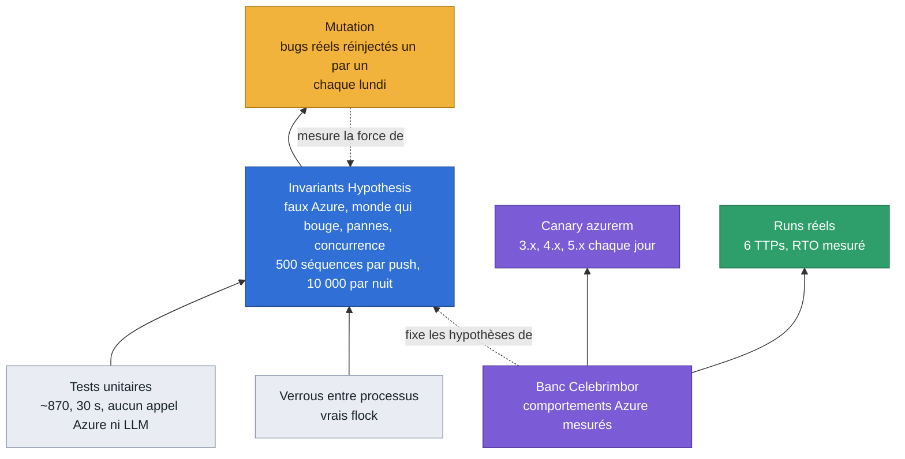
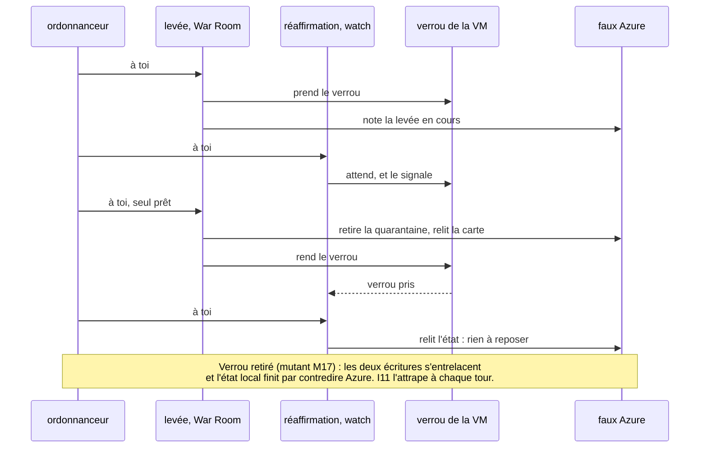
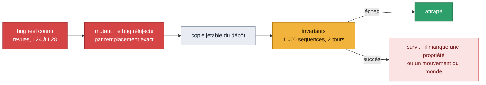
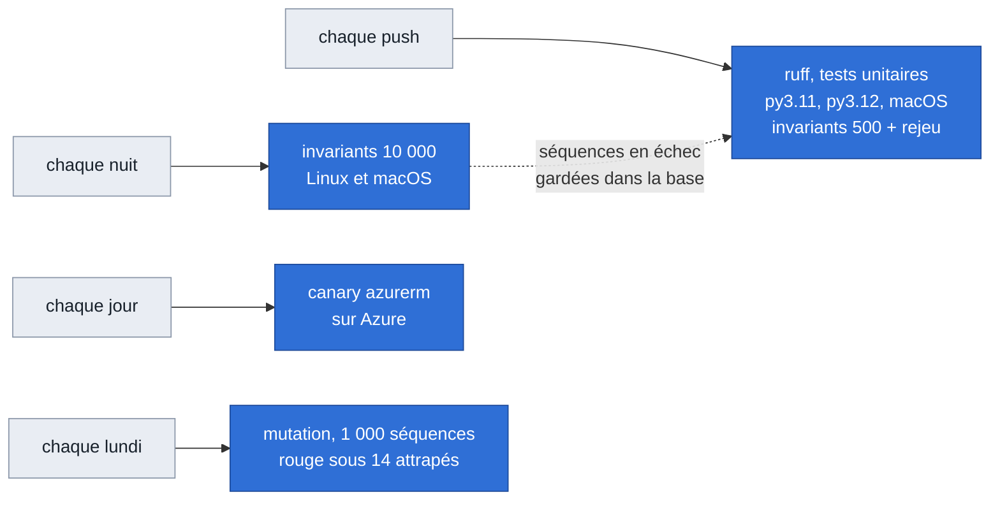

# Comment on prouve ce qu'on avance

Glorfindel modifie le réseau d'un client, parfois seul. Une affirmation du type « la VM est
isolée » doit donc être vraie, pas probable. Ce document montre les couches de preuve, ce que
chacune voit et ne voit pas, et ce qu'elles ont trouvé. Vue d'ensemble du produit :
[`../architecture.md`](../architecture.md).

## Les couches

| Couche | Ce qu'elle voit | Ce qu'elle ne voit pas |
|---|---|---|
| Tests unitaires | une fonction, un cas écrit à la main | les enchaînements, les cas auxquels personne n'a pensé |
| Invariants | des milliers de réseaux et de séquences tirés au hasard, avec pannes, monde qui bouge et deux opérations à la fois | ce que le faux Azure ne modélise pas (deux hôtes, couches au-dessus du NSG) |
| Mutation | si les invariants attrapent un bug connu | un bug d'une classe jamais vue |
| Verrous entre processus | l'exclusion mutuelle réelle de `flock` | un verrou entre deux hôtes |
| Banc Celebrimbor | le comportement réel d'Azure et de Terraform | la variété des réseaux clients |
| Canary azurerm | qu'un comportement mesuré du provider tient encore | Bicep, ARM, autres outils |
| Runs réels | la boucle complète, de l'attaque à la remise en service | la répétition à grande échelle |

Règle de travail : un comportement d'Azure ou de Terraform n'est affirmé qu'après une mesure
sur le banc. Le faux Azure reprend ces mesures ; ce qu'il suppose sans mesure est écrit en
tête de `tests/unit/fake_azure.py`.

## La machine à invariants

Les propriétés, vérifiées après chaque étape :

| | Propriété |
|---|---|
| I1 | aucune VM n'est plus joignable que son propriétaire ne l'a conçue |
| I2 | la configuration du client est ce qu'il a écrit en dernier ; une carte porte son NSG ou celui de quarantaine, jamais aucun ni un autre ; et, par auteur (journal des écritures de l'API), Glorfindel n'écrit que ce qui est à lui |
| I3 | aucun succès sur un mensonge : chaque vérification qui dit vrai est vraie, à chaque étape |
| I4 | une opération sur une VM ne change rien pour une autre, homonymes compris |
| I5 | la réaffirmation n'ouvre jamais rien, et n'écrit rien en `human_only` |
| I6 | une VM, un fichier d'état |
| I7 | depuis tout état atteint, la levée ramène chaque VM à sa conception, ou la garde en quarantaine en disant ce qui manque |
| I8 | ce qu'une opération laisse sur Azure est dans l'état |
| I9 | une levée commencée n'est jamais défaite par la réaffirmation |
| I10 | la configuration est respectée ; illisible, l'isolation n'écrit rien |
| I11 | deux opérations à la fois finissent comme l'une après l'autre : l'état local dit ce qu'Azure a |
| I12 | une VM d'un autre abonnement n'est jamais touchée, ni déclarée isolée |
| L1 | un blocage dont les règles ont disparu est reposé ou signalé, même derrière la quarantaine |
| U1 | une règle laissée par une carte qui n'existe plus, et qui coupe une carte vivante, est signalée |

**Des oracles qui ne demandent rien au code.** Ce qu'une propriété juge vient du journal du test :
la levée qu'il a demandée (I9), ce qu'il a perdu et quand (une carte « intraçable »), qui a écrit
quoi (I2 par auteur). Lire les marqueurs que le code pose revenait à le croire sur parole : un bug
qui efface l'état d'une carte gagnait l'exemption prévue pour une carte dont l'état est perdu (A0).

### Deux opérations à la fois

La War Room, la CLI et le watch sont trois processus qui peuvent viser la même VM. Un
ordonnanceur fait avancer deux opérations un appel Azure à la fois, dans un ordre tiré au
hasard, avec les vrais verrous. Un fil qui attend un verrou le signale ; il ne reçoit son tour
qu'une fois le verrou pris.

Le `flock` qui sépare les processus est testé à part, sur de vrais processus
(`tests/unit/test_locks.py`) : quatre processus sur le même verrou ne se chevauchent jamais,
l'ID canonique et l'ID en minuscules prennent le même verrou, une tâche de fond renonce au
bout de son délai. Sans `flock`, ces tests échouent.

## La mesure par mutation

Un test qui passe ne dit rien de sa force. `scripts/mutation_check.py` réinjecte, un par un,
des bugs que Glorfindel a vraiment eus, dans une copie jetable du dépôt, et regarde si les
invariants les attrapent.

| Étape | Attrapés à chaque tour, au budget du push |
|---|---|
| Invariants L24/L25, avant le monde qui bouge | 1 sur 17 |
| L26 : le monde bouge, quatre propriétés de plus | 15 sur 17 |
| L27 : deux opérations à la fois, verrou compris | 17 sur 22 (M01 à M25) |
| A0 : monde v3 (voir plus bas), 41 mutants | 22 sur 36 par les séquences tirées, les autres par leur séquence figée |

**Le jeu de contrôle.** Seize bugs plausibles proposés par la septième passe, jamais utilisés pour
orienter la génération (`--control`) : il mesure si la suite trouve ce qu'on ne lui a pas appris.
Au budget du push : 3 sur 16 à son arrivée, 6 après la première étape d'A0, **10 sur 16** à la fin
d'A0 (et 2 intermittents).

Écartés du décompte, avec leur raison écrite dans le harnais : **M11** (plus aucun appelant ne voit
un « not found » autre qu'un 404) et **M25** (depuis A0 le reset note son intention avant de toucher
Azure : l'état d'un reset partiel est tenu de toute façon). **M02** et **M14**, autrefois écartés,
sont attrapés depuis A0 : M02 par les isolations d'une ancienne version dans le monde, M14 par un
autre hôte qui écrit la carte juste après Glorfindel. M36 (fichier d'état ancien) n'est couvert que
par un test unitaire : il faut un crash entre deux opérations de fichier.

Les mutants M18 à M29 réinjectent les défauts trouvés par la machine elle-même. Les plus rares
(M21 à M24, trouvés à des milliers de séquences) ne sont pas attrapés à chaque tour au budget
du push ; leur séquence figée, elle, les attrape à chaque push.

### Les pannes des dépendances (G2)

Les invariants modélisent les pannes d'Azure sous l'isolation (429, crash, 403, disque plein).
G2 couvre les autres dépendances de la décision — le modèle, l'API du cloud au contrôle de
préparation, la télémétrie de l'enquête, la configuration — par dix-sept mutants mesurés par
`tests/unit/test_dependency_failures.py` (table `TESTS`). Les pannes passent par un cycle
complet du graphe, avec un témoin positif qui exécute quand rien ne tombe ; les lecteurs des
réglages (borne de l'appel, seuil, âge d'approbation, lecture seule, `docker-compose.yml`)
sont testés directement :

| Mutant | Panne réinjectée | Effet |
|---|---|---|
| M151 | l'appel de décision sans borne | un modèle pendu tient la file de la VM des heures, sans carte |
| M152 | VM jamais contrôlée tenue pour prête | Azure injoignable au contrôle : la VM agit seule |
| M153 | requête d'enquête en échec lue comme « aucune ligne » | isolation décidée sur une absence que la télémétrie n'a pas dite |
| M154 | garde de télémétrie retirée | idem, l'échec connu mais ignoré |
| M155 | `--mode` appliqué sur une configuration illisible | une VM épinglée `human_only` devient autonome |
| M156 | seuil de confiance illisible accepté | `nan` ou `-1` : la porte de confiance ne retient plus rien |
| M157 | interrupteur de lecture seule lu strictement | `on`, `TRUE` : les écritures restent ouvertes |
| M158 | âge maximal d'approbation `nan` ou `inf` accepté | une carte de tout âge s'exécute depuis la War Room |
| M170 | âge maximal d'approbation ≤ 0 ramené à 2 h | une approbation en un clic fermée exprès se rouvre |
| M171 | âge maximal ≤ 0 sans refus propre | une carte datée en avance sur l'horloge s'exécute |
| M172 | porte de confiance écrite `confiance < seuil` | une confiance `NaN` du modèle passe la porte |
| M173 | confiance du modèle non bornée | un 5.0 s'affiche 500 % sur la carte et dans la mémoire |
| M174 | requêtes en échec tues sur une carte retenue plus tôt | l'opérateur approuve sans savoir que l'enquête n'a rien lu |
| M175 | `GLORFINDEL_LLM_TIMEOUT_S` absent d'`x-env` | réglé dans `.envrc`, ignoré par les conteneurs |
| M176 | seuil lu dans l'agent par la War Room | un import en échec fait disparaître la matrice de capacités |
| M177 | `--mode` appliqué à la bannière sur une configuration illisible | la bannière annonce un mode que rien n'applique |
| M178 | carte d'une configuration illisible lue « réponse autonome configurée » | elle annonce un mode que personne n'a configuré |

M151–M158 : huit sur huit attrapés au premier tour (21/10) ; M170–M178, ajoutés après la
relecture : neuf sur neuf (21/10). Détail des pannes et de ce que fait Glorfindel :
[`../glorfindel.md`](../glorfindel.md), « Pannes des dépendances ».

### La stabilité de la décision (D-1)

La même force brute a reçu un blocage à 0,80 le 21/10, puis une isolation à 0,78 le 23/10.
D-1 fixe la température du premier tirage (0, ou l'échantillonnage par défaut d'un modèle
qui la refuse, comme `claude-sonnet-5-5`), et ne laisse partir seule une action disruptive
que si plusieurs tirages s'accordent. Treize mutants, mesurés par
`tests/unit/test_decision_stability.py` ; les cycles passent par le graphe complet là où la
carte compte :

| Mutant | Défaut réinjecté | Effet |
|---|---|---|
| M200 | premier tirage sans température | rien ne fixe le tirage, même sur un modèle qui l'accepte |
| M201 | refus de la température non rattrapé | `claude-sonnet-5-5`, le modèle par défaut : toute décision échoue |
| M202 | tirage dit fixé sur un modèle qui a refusé | la ligne de debug ment sur la reproductibilité |
| M203 | accord des tirages jamais vérifié | une action disruptive part sur un seul tirage |
| M204 | tirages de confirmation à la température du premier | ils répètent le premier au lieu de sonder la variance |
| M205 | tirage de confirmation sous le seuil compté d'accord | une isolation à 40 % confirme une isolation à 95 % |
| M206 | tirage en échec écarté, les autres comptés | un fournisseur qui tombe à mi-chemin laisse passer l'action |
| M207 | moins de tirages que demandé comptés d'accord | idem, sans même un échec |
| M208 | `GLORFINDEL_DECISION_DRAWS=1` accepté | un seul tirage, aucun accord |
| M209 | valeur illisible lue comme le défaut | une faute de frappe n'est plus vue |
| M210 | garde d'accord sans type de carte | la carte dit « confiance insuffisante » |
| M211 | carte instable non approuvable en un clic | l'opérateur ne peut pas exécuter le premier tirage qu'il juge bon |
| M212 | `GLORFINDEL_DECISION_DRAWS` absent d'`x-env` | réglé dans `.envrc`, ignoré par la watch |

Treize sur treize attrapés au premier tour (26/10). Détail :
[`../glorfindel.md`](../glorfindel.md), « Stabilité de la décision ».

### Une fenêtre d'exercice n'est plus crue sur parole (H-1)

Qui écrit dans `runs/exercises/` ou dans le canal pouvait faire passer une vraie attaque pour
un exercice. H-1 met les gardes côté lecteur : la watch, et H0 pour les campagnes. Dix-neuf
mutants, mesurés par `tests/unit/test_exercise_guard.py` (M57 suit la vérification des cibles
dans `_targets`) :

| Mutant | Défaut réinjecté | Effet |
|---|---|---|
| M220 | fenêtre plus longue que 2 h crue | une fenêtre d'un jour couvre toute la journée |
| M221 | fenêtre déclarée pour plus tard crue | elle couvre ce qui viendra |
| M222 | VM non inscrite marquée | la vraie charge passe pour un exercice |
| M223 | raccourci par `run_id` sur une VM que la fenêtre ne nomme pas | n'importe quelle VM marquée par un nom de run |
| M224 | carte d'exercice cachée de TO JUDGE | une vraie attaque couverte n'atteint jamais l'opérateur |
| M225 | fenêtre jamais purgée | son `run_id` marque encore des semaines plus tard |
| M226 | fenêtre nommée `watch-…` crue | une détection du RulePoller devient un exercice par son `run_id` |
| M227 | sans vérification d'inscription, tout est inscrit | une watch qui ne peut pas lire les tags croit toutes les fenêtres |
| M228 | lecture des tags en échec lue « inscrite » | un 403 ouvre la porte |
| M229 | fenêtre écrite aujourd'hui pour demain crue demain | le refus du futur ne dure qu'un jour |
| M230 | fenêtre purgée supprimée au lieu d'être vidée | le canal la ramène à chaque tirage |
| M231 | manifeste d'une autre forme accepté par H0 | rapport écrit sur un fichier forgé |
| M232 | run du canal sans fenêtre connue gardé | un run inventé entre dans les faits |
| M233 | run du canal sur une VM non inscrite gardé | idem, sur la vraie charge |
| M234 | run du canal sur une VM que sa fenêtre ne nomme pas gardé | idem |
| M235 | provenance des faits tue dans le rapport | le lecteur prend le manifeste pour une observation |
| M236 | scénario du canal mal formé gardé | des chiffres non typés dans les faits |
| M237 | rapport de run d'un autre run gardé | l'heure d'attaque d'un autre run |
| M238 | fenêtre de plus de 2 h bornant la recherche d'une décision | une décision de trois jours rattachée au run |

Dix-neuf sur dix-neuf attrapés au premier tour (26/10), et M57 aussi. Détail :
[`../glorfindel.md`](../glorfindel.md), « Une fenêtre n'est plus crue sur parole », et
[`../analysis.md`](../analysis.md), « Ce que H0 accepte du canal ».

### Le découpage d'`actions.py` (A1, MC0)

Un découpage ne doit rien changer : il est prouvé par ce qui précède, avant et après. Les
4 394 lignes d'`actions.py` ont été déplacées sans changement de texte
(`scripts/check_paragraphs.py --old 03b29ce:glorfindel/actions.py` retrouve chaque ligne, hors la
ligne `class AzureConnector(...)`), dans `glorfindel/response/` et `glorfindel/providers/azure/`.
Les mutants qui visaient `actions.py` visent maintenant le module où leur texte est arrivé (aucun
STALE). `glorfindel/actions.py` reste le chemin d'import, et un seul espace de noms : un
`monkeypatch` à travers lui atteint chaque module qui lit le nom — sans quoi le `conftest`
hermétique n'aurait redirigé l'état que dans un module, et les verrous auraient écrit sous le
vrai `~/.glorfindel`.

Mesuré le 26/10 au budget du lundi (1 000 séquences, 2 tours), avant (`03b29ce`) et après :

| | Avant | Après |
|---|---|---|
| Suite complète | 1 535 | 1 549 (+ 14 tests d'A1) |
| Invariants à 500 séquences, rejeu, verrous | verts | verts (31) |
| Harnais, attrapés à chaque tour | 216 sur 230 | 227 sur 240 (217 sur 230, et les 10 d'A1) |
| Jeu de contrôle | 11 sur 16 | 11 sur 16 (C07, C10, C12 survivent avant comme après) |

Les écarts sur M01–M41 sont ceux du tirage (M22, M23, M28, M31, M32, M36, M38, M39 passent
de « flaky » à « figé seulement » ou l'inverse) : aucun mutant attrapé à chaque tour avant ne
l'est plus après.

Quatorze mutants pour ce qu'A1 et MC0 ajoutent (M460–M463 après la relecture), tous attrapés au premier tour (26/10), mesurés par
`tests/unit/test_actions_split.py`, `test_provider_boundary.py`, `test_readiness.py` et
`test_jobs.py` :

| Mutant | Défaut réinjecté | Effet |
|---|---|---|
| M450 | une écriture à travers la façade n'atteint qu'un module | les verrous restent sous le vrai `~/.glorfindel` |
| M451 | la façade lie des copies | une valeur que son module change (`_warmed_up`) se lit périmée |
| M452 | un module du découpage oublié par la façade | ses noms injoignables par `glorfindel.actions` |
| M453 | droits des règles lus sur ceux de la quarantaine | « blocage possible » sans droit sur les règles |
| M454 | capacité disponible malgré ses droits manquants | « prête » sans les droits |
| M455 | capacité non déclarée comptée disponible | un fournisseur sans coupure de sessions passe pour l'avoir |
| M456 | connecteur sans déclaration lu comme Azure | un second fournisseur jugé sur les droits d'Azure |
| M457 | la frontière laisse le SDK d'un fournisseur dans l'adaptateur d'un autre | le contrôle de CI ne voit plus la fuite |
| M458 | la déclaration d'Azure dérive de `check_permissions` | la préparation lit un droit que personne ne vérifie |
| M459 | job de restauration relu dans le groupe de la VM | le statut d'une restauration jamais trouvé |
| M460 | capacités lues sur `type()` | un `MagicMock(spec=AzureConnector)` fait tomber la préparation |
| M461 | la déclaration portée par l'instance ignorée | un connecteur jugé sur les droits de sa classe |
| M462 | une dette du socle partagé déclarée adaptateur | la frontière ne la voit plus |
| M463 | suppression à travers la façade ignorée en silence | `mock.patch` laisse sa valeur dans tous les modules |

### Le monde simulé AWS (MC1)

Les invariants tournent aussi sur un faux AWS (`tests/unit/fake_aws.py`), avec l'adaptateur AWS
écrit contre lui (`glorfindel/providers/aws/`) : `tests/unit/test_invariants_aws.py`, la même
machine, le même harnais (pannes, deux opérations à la fois avec les vrais verrous, journal par
auteur), les mêmes réglages `GLORFINDEL_INVARIANT_*` ; en CI, à 500 séquences avec le reste. Code
seul : aucun appel AWS, aucun compte. **La sémantique d'AWS du faux monde est faite d'hypothèses
tirées de la documentation, toutes à mesurer sur le banc AWS (MC2)** : leur liste (H1–H14), ce
qu'isoler, bloquer et lever veulent dire sur AWS et la transposition de chaque invariant sont dans
[`monde-aws.md`](monde-aws.md). I1–I12 et L1 tiennent, transposés là où AWS diffère (I4 : tout
blocage est à l'échelle de l'ACL : tous les sous-réseaux qui lui sont associés, souvent tout le VPC pour l'ACL par défaut, et le blocage d'une autre instance tient ; I10 : pas de repli par
règles ; I12 : compte et région) ; U1 n'a pas d'équivalent.

Ce que la machine AWS a trouvé dans l'adaptateur en se construisant, avant toute revue :

| Défaut | Effet avant correction |
|---|---|
| un blocage réutilisait les entrées d'un autre, qu'une autorisation ajoutée depuis par le client précède | « bloqué », l'instance joignait l'attaquant sur ses ports hauts |
| le blocage n'était pas relu | idem, dès qu'une entrée posée passe après une autorisation |
| une ENI laissée sur `default`, un de ses groupes d'origine supprimé | la levée retentait l'origine de l'état, jamais le tag que l'opérateur pose |

Mesuré le 26/10 au budget du lundi (1 000 séquences, 2 tours). Dix-huit mutants, M600–M617 :
les défauts trouvés, et ceux que la note de conception ou l'histoire d'Azure nomment. M600, M601,
M602, M608, M612 et M614, rares dans les séquences tirées (M600 trouvé à 5 000), sont aussi mesurés
par leur cas écrit à la main (`tests/unit/test_aws_adapter.py`) ; M617, une fausse alerte sans
fausse affirmation, par lui seul.

| Mutant | Défaut réinjecté | Attrapé |
|---|---|---|
| M600 | un blocage réutilise une entrée qu'une autorisation du client précède | à chaque tour |
| M601 | le blocage n'est pas relu | à chaque tour |
| M602 | ENI sur `default`, groupe d'origine supprimé : l'origine de l'état, jamais le tag | à chaque tour |
| M603 | quarantaine éteinte ignorée : écritures sans repli (I10) | à chaque tour |
| M604 | DNS et IMDS d'Amazon non déclarés par l'isolation (H6) | à chaque tour |
| M605 | une ENI laissée sur `default` ne retrouve pas son origine (U2) | à chaque tour |
| M606 | ré-isoler une ENI laissée sur `default` note `default` comme origine (U2) | un tour sur deux |
| M607 | ENI déjà en quarantaine : ce qu'elle porte lu comme son origine (S1) | à chaque tour |
| M608 | une autorisation ajoutée au groupe de quarantaine y reste | à chaque tour |
| M609 | une vérification qui ne lit pas une ENI dit « isolée » | à chaque tour |
| M610 | l'isolation n'est pas notée (I8) | à chaque tour |
| M611 | une levée en échec efface l'état (I8) | à chaque tour |
| M612 | pas de verrou par ACL : un déblocage retire les entrées qu'un blocage voisin réutilise | à chaque tour |
| M613 | verrou de l'instance inopérant (le M17 d'AWS) | un tour sur deux |
| M614 | une entrée lue comme de Glorfindel quelle que soit l'adresse qu'elle refuse | à chaque tour |
| M615 | un déblocage garde le blocage noté | à chaque tour |
| M616 | `verify_isolation` se porte garant d'une instance d'un autre compte (I12) | à chaque tour |
| M617 | isolation vérifiée sur les ENI lues avant l'échange | à chaque tour |

La relecture de MC1 a trouvé quatre trous, corrigés : un blocage annonçait le sous-réseau de
l'instance alors qu'une ACL en sert souvent plusieurs (celle par défaut d'un VPC sert tous les
sous-réseaux qu'on n'a pas associés ailleurs) ; un groupe de quarantaine privé de son tag
`managed-by` laissait la levée dire `released`, état effacé, l'ENI encore dedans ; la garde de compte
et de région s'ouvrait quand l'adaptateur n'en avait pas ; une instance sans interface était dite
isolée. Six mutants de plus, M618–M623, mesurés par leurs cas de `tests/unit/test_aws_adapter.py` :

| Mutant | Défaut réinjecté |
|---|---|
| M618 | un blocage ne nomme que les sous-réseaux de l'instance, pas tous ceux de son ACL |
| M619 | une ENI qui porte un groupe nommé comme la quarantaine, que rien ne note, dite levée |
| M620 | garde ouverte sans compte ni région configurés (I12) |
| M621 | une instance sans interface dite isolée |
| M622 | le groupe de quarantaine noté dans l'état ignoré une fois son tag perdu |
| M623 | `verify_release` aveugle à un groupe nommé comme la quarantaine |

**Le jeu de contrôle sur AWS.** Seize bugs plausibles de l'adaptateur, M630–M645, écrits et commités
avant la machine AWS (dans le même commit que l'adaptateur) et jamais utilisés pour l'orienter, dans la
discipline de C01–C16 (`--control`). Au budget du lundi, **AWS 9 à 10 sur 16, Azure 9 à 11 sur 16,
selon le tirage** : 10 sur 16 sur la machine finale (M631 un tour sur deux), 9 sur 16 à la relecture
(M638 survit, M630 un tour sur deux, M631 attrapé) ; Azure 11 puis 10 sur 16 sur la base, 9 sur 16 sur
la branche à la relecture, code identique. M630, M631 et M638 sont au bord du tirage. Les survivants
constants, ce qu'il manque pour les voir — non ajouté, pour ne pas orienter la génération sur eux :

| Mutant | Défaut | Ce que la machine ne joue pas |
|---|---|---|
| M633 | les groupes d'une ENI écrits sans vérifier ce qu'elle porte | quelqu'un qui change l'ENI entre la lecture de Glorfindel et son écriture |
| M636 | une entrée numérotée sans regarder les autorisations du client | rien de faux n'est dit : la relecture (M601) dit `partial` ; aucune propriété n'exige qu'un blocage possible soit posé |
| M640 | un blocage vérifié sans les entrées qui le précèdent | une autorisation du client glissée devant sur un port que les sondes regardent |
| M641 | une ENI qui porte la quarantaine parmi d'autres groupes, lue isolée | quelqu'un qui ajoute un groupe à une ENI en quarantaine |
| M644 | un groupe au nom de la quarantaine, sans son tag, adopté | un groupe du client qui porte ce nom (un test unitaire le couvre) |

**Azure inchangé.** Aucun fichier d'Azure n'a bougé (seule la docstring de
`glorfindel/providers/__init__.py`). Mesuré au même budget, avant (`18df2d6`) et après :

| | Avant | Après |
|---|---|---|
| Suite complète | 1 654 | 1 680 (+ 26 tests de MC1) |
| Invariants Azure à 500 séquences, rejeu, verrous | verts (31) | verts (31) |
| Harnais, mutants d'Azure attrapés à chaque tour | 297 sur 311 | 299 sur 311 |
| Jeu de contrôle d'Azure | 11 sur 16 (10 à la relecture) | 10 sur 16 (C05 ; 9 à la relecture) |

Les écarts sont ceux du tirage : M34 passe de « attrapé » à « un tour sur deux », M21, M36, M41
l'inverse ; C05 survit à 2 tours. Remesurés à 4 tours sur le code d'après, C05 et M34 sont attrapés
3 fois sur 4, M21 4 fois sur 4, M36 jamais (il était « un tour sur deux » avant) : des mutants au bord
du tirage, comme A1 l'avait noté pour M22–M39.

### Ce qui a changé depuis la campagne précédente (D-2)

Le rapport de campagne se compare à la campagne précédente. Le code la choisit par une règle :
la dernière campagne `done` antérieure qui partage une clé (une technique sur une VM). Il joint
les runs par clé en faits typés, rend la section, et écarte un écart qui ne vient pas d'un
fait. Vingt mutants, mesurés par `tests/unit/test_campaign_changes.py`, sur des campagnes
écrites sur le disque :

| Mutant | Défaut réinjecté | Effet |
|---|---|---|
| M260 | campagne `aborted` choisie | le rapport se compare à une campagne interrompue |
| M261 | campagne postérieure choisie | il se compare à l'avenir |
| M262 | campagne sans clé commune choisie | aucune ligne à comparer, la vraie précédente ignorée |
| M263 | clé sans la VM | une technique sur une autre VM passe pour la même |
| M264 | la plus ancienne choisie | l'écart porte sur une campagne dépassée |
| M265 | section muette sans précédente | le lecteur ne sait pas pourquoi rien n'est comparé |
| M266 | VM comparée avec sa casse | la même VM, écrite autrement, n'a plus de précédent |
| M267 | clés d'un seul côté tues | une technique qui n'est plus jouée disparaît sans un mot |
| M268 | scénario sauté compté comme clé | une technique jamais jouée est comparée |
| M269 | runs indexés sans l'état ni le début de leur campagne | aucun rapport n'a jamais de précédente |
| M270 | deux runs d'une même clé appariés à l'envers | le premier fait face au dernier |
| M271 | section absente du rapport | la comparaison calculée n'est pas rendue |
| M272 | faits de changement absents du message au modèle | il ne peut pas les citer |
| M273 | affirmation `change` sans fait de changement gardée | un écart affirmé sans fait |
| M274 | nombre absent des faits cités gardé | « 40 s plus tard » quand l'écart est de 15 s |
| M275 | nombres d'une tendance non contrôlés | le même écart inventé, écrit en `trend` |
| M276 | noms lus comme des nombres | « T1110.001 » écarte une affirmation juste |
| M277 | `value` d'un changement non contrôlé | une action qu'aucun fait ne porte |
| M278 | campagne reversée : faits recalculés | une décision vue par le rapport devient inconnue après la purge |
| M279 | campagne en cours versée dans l'index | des faits incomplets entrent dans l'index |

Vingt sur vingt attrapés au premier tour (26/10). La relecture de D-2 a trouvé quatre trous dans
la vérification : un écart inventé passait s'il était écrit en `observation` ; « a isolé » sur
une décision inconnue passait dès qu'un fait de changement était cité ; des tendances justes
étaient barrées (un écart entre deux runs, « le 21 octobre », « en 2026 », « au 2ᵉ run », « dans
les 2 campagnes ») ; le sens d'un changement n'était pas lu. M275 et M276 suivent le code
corrigé. Dix mutants de plus, dans la plage M510–M519 (M260–M279 est pleine), mesurés par le
même fichier :

| Mutant | Défaut réinjecté | Effet |
|---|---|---|
| M510 | nombres d'une `observation` qui cite un fait de changement non contrôlés | « vue 40 s plus tard » gardé en `observation` |
| M511 | fait de changement cité : « a isolé » permis quels que soient ses côtés | une décision inconnue dite prise |
| M512 | écart entre deux runs cités refusé | « augmente de 15 s » barré dans une tendance juste |
| M513 | date en toutes lettres, année, ordinal lus comme des nombres | « le 21 octobre », « en 2026 », « au 2ᵉ run » barrés |
| M514 | décompte lu comme un nombre de fait | « dans les 2 campagnes » barré |
| M515 | décompte sans borne | « dans les 3 campagnes » gardé avec deux runs cités |
| M516 | action ou détection absente des faits gardée | « de detected à missed » sur une clé détectée deux fois |
| M517 | passage d'une action à une autre non contrôlé | « de l'isolement au blocage » quand c'est l'inverse |
| M518 | nombres à l'envers gardés | « de 106,9 s à 91,9 s » quand la latence a augmenté |
| M519 | côté d'un fait lu sur l'identifiant du run | un run sans `run_id` dit « seulement dans la précédente » |

Les trente (M260–M279, M510–M519) attrapés au premier tour (26/10), aucun périmé.

La deuxième relecture de D-2 a trouvé un bug et des trous bon marché : l'unité de « de X à Y »
était obligatoire (un `?` portait sur le lookahead de l'unité), si bien que « de 0,78 à 0,8 »
ou « de 107 à 92 secondes » n'étaient pas lus ; le sens et les actions d'une `trend` n'étaient
pas contrôlés ; une durée inventée passait pour un décompte (« vue 1 heure plus tard ») ; un
nombre était accepté quelle que soit son unité (« vue en 2 s » parce que 2 est un écart de
points) ; « entre le 21 et le 23 octobre » était barré ; une `observation` qui cite un fait de
changement pouvait nommer une action qu'aucun fait ne porte. La session principale a tranché :
c'est la dernière correction de cette famille ; la section calculée fait foi, et ce qui reste
est écrit dans les limites connues. M513, M516 et M518 suivent le code corrigé. Dix mutants de
plus, dans la plage M530–M539 (M510–M519 est pleine), mesurés par le même fichier :

| Mutant | Défaut réinjecté | Effet |
|---|---|---|
| M530 | unité obligatoire dans « de X à Y » | « de 0,78 à 0,8 » à l'envers gardé |
| M531 | sens d'une `trend` non lu | « passe de 106,9 s à 91,9 s » gardé en tendance |
| M532 | actions d'une `trend` non contrôlées | « wipe_storage cette fois » gardé en tendance |
| M533 | actions d'une `observation` qui cite un fait de changement non contrôlées | « a pris un wipe_storage » gardé |
| M534 | tout mot fait un décompte | « vue 1 heure plus tard » gardé |
| M535 | unité ignorée | « vue en 2 s » gardé, 2 étant un écart de points |
| M536 | durée non convertie | « 15 ms plus tard » lu 15 s, gardé |
| M537 | plage de dates lue comme des nombres | « entre le 21 et le 23 octobre » barré |
| M538 | écart relatif refusé | « +16 % » barré quand la latence passe de 91,9 s à 106,9 s |
| M539 | « de X à Y » qui part d'un côté sans arriver à l'autre gardé | « de 91,9 s à 15 s » gardé |

Les quarante (M260–M279, M510–M519, M530–M539) attrapés à chaque tour (26/10), aucun périmé.

La troisième relecture de D-2 a trouvé un faux positif réel, introduit par M539 : une `trend`
ne mettait face à face qu'un run antérieur et un run de cette campagne, si bien qu'une
tendance juste sur trois campagnes (« de 120 s (19/10) à 91,9 s (21/10), puis à 106,9 s »,
« 0,85 → 0,80 → 0,78 », « du blocage à l'isolement (avant), puis retour au blocage ») était
barrée. Deux runs antérieurs de la même technique se font maintenant face aussi, dans les deux
sens : leur ordre n'est pas connu. Un sens inversé entre un run antérieur et un run de cette
campagne reste écarté, sauf quand un autre run antérieur cité porte la même action, ou la même valeur, que le run de cette campagne : la tendance peut alors décrire le passage entre deux runs antérieurs, dont l'ordre n'est pas lu (limite
connue, voir [`../analysis.md`](../analysis.md)). Et deux trous bon marché : une date en anglais (« since October 21 »)
était lue comme un nombre, et un nombre nu avant une date (« baisse de 12, le 23 octobre »)
était avalé comme premier jour d'une plage. M513 et M537 suivent le code corrigé. Cinq mutants
de plus, M540–M544 (M530–M539 est pleine), mesurés par le même fichier :

| Mutant | Défaut réinjecté | Effet |
|---|---|---|
| M540 | deux runs antérieurs jamais face à face | « 120 s → 91,9 s → 106,9 s » barré |
| M541 | deux runs antérieurs face à face dans l'ordre cité seulement | la même tendance barrée selon l'ordre de ses runs |
| M542 | deux runs antérieurs de techniques différentes face à face | « de l'isolement au blocage » gardé, l'isolement étant celui d'une autre technique |
| M543 | mois anglais absents | « since October 21 » barré |
| M544 | une plage de dates sans « le », « entre », « du », « des », « aux »… devant | « baisse de 12, le 23 octobre » gardé |

Les quarante-cinq (M260–M279, M510–M519, M530–M544) attrapés (26/10), aucun périmé.

La quatrième relecture a trouvé une régression de M544 : « les runs des 21 et 23 octobre »,
« aux 21 et 23 octobre » étaient barrés (21 lu comme un nombre). « des », « aux », « au » (et
« the ») ouvrent maintenant une plage, « de » toujours pas ; « du 21 et du 23 octobre » est
lu ; un jour de plage va de 1 à 31, si bien que « between 70 and 60, 23 October » n'est plus
avalé. Trois mutants de plus, M545–M547 :

| Mutant | Défaut réinjecté | Effet |
|---|---|---|
| M545 | un jour de plage peut être n'importe quel nombre | « between 70 and 60, 23 October » gardé |
| M546 | « des », « aux », « au » n'ouvrent pas une plage | « les campagnes des 21 et 23 octobre » barré |
| M547 | « du » refusé à l'intérieur d'une plage | « du 21 et du 23 octobre » barré |

Avec M280–M289 et M520–M528 de M-3, venus de main, tous attrapés au premier tour (26/10),
aucun périmé.

D2b a repris les trois points que les relectures de D-2 avaient laissés. Une tendance met
désormais ses runs face à face dans l'ordre où ils ont été joués (le début de leur campagne,
gardé dans l'index, ou son identifiant quand c'est une date ; le `seq` dans une campagne) : une
paire de runs antérieurs ne sert plus d'alibi. Le début d'une campagne venue du canal est borné
par ce que H0 a vu (la première fenêtre crue de ses runs, le marqueur `.pulled`) : une date
forgée ne change plus la campagne précédente. « au » et « the » seuls n'ouvrent plus une plage
de dates ; « au 21 et au 23 », « from the 21 to the 23 », « on the 21st and 23rd » en sont.
M540–M542, M546 et M547 suivent le code corrigé. Dix-sept mutants, M650–M666, mesurés par le
même fichier :

| Mutant | Défaut réinjecté | Effet |
|---|---|---|
| M650 | ordre des runs d'une tendance non lu | une paire de runs antérieurs sert d'alibi à « de l'isolement au blocage » |
| M651 | runs face à face à rebours du temps | « de 120 s (19/10) à 91,9 s (21/10) » barré |
| M652 | début de campagne de l'index non lu avec le run | l'ordre retombe sur l'inconnu |
| M653 | runs de cette campagne sans son début | le run d'une campagne postérieure passe pour antérieur |
| M654 | identifiant daté ignoré | des runs indexés sans début restent sans ordre |
| M655 | deux runs d'une campagne non ordonnés par `seq` | l'alibi revient dans une seule campagne |
| M656 | début du manifeste après la première fenêtre cru | une date forgée choisit une campagne postérieure |
| M657 | début du manifeste bien avant la première fenêtre cru | une date forgée saute la vraie précédente |
| M658 | début du manifeste après le tirage par H0 cru | sans fenêtre, rien ne borne la date |
| M659 | début refusé tu | le lecteur ne sait pas que la date a été écartée |
| M660 | début refusé gardé | la date forgée choisit quand même |
| M661 | fenêtre refusée par H-1 prise pour borne | une fenêtre forgée couvre une date forgée |
| M662 | « au » ouvre une plage | « tombe au 12, le 23 octobre » gardé |
| M663 | « the » seul ouvre une plage | « by the 12, 23 October » gardé |
| M664 | « au 21 et au 23 octobre » lu comme des nombres | une tendance juste barrée |
| M665 | « au », « aux », « the » refusés dans la suite d'une plage | « From the 21 to the 23 October » barré |
| M666 | jours sans « st », « nd », « rd » | « On the 21st and 23rd October » barré |

La relecture de D2b a trouvé un bug : une date que le manifeste donne et qu'aucune date UTC ne
tient (« 9999-12-31T23:59:59-05:00 », l'an 10000 en UTC) était bien refusée, puis le message
qui le disait levait, et le rapport n'était jamais écrit. Elle a aussi noté qu'un début devenu
inconnu laissait l'ancien dans l'index (ChromaDB fusionne les métadonnées d'une ligne), et que
la condition « deux runs de cette campagne ne font pas une tendance » n'était pas mesurée.
Trois mutants de plus :

| Mutant | Défaut réinjecté | Effet |
|---|---|---|
| M667 | date hors de portée UTC non rattrapée | le rapport de la campagne n'est jamais écrit |
| M668 | début inconnu absent de la ligne | le début forgé d'une indexation antérieure reste, et peut être choisi |
| M669 | deux runs de cette campagne face à face dans une tendance | un sens pris dans la seule campagne passe pour une tendance |

Avec M163, M260–M279, M510–M519 et M530–M547, les soixante-neuf attrapés au premier tour
(26/10), aucun périmé.
Détail : [`../analysis.md`](../analysis.md), « Ce qui a changé depuis la campagne précédente ».

### L'hôte de Glorfindel : référence épinglée, verrou, un environnement par conteneur, boutons (M-3)

H0 déployait la tête de `main`, sans verrou de dépendances ; les trois conteneurs recevaient tous
les secrets ; un bouton Discord obéissait à qui cliquait. Dix-neuf mutants (dix du lot, neuf
de sa relecture), mesurés par `tests/unit/test_bot.py`, `test_glorfindel_host.py`,
`test_host_deploy.py` et `test_dependency_lock.py` :

| Mutant | Défaut réinjecté | Effet |
|---|---|---|
| M280 | un bouton Discord obéit à qui clique | n'importe qui sur le serveur lance un Restore |
| M281 | sans liste d'autorisés, tout clic passe | les boutons ouverts par défaut |
| M282 | n'importe quel rôle autorise un clic | un rôle sans rapport suffit |
| M283 | un clic refusé n'est pas journalisé | une tentative ne laisse pas de trace |
| M284 | le jeton du bot revient à chaque conteneur | un conteneur compromis a le bot |
| M285 | la War Room reçoit les clés des modèles | elle n'en appelle aucun et les tient quand même |
| M286 | la watch ne connaît le bot que par son jeton | chaque carte part aussi au webhook |
| M287 | H0 déploie une branche : toute révision se résout | la tête de `main` revient sur l'hôte |
| M288 | l'image ne porte pas sa référence | on ne sait plus ce qui tourne |
| M289 | l'image résout ses dépendances sans verrou | une version mineure change les décisions |
| M520 | un clic refusé est dit, puis passe à son action | le refus n'empêche rien |
| M521 | un salon Discord seul fait taire le webhook, sans bot | les escalades ne partent nulle part |
| M522 | la watch et la War Room reçoivent le jeton du bot, pas seulement sa présence | le secret voyage |
| M523 | la watch compte un salon seul comme une alerte | l'avertissement « aucune alerte » se tait |
| M524 | `REF=--checkout-only` atteint `deploy.sh` comme une option | un checkout sans reconstruction, dit comme un déploiement |
| M525 | une `REF` exportée dans l'environnement est déployée en silence | un nom générique choisit ce qui tourne |
| M526 | make développe une `REF` refusée en l'exportant | `$(shell …)` s'exécute |
| M527 | la ligne ssh recopie `REF` dans la recette | make la développe avant qu'elle soit vérifiée |
| M528 | règles approuvées sur la VM que la référence change : « gardé », puis git refuse (depuis P1 : un fichier de règles modifié refusé sans dire comment migrer) | l'opérateur répare et efface les règles |

Dix-neuf sur dix-neuf attrapés, trois tours (26/10, #202). Détail :
[`../../infra/glorfindel-host/README.md`](../../infra/glorfindel-host/README.md), « Ce que la VM
exécute » et « Redéployer H0 après M-3 ».

### Les couches de règles (P1)

La base livrée reste intacte ; les règles du client vivent dans leur couche,
`~/.glorfindel/client_rules.yaml`, chargée par-dessus ; une entrée invalide de la couche ne
coupe jamais la détection ; une règle approuvée se lie au backend de son workspace. Vingt-deux
mutants, mesurés par `tests/unit/test_rule_layers.py`, `test_proposed_rules.py` et
`test_host_deploy.py`, tous attrapés au premier tour (26/10) ; M528 (M-3) suit le nouveau refus
de `deploy.sh`, attrapé aussi. L'export d'une règle généralisée, sans identifiant, est reporté à
un lot rattaché à P2 (relu par un humain avant tout envoi) : ses mutants (M679–M684, M689–M694,
M700–M712, M717–M719) sont partis avec lui ; les numéros laissent un trou.

| Mutant | Défaut réinjecté | Effet |
|---|---|---|
| M670 | la règle approuvée écrite dans la base livrée | une mise à jour la perd |
| M671 | la couche du client pas chargée | une mise à jour « perd » toutes les règles du client |
| M672 | la règle de base gagne sur celle du client de même nom | la version du client ignorée |
| M673 | `disable:` ignoré | une règle de base que le client a désactivée tourne |
| M674 | une règle de base remplacée sans le dire | rien dans les notes ni la bannière |
| M675 | les notes pas journalisées | le journal de la watch ne dit rien de la couche |
| M676 | une couche illisible empêche la base de charger | la watch ne détecte plus rien |
| M677 | une couche illisible lue vide, puis écrite par-dessus | les règles du client effacées |
| M678 | la proposition approuvée avant que sa règle soit écrite | « approuvée » sans règle |
| M685 | la migration ne prend que les règles nouvelles | une règle de base modifiée sur la VM perdue |
| M686 | la migration oublie une règle de base supprimée sur la VM | elle revient |
| M687 | H0 : un fichier de règles modifié repart dans l'image | les règles approuvées avant P1 jamais migrées |
| M688 | la base montée en écriture dans la watch | un conteneur peut de nouveau l'écrire |
| M695 | une entrée de la couche pas validée | `interval_s: 30s` : plus aucune règle, base comprise |
| M696 | une clé de la couche qui n'est pas une liste pas dite | des règles absentes en silence |
| M697 | la règle approuvée reprend la forme en ligne | elle ne s'applique à aucune VM |
| M698 | la migration ne lie pas une règle en ligne à son backend | une règle d'avant P1 reste inerte |
| M699 | une règle qui ne s'applique à aucune VM pas dite au chargement | inerte en silence |
| M713 | `glorfindel rules` cache le backend d'une règle auto | liée et inerte se confondent |
| M714 | une règle approuvée d'un autre workspace prend le backend de la première règle | elle tourne sur le mauvais workspace |
| M715 | une config illisible lue « aucun backend » par `migrate-rules` | la vraie cause tue |
| M716 | une couche ignorée dite « absente » | contredit la note |

### Annatar et Gothmog exigent Glorfindel (V1)

Avant chaque run, et avant tout appel au cloud, l'injecteur lit le battement de la watch
(`eregion_core/watch_gate.py`) et refuse sans battement vivant ; `--without-glorfindel` passe, et
le rapport le dit. Le cloud des tests échoue si on l'appelle : le contrat d'Orodruin, l'exécuteur
de la cible et le réseau lèvent, et chaque tentative est notée. Trente mutants, mesurés par
`tests/unit/test_watch_gate.py` et `tests/unit/test_gothmog.py`, tous attrapés au premier tour
(27/10) ; M750–M759 après la relecture.

| Mutant | Défaut réinjecté | Effet |
|---|---|---|
| M720 | `annatar run` sans watch vivante pas refusé | l'attaque part, détection jamais mesurée |
| M721 | Annatar lit la watch après le contrat d'Orodruin | un appel au cloud avant le refus |
| M722 | un atomic `--without-glorfindel` ne le dit pas au rapport | un run de dév pris pour un `unknown` |
| M723 | un script `--without-glorfindel` ne le dit pas au rapport | idem |
| M724 | `gothmog run` sans watch vivante pas refusé | la panne part sans personne pour la voir |
| M725 | Gothmog lit la watch après le contrat d'Orodruin | un appel au cloud avant le refus |
| M726 | une panne `--without-glorfindel` ne le dit pas au rapport | « rien de disruptif » sans watch |
| M727 | `gothmog preflight` ignore la watch | « la panne pourrait partir », puis refus au run |
| M728 | une campagne sans watch démarre | passe `running`, chaque run en erreur |
| M729 | une campagne continue après un refus pour watch absente | une chaîne de refus marqués erreurs |
| M730 | `campaign run --without-glorfindel` n'atteint pas ses runs | chaque run refusé |
| M731 | un battement de n'importe quel âge vaut une watch | une watch arrêtée depuis des jours compte |
| M732 | le canal retour n'est pas lu | depuis Orodruin, la watch hébergée jamais vue |
| M733 | un canal illisible lève au lieu de refuser | une trace au lieu d'une raison |
| M734 | H0 accepte un run sans Glorfindel qui revendique un verdict | un `detected` sans watch |
| M735 | la console perd le drapeau | un run de dév affiché `unknown` |
| M736 | un script `--without-glorfindel` attend encore la détection | 30 s perdues, puis `unknown` |
| M737 | un atomic `--without-glorfindel` attend encore la détection | idem |
| M738 | `make gothmog-run` perd `WITHOUT_GLORFINDEL` | la dérogation ne passe pas sur Orodruin |
| M739 | `make orodruin-campaign-run` perd `WITHOUT_GLORFINDEL` | idem pour une campagne |
| M750 | une campagne `--without-glorfindel` ne le dit pas dans son manifeste | ses runs comptés « sans mesure », sans raison |
| M751 | une campagne reprise avec un autre réglage | détections mesurées et non mesurées mêlées |
| M752 | une campagne sans Glorfindel a un rapport d'analyse | « décision inconnue » cherchée, appel au modèle |
| M753 | H0 écrit le rapport d'une campagne sans Glorfindel | idem, sur H0 |
| M754 | une campagne sans Glorfindel entre dans l'index | choisie comme précédente (D-2) |
| M755 | une campagne `aborted` sort en 0 | `make orodruin-campaign-run` réussit |
| M756 | un battement daté dans le futur reste frais | une horloge fausse vaut une watch pour toujours |
| M757 | `WITHOUT_GLORFINDEL=0` lève l'exigence | la dérogation par erreur |
| M758 | un fichier local vivant compte malgré le canal | une watch locale prise pour la watch hébergée |
| M759 | la console compte une campagne sans Glorfindel en `unknown` | un run de dév pris pour un trou |

### L'IA d'analyse : son modèle, sa mémoire, le tri, rien sans un humain (IA1)

L'IA d'analyse refuse le modèle de décision de Glorfindel et toute mémoire rangée dans son état
(`analysis/separation.py`). Le tri d'une campagne (`analysis/triage.py`) est calculé depuis les
runs, le catalogue, les règles et le code d'infrastructure ; le modèle explique et propose ; la
vérification écarte ce que les faits ne portent pas, et chaque proposition attend un humain. Vingt
mutants, mesurés par `tests/unit/test_analysis_separation.py` et `tests/unit/test_analysis_triage.py`
(les cas du harnais y tournent avec un modèle simulé), tous attrapés au premier tour (27/10).

| Mutant | Défaut réinjecté | Effet |
|---|---|---|
| M780 | le modèle de décision de Glorfindel accepté | le rapport partage les angles morts du défenseur |
| M781 | le modèle comparé avec son préfixe | `claude-sonnet-5-5` passe pour un autre que `anthropic/claude-sonnet-5-5` |
| M782 | le chemin de l'index lu sans être résolu | `..` ou un lien mènent dans `~/.glorfindel` |
| M783 | l'index permis dans l'état de Glorfindel | l'analyse écrit dans la mémoire du défenseur |
| M784 | le rapport ouvre son index sans le contrôle | idem, par `EREGION_ANALYSIS_INDEX` |
| M785 | le rapport appelle son modèle sans le contrôle | idem, par `EREGION_ANALYSIS_MODEL` |
| M786 | une escalade triée avant une technique manquée | ce qui est passé n'est plus en tête |
| M787 | un commentaire du code d'infrastructure vaut collecte | « collectée » sur une ligne que Terraform ignore |
| M788 | `disable:` de la couche du client ignoré | une règle désactivée « surveille » encore |
| M789 | une proposition que les faits ne portent pas gardée | « écrire une règle » quand une règle existe |
| M790 | une proposition qui porte une règle gardée | l'analyse écrit une requête de détection |
| M791 | le statut écrit par le modèle gardé | une proposition « approuvée » sans humain |
| M792 | une décision sans nom d'humain enregistrée | une approbation que personne n'a donnée |
| M793 | une proposition décidée deux fois | la trace de la première décision perdue |
| M794 | un nouveau tri écrit par-dessus une décision | la décision d'un humain perdue |
| M795 | « Glorfindel a isolé » gardé sur une décision inconnue | un inconnu présenté comme un fait |
| M796 | une deuxième entrée pour un item la remplace | l'explication gardée n'est plus celle vérifiée la première |
| M797 | le tri appelle le modèle de Glorfindel | idem M780, pour le tri |
| M798 | le harnais ne compte pas l'obéissance que la vérification a écartée | l'obéissance du modèle à une ligne plantée n'est plus mesurée |
| M799 | une collecte illisible dite « non collectée » | un inconnu présenté comme une cause |

Après les relectures (27/10), neuf de plus, tous attrapés à chacun des trois tours ; M840 est
mesuré par `tests/unit/test_analysis_rules_parity.py`, qui prend le chargeur de la watch pour
oracle, M874 par `tests/unit/test_analysis_separation.py`. M843 (un filtre de la prose du modèle,
« approuvée par … ») a été retiré avec ce filtre : ce qui fait foi est le statut écrit par le
code, et M871–M875 mesurent cette garantie.

| Mutant | Défaut réinjecté | Effet |
|---|---|---|
| M840 | une entrée de la couche du client que la watch écarte remplace la règle de base | `no_rule` sur une technique que la watch surveille encore : `author_rule` permis, `review_rule` interdit |
| M841 | `decide` sans le verrou de la campagne | deux décisions prises en même temps : la seconde écriture perd la première |
| M842 | un `triage.json` illisible laisse passer l'exception | une trace Python au lieu d'un refus |
| M844 | la raison d'une entrée écartée, qui cite le modèle, sans `_cell` | un retour à la ligne du modèle casse `triage.md` |
| M871 | le statut affiché à côté d'une proposition pris du texte du modèle | `triage.md` montre une décision que le code n'a pas écrite |
| M872 | le Markdown du modèle rendu tel quel | son texte dessine un « Statut (écrit par le code) » à lui |
| M873 | un nouveau tri écrit sans le verrou | une décision prise pendant ce temps est perdue |
| M874 | un refus du modèle d'analyse sort avec 1, comme une erreur | `glorfindel-host-model` ne donne pas son conseil |
| M875 | l'en-tête de `triage.md` ne dit plus que seul le statut du code fait foi | le texte du modèle peut passer pour une décision |

## Ce que les invariants ont trouvé

Aucun de ces défauts n'avait été vu en revue. Chacun a son test et sa séquence figée.

| Lot | Défaut | Effet avant correction |
|---|---|---|
| L24 | nom de règle commun aux homonymes | isoler l'un rouvrait l'autre |
| L24 | présence par nom prise pour une preuve | une règle restreinte comptait comme isolation |
| L24 | état réécrit par une ré-isolation interrompue | « released » avec une carte encore isolée |
| L24 | NSG d'origine masqué par la quarantaine | un ancien repli échappait à la levée |
| L24 | any/any sur un NSG partagé qui semblait dédié | une autre VM coupée à sa propre levée |
| L24 | subnet illisible lu comme « sans NSG » | « released » sans rien retirer |
| L24 | reste contourné qui masquait un deny sain | fausse alerte |
| L24 | déblocage sans état | « unblocked », règles en place |
| L24 | blocage sain à côté d'un ancien contourné | lu « contourné » |
| L26 | règle de l'ancienne IP après un changement d'adresse | la VM suivante sur cette IP aurait été coupée |
| L26 | blocage vérifié sur les IP du moment du blocage | « bloqué », la nouvelle adresse ouverte |
| L26 | blocage caché derrière la quarantaine | « bloqué », quarantaine vidée, attaquant passé |
| L26 | original demandé pour une carte redéployée | levée en échec pour toujours |
| L26 | seconde levée lisant l'état comme un ancien format | **NSG de quarantaine partagé vidé, VMs rouvertes** |
| L27 | déblocage aveugle derrière la quarantaine | « not_found », IP rebloquée à la levée |
| L27 | `reset --from-azure` qui lisait l'original dans le seul tag | reset partiel alors que l'état connaissait l'original |
| L27 | reset partiel qui laissait l'état intact | la réaffirmation aurait reposé ce que l'opérateur retirait |
| L28 | carte détachée vers « aucun NSG » à la levée (U2, septième passe) | `released`, carte laissée sans son NSG, tag effacé |
| L28 | réisolation d'une carte nue | « aucun » enregistré par-dessus le vrai original, carte laissée sans NSG à la levée |
| A0 | une seule priorité (l'entrante) pour juger les deux sens | deny sortant déplacé derrière une allow client : « isolée », mouvement latéral ouvert |
| A0 | allow sortante avant le deny d'un blocage comptée comme « exposition » | « bloqué », la VM joignait encore l'attaquant |
| A0 | carte pas relue après l'échange de NSG | un autre hôte défait l'échange : « isolée », carte sans NSG |
| A0 | ancienne règle à nom fixe sur un NSG partagé ou au partage illisible | « levée », la VM encore coupée |
| A0 | ancien état mono-NSG ignoré par `verify_release` | « levée », règles de l'ancienne version en place |
| A0 | `reset --from-azure` sans intention notée | interrompu, la réaffirmation réisolait en pleine levée |
| A0 | ancien fichier d'état réécrit avant d'être déplacé | crash : deux fichiers, la recherche par nom lisait l'ancien |
| A0 | alertes de la réaffirmation clées par le nom | l'alerte d'un homonyme fermait la carte de l'autre : blocage disparu, rien de dit |
| A0 | blocage disparu derrière la quarantaine | rien de dit avant que la levée rouvre la carte |
| A0 | original d'une carte nue lu dans le seul tag par le reset | « swept », état effacé, carte sans NSG en silence |
| A0 | NSG d'origine remis sans en lire les règles | « swept », VM encore coupée par une ancienne isolation |
| A0 | NSG supprimé lu comme « illisible » | blocage disparu jamais signalé, levée partielle pour toujours |

Le plus grave : après une levée qui échoue en partie, une seconde levée lisait les champs de
rétro-compatibilité de l'état comme un ancien format, et supprimait les deny du NSG de
quarantaine **partagé**. Toutes les VMs en quarantaine du même groupe étaient rouvertes. La
machine ne l'a trouvé qu'à 5 000 séquences.

## Cadence

Une séquence trouvée la nuit est rejouée en premier à chaque push jusqu'à sa correction, puis
écrite dans `tests/unit/test_invariant_regressions.py`.

## Ce qui n'est pas couvert

- **Deux hôtes** : les verrous sont par hôte. Un autre hôte qui écrit la carte juste après
  Glorfindel est modélisé (A0) ; deux Glorfindel complets sur deux machines ne le sont pas.
- **VM supprimée et état perdu** : les règles qu'une isolation par règles a laissées sur un
  NSG partagé sont introuvables, faute de cartes pour dire où chercher.
- **Couches au-dessus du NSG** : règles d'administration d'Azure Virtual Network Manager,
  routes, pare-feu. Elles peuvent contourner une isolation et ne sont pas encore lues.
- **Hypothèses du faux Azure** non mesurées : le code d'erreur d'un NSG d'une autre région,
  le refus de supprimer un NSG attaché, Run Command shell refusé sous Windows.
- **Le monde simulé AWS** (MC1) : rien n'y est mesuré. Ses seize hypothèses attendent le banc AWS
  (MC2), et la cohérence à terme des lectures d'EC2 n'est pas modélisée ([`monde-aws.md`](monde-aws.md)).
